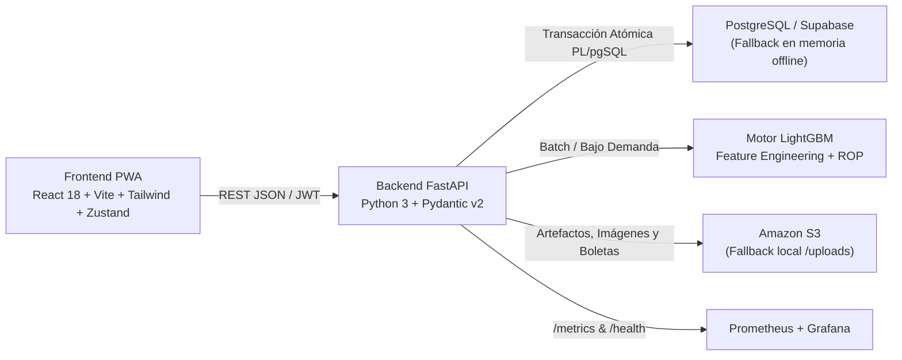

# Guía Completa de Funcionamiento — Minimarket «El Buen Vecino»

Sistema web tipo **POS + Gestión de Inventario con Inteligencia Artificial** diseñado con arquitectura modular (*Vertical Slices* en FastAPI y *Feature-First* en React + TypeScript).

---

## 1. Arquitectura y Stack Tecnológico



- **Frontend (`frontend/`):** React 18, TypeScript, Vite, Tailwind CSS (diseño plano oscuro sin neón), Zustand (`useAuthStore`, `useCartStore`), Axios con interceptores JWT.
- **Backend (`backend/`):** FastAPI, PyJWT, PBKDF2-HMAC-SHA256 para contraseñas, LightGBM + scikit-learn + pandas + joblib, `boto3` para S3, `prometheus-client` para observabilidad.
- **Base de Datos (`db/`):** Migraciones SQL (`001_initial_schema.sql`, `002_registrar_venta.sql` con función atómica `registrar_venta()`, `003_rls_policies.sql`) y seeds de 28 productos peruanos y 90 días de historial. Si no existe conexión activa a PostgreSQL, `DatabaseManager` activa automáticamente un modo **fallback en memoria** completamente operativo.

---

## 2. Roles, Credenciales y Control de Acceso (RBAC)

El sistema maneja **dos roles** protegidos tanto en el frontend (`ProtectedRoute.tsx`) como en el backend (`require_cajero`, `require_admin`):

### Cuentas de Demostración

| Rol | Correo | Contraseña | Acceso en UI |
| :--- | :--- | :--- | :--- |
| **Administrador** | `admin@elbuenvecino.com` | `admin123` | Acceso total (Caja POS, Inventario CRUD + Kardex, Ventas, Predicciones IA) |
| **Cajero (Mañana)** | `cajero1@elbuenvecino.com` | `cajero123` | Caja POS, Consulta de Stock, Historial de Ventas |
| **Cajero (Tarde)** | `cajero2@elbuenvecino.com` | `cajero123` | Caja POS, Consulta de Stock, Historial de Ventas |

### Matriz de Permisos Verificada por Rol

| Funcionalidad | Cajero | Administrador |
| :--- | :---: | :---: |
| Iniciar sesión / Auto-registro de cuenta (`POST /api/v1/auth/register`) | ✅ | ✅ |
| Vender en Caja POS (`POST /api/v1/ventas`) | ✅ | ✅ |
| Consultar niveles de stock (`GET /api/v1/inventario`) | ✅ | ✅ |
| Crear / Editar / Desactivar productos y subir imagen a S3 | ❌ | ✅ |
| Realizar ajustes manuales de stock y consultar Kardex | ❌ | ✅ |
| Consultar historial de ventas, filtrar por fechas y respaldar boleta en S3 | ✅ | ✅ |
| Ver Predicciones IA y reentrenar modelo LightGBM (`/predicciones`) | ❌ *(Bloqueado)* | ✅ |

> El auto-registro público (`/api/v1/auth/register`) asigna obligatoriamente el rol **`cajero`** por principio de mínimo privilegio, almacenando la contraseña con hash **PBKDF2-HMAC-SHA256**.

---

## 3. Funcionamiento Módulo por Módulo

### 3.1 Inicio de Sesión y Registro (`/login`)
- Permite alternar entre **Iniciar Sesión** y **Registrar Cajero** (al registrarse inicia sesión automáticamente).
- Incluye accesos rápidos para rellenar credenciales de **Admin** (`admin@elbuenvecino.com`) y **Cajero** (`cajero1@elbuenvecino.com`).
- El token JWT emitido expira en 12 horas y se adjunta automáticamente en cada petición mediante interceptor de Axios (`Authorization: Bearer <token>`).

### 3.2 Caja POS (`/` — Ruta Crítica)
1. **Búsqueda y Escáner:**
   - Buscador por nombre en tiempo real y campo dedicado **Escanear código de barras** (al presionar `Enter` agrega automáticamente el SKU correspondiente al carrito).
   - Filtros por categoría en píldoras (`Lácteos y Huevos`, `Abarrotes y Despensa`, `Bebidas y Licores`, `Snacks y Golosinas`, `Limpieza y Hogar`, `Cuidado Personal`).
2. **Carrito «Venta Actual»:**
   - Permite incrementar/disminuir cantidades (validando el stock disponible) o vaciar el carrito.
   - Calcula en tiempo real **Subtotal**, **IGV (18%)** y **Total a Cobrar**.
3. **Cobro y Pop-up de Confirmación (`F2` o botón `COBRAR VENTA`):**
   - Métodos de pago soportados: **Efectivo** (con billetes rápidos `S/ 10` a `S/ 200`, botón `Exacto` y cálculo automático de vuelto), **Yape / Plin** y **Tarjeta**.
   - Al confirmar (`Confirmar Cobro`), se ejecuta `POST /api/v1/ventas` descontando el stock y registrando el movimiento en el Kardex.
   - Se muestra el pop-up **`¡Venta realizada con éxito!`** con número de boleta, desglose de ítems, total, vuelto (si aplica), botón **S3** para respaldar el comprobante en la nube, **Imprimir** y **Nueva Venta** (recarga automáticamente el stock visible en pantalla).

### 3.3 Inventario y Catálogo (`/inventario`)
1. **Tarjetas de Salud de Stock:** Conteo en tiempo real de productos en estado **Crítico** (`<= stock_minimo`), **Bajo** (`<= stock_seguridad`) y **Óptimo**.
2. **Vista Cajero:** Consulta de niveles de stock, búsqueda por SKU/nombre y filtro por estado (sin exponer acciones administrativas).
3. **Vista Administrador:**
   - **Nuevo Producto / Editar / Desactivar:** CRUD completo (`POST`, `PUT`, `DELETE` lógico) con carga opcional de imagen (`.jpg`, `.png`, `.webp` hasta 5 MB) hacia **Amazon S3** (o `/uploads/productos/` en modo local).
   - **Ajustar Stock:** Registro de entradas por compra, ajustes por conteo físico o mermas (`POST /api/v1/inventario/ajuste`), validando que el stock nunca quede negativo.
   - **Pestaña Kardex / Movimientos:** Auditoría cronológica de todas las salidas por venta y ajustes manuales.

### 3.4 Historial de Ventas (`/ventas`)
- Lista las boletas emitidas ordenadas de la más reciente a la más antigua con desglose de Subtotal, IGV (18%) y Total.
- **Filtros:** Búsqueda instantánea por número de ticket o nombre del cajero + selector de rango de fechas (**Fecha inicio** y **Fecha fin** vía `GET /api/v1/ventas?fecha_inicio=YYYY-MM-DD&fecha_fin=YYYY-MM-DD`) con botón **Limpiar**.
- **Detalle de Ticket:** El botón `Ver Ticket` abre la boleta electrónica con sus líneas de detalle y permite imprimirla o respaldarla en JSON hacia **Amazon S3** (`POST /api/v1/ventas/{id}/comprobante-s3`).

### 3.5 Predicciones IA (`/predicciones` — Solo Administrador)
- **Métricas del Modelo:** Precisión estimada (`100% - WAPE`), desviación media diaria (**MAE**) y total de SKUs monitoreados.
- **Reentrenamiento bajo demanda (`Reentrenar Modelo (IA)`):** Ejecuta `POST /api/v1/predicciones/run`:
  1. Extrae ventas de los últimos 90 días (o usa serie base si no hay suficientes datos en Supabase).
  2. Construye 11 variables temporales en `feature_engineering.py` (*lags* `t-1`, `t-7`, `t-14`, medias móviles de 7 y 28 días, desviación estándar, día de semana/mes, fin de semana y días de pago/quincena).
  3. Entrena `LGBMRegressor` con división temporal `80/20`, calcula **WAPE** y **MAE** y serializa `model_latest.joblib` (con respaldo a S3 si hay credenciales).
  4. Calcula para cada SKU: **Demanda 7 días**, **Días de cobertura** ($\text{Stock} / \text{Demanda diaria}$), **Punto de Reorden** y **Compra Sugerida**, clasificando en **Crítico**, **Bajo** u **Óptimo**.

---

## 4. Endpoints de Infraestructura y Observabilidad

- `GET /health` — Estado de salud del servicio (`status: healthy`).
- `GET /metrics` — Métricas en formato Prometheus (`http_requests_total`, `http_request_duration_seconds`, `sales_registered_total`, `sales_revenue_soles_total`, `ml_training_duration_seconds`, `ml_wape_score`, `ml_predictions_generated_total`, `backup_last_success_timestamp`).
- `GET /docs` — Documentación interactiva Swagger/OpenAPI.
- `GET /uploads/...` — Servido estático local cuando S3 opera en modo simulación sin credenciales AWS.

---

## 5. Hallazgos Detectados y Corregidos Durante Pruebas E2E por Rol

Durante la validación end-to-end ejecutada con **Playwright** sobre los roles **`cajero`** y **`administrador`** se detectaron y resolvieron los siguientes problemas:

1. **Error `403` en `/inventario` para el rol Cajero:** `InventarioPage.tsx` ejecutaba `getKardex()` dentro de `Promise.all()`, fallando toda la carga de la página cuando el usuario tenía rol `cajero`. **Solución:** se condicionó la llamada de Kardex y los controles de escritura/edición únicamente al rol `administrador`, dejando la vista de niveles de stock totalmente funcional para cajeros.
2. **Entrada por escáner de código de barras en POS:** Al presionar `Enter` en el lector de código de barras sin botón de envío visible, el evento `submit` podía no dispararse en algunos navegadores. **Solución:** se agregó manejo explícito `onKeyDown` (`Enter`) además de un botón `sr-only` en el formulario de código de barras.
3. **Estilo visual inconsistente en acceso denegado (`ProtectedRoute.tsx`):** La pantalla de `Acceso Restringido` al intentar entrar a `/predicciones` como cajero usaba fondo blanco con sombra. **Solución:** adaptada al tema oscuro plano (`#141416`).

---

## 6. Ejecución Local y Pruebas

### Levantar Servidores en Desarrollo
```powershell
# Terminal 1: Backend FastAPI (Puerto 8000)
$env:PYTHONPATH="backend"
python -m uvicorn app.main:app --host 127.0.0.1 --port 8000

# Terminal 2: Frontend Vite (Puerto 5173)
Set-Location frontend
npm run dev -- --host 127.0.0.1 --port 5173
```

### Ejecutar Suites de Verificación
```powershell
# Pruebas unitarias y de integración Backend (19 tests)
$env:PYTHONPATH="backend"
pytest backend/tests -v

# Verificación de tipos TypeScript y build de producción Frontend
Set-Location frontend
npm run build
```

La suite E2E reproducible con Playwright se encuentra en `frontend/tests-e2e/flujos_criticos.spec.mjs`.
