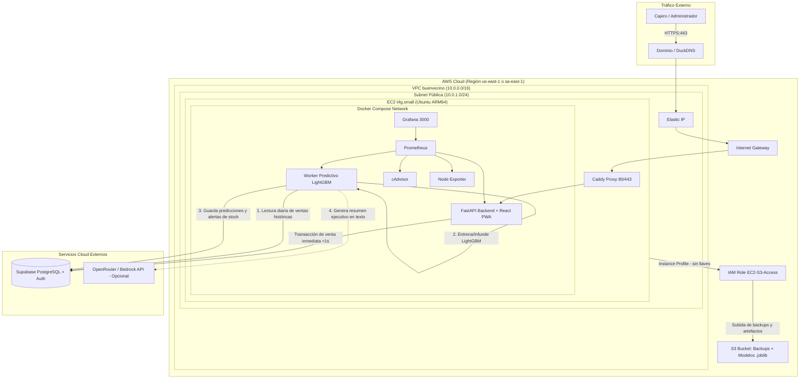

# Plan de implementación: sistema web con IA para gestión predictiva de inventarios

Proyecto «El Buen Vecino» · Plan operativo para agentes de IA con asistencia humana · Stack AWS + LightGBM (ML) · 23 de noviembre de 2026

## 1. Objetivo, alcance y principios

**Objetivo.** Poner en producción, con un costo cercano a 0 USD de desembolso real (financiado con créditos promocionales de AWS vía GitHub Student Developer Pack y tiers gratuitos de Supabase y OpenRouter/Bedrock), la arquitectura definida en el proyecto: máquina virtual EC2 Graviton2 en AWS con Docker Compose, Supabase (PostgreSQL, Auth, RLS), Amazon S3 (respaldos y artefactos de modelos), **modelo predictivo de Machine Learning supervisado basado en LightGBM** para proyección de demanda y control de stock, y stack de observabilidad Prometheus/Grafana. Usuarios: 1 administrador y 2 cajeros. Meta de rendimiento: venta registrada en menos de 1 segundo e inferencia predictiva en menos de 50 milisegundos.

**Principios para los agentes**

1. Todo es código: infraestructura (Terraform para AWS), SQL, Compose, pipeline de Machine Learning (scripts de preprocesamiento, entrenamiento y serialización), dashboards y alertas viven en el repositorio.
2. El agente propone y ejecuta en desarrollo; el humano aprueba cualquier acción sobre producción, dinero, credenciales o reglas de red.
3. **El modelo predictivo y la IA quedan estrictamente fuera de la ruta crítica de la venta:** la transacción en caja solo interactúa con Supabase.
4. Mínimo privilegio en cada token, clave, IAM Role y MCP.
5. Cada fase termina con criterios de aceptación verificables con métricas numéricas y evidencia.

## 2. Decisiones a confirmar por humanos (Fase 0)

| Decisión | Recomendación | Motivo |
| --- | --- | --- |
| Región AWS | `us-east-1` (N. Virginia) o `sa-east-1` (São Paulo) | `us-east-1` maximiza el rendimiento de los créditos (precios ~30% menores); `sa-east-1` ofrece menor latencia hacia Lima (<70 ms). |
| Región Supabase | South America (São Paulo) | Menor latencia de base de datos hacia los clientes y servidores. |
| Tipo de Instancia EC2 | `t4g.small` (ARM Graviton2, 2 vCPU, 2 GB RAM) | 2 GB de RAM soportan holgadamente la app + LightGBM + Prometheus + Grafana + cAdvisor sin OOM. Costo ~12 USD/mes cubierto por créditos. |
| Motor de Machine Learning | **LightGBM** (`pip install lightgbm`) | Algoritmo basado en histogramas (*leaf-wise*); entrena en <2 segundos con <80 MB RAM en Graviton2, maneja categorías nativas y pesa <1 MB serializado. |
| Stack de la aplicación | Backend FastAPI (Python) + frontend React/Vite como PWA, servido por Caddy | Ligero, modular, soporte nativo ARM64, fácil de testear con agentes. |
| Dominio y DNS | Subdominio gratuito (DuckDNS) o dominio propio (.com / .me de GitHub Pack) | Necesario para TLS automático con Let’s Encrypt en Caddy. |
| Almacenamiento de Respaldos | Amazon S3 (Bucket privado con Lifecycle Rule) | Integración nativa con IAM Instance Profile (cero credenciales en la VM). |
| LLM para Explicabilidad (Opcional) | OpenRouter o Amazon Bedrock (límite duro de 5 USD) | Redacta resúmenes ejecutivos a partir de las predicciones de LightGBM; prescindible si se usan plantillas fijas. |
| Correo de alertas | Cuenta de correo SMTP (Gmail App Password o Amazon SES) | Grafana envía alertas operativas por correo (ALT-01 a ALT-06). |

## 3. Opciones económicas y consumo de créditos

| Componente | Opción seleccionada | Cobertura de Costo | Costo Real Mensual |
| --- | --- | --- | --- |
| **Cómputo** | AWS EC2 `t4g.small` (ARM64, 2 vCPU, 2 GB RAM) | Créditos GitHub Student (AWS Educate/Promotional) | ~12.00 USD (deducido de créditos) |
| **Almacenamiento VM** | AWS EBS gp3 (30 GB) | Créditos GitHub Student | ~2.40 USD (deducido de créditos) |
| **Dirección IP** | Elastic IP (IPv4 pública fija) | Gratis mientras esté asignada a la instancia encendida | 0.00 USD |
| **Base de datos y Auth** | Supabase (PostgreSQL + GoTrue + RLS) | Plan gratuito (Free Tier) | 0.00 USD |
| **Respaldos y Modelos** | Amazon S3 Standard (Backups DB y pesos `.joblib`) | Nivel gratuito / Créditos AWS (<1 GB) | <0.10 USD (deducido de créditos) |
| **Motor Predictivo (ML)** | LightGBM en Python (ejecución local en EC2) | Cómputo propio en la VM | 0.00 USD (cero costo de APIs) |
| **Proxy y HTTPS** | Caddy v2 (TLS automático Let’s Encrypt) | Software libre / Open Source | 0.00 USD |
| **IaC** | OpenTofu / Terraform (`hashicorp/aws`) | Open Source | 0.00 USD |
| **CI/CD** | GitHub Actions + GitHub Container Registry (GHCR) | Incluido en GitHub Student Pack | 0.00 USD |
| **LLM (Explicabilidad)** | OpenRouter o Amazon Bedrock (opcional) | Prepago con límite estricto / Créditos AWS | 0.00 – 2.00 USD |
| **Monitoreo** | Prometheus + Grafana + cAdvisor + Node Exporter | En la misma EC2 (gestionado por Compose) | 0.00 USD |

## 4. Organización de agentes y puntos de control humano

| Agente | Responsabilidad | Herramientas / MCP principales |
| --- | --- | --- |
| **Orquestador/Arquitecto** | Planificación, gobernanza, ADRs, revisión de PRs | GitHub |
| **Infraestructura (DevOps)** | Terraform para AWS (VPC, EC2, S3, IAM, SG) | AWS CLI / Terraform, GitHub |
| **Datos (DBA)** | Migraciones SQL, RLS, funciones transaccionales, seed data | Supabase |
| **Machine Learning Engineer** | Pipeline de LightGBM (preprocesamiento, lags, entrenamiento, métricas WAPE/MAE y serialización) | Python, LightGBM, Pandas |
| **Backend** | API FastAPI, integración del modelo, métricas Prometheus | Context7, Supabase |
| **Frontend** | Interfaz PWA, flujo de caja optimizado, panel admin con alertas de stock | Context7, Playwright |
| **Observabilidad** | Configuración de Prometheus, dashboards Grafana y alertas | Grafana, Docker |
| **QA/Seguridad** | Pruebas E2E, pruebas de carga (k6), auditoría Trivy/Gitleaks | Playwright, k6 |
| **Documentación** | Manuales operativos, runbooks, capturas | GitHub |

**Puntos de control humano obligatorios:**
- Configuración de credenciales AWS y aplicación del cupón de créditos GitHub Student.
- Aprobación de `terraform apply` en AWS.
- Configuración de alertas de presupuesto en AWS Budgets.
- Cualquier migración destructiva o cambio de reglas RLS sobre producción.
- Aprobación del primer despliegue a producción.

## 5. Arquitectura del sistema



## 6. Plan por fases

### Fase 0: Gobernanza, cuentas y créditos (Semana 1)
- **Humano:**
  1. Validar cuenta AWS con créditos del GitHub Student Pack activos.
  2. Configurar alerta en **AWS Budgets** a los 25 USD y 50 USD.
  3. Crear usuario IAM con privilegios mínimos para Terraform.
  4. Crear proyectos en Supabase (`buenvecino-dev` y `buenvecino-prod`) en São Paulo.
  5. Obtener API key opcional de OpenRouter/Bedrock (límite duro $5 USD).
- **Agentes:**
  - Inicializar repositorio Git local.
  - Estructurar carpetas: `/infra`, `/db`, `/backend`, `/frontend`, `/ml`, `/monitoring`, `/deploy`, `/docs`.
  - Crear `AGENTS.md`, `.env.example`, `.gitignore`, templates de PR y pre-commit.
- **Criterio de aceptación:** Repo listo, pipeline CI en verde, presupuesto AWS configurado con alertas.

### Fase 1: Red y cómputo en AWS (Semana 1)
- **Agente de Infraestructura (Terraform):**
  - VPC `vpc-buenvecino` (`10.0.0.0/16`), Subnet pública (`10.0.1.0/24`), Internet Gateway y tabla de ruteo `0.0.0.0/0`.
  - Security Group: 80 y 443 desde `0.0.0.0/0`; 22 (SSH) únicamente desde la IP del administrador.
  - IAM Role y Profile para EC2 con permisos estrictos sobre el bucket S3 de respaldos y modelos.
  - Instancia EC2 `t4g.small` (Ubuntu 24.04 ARM64), disco EBS gp3 de 30 GB y Elastic IP asociada.
  - Cloud-init script: SSH solo por llave, fail2ban, Docker CE + Docker Compose plugin, swap de 2 GB.
- **Humano:** Revisar `terraform plan` y aprobar `apply`. Asignar el registro DNS tipo A hacia la Elastic IP.
- **Criterio de aceptación:** Conexión SSH exitosa por llave; escaneo externo muestra únicamente puertos 80 y 443 abiertos; Docker funcional en la EC2.

### Fase 2: Datos, seguridad y RLS en Supabase (Semanas 1–2)
- **Agente de Datos:**
  - Esquema relacional versionado: `categorias`, `productos`, `proveedores`, `ventas`, `detalle_ventas`, `movimientos_inventario`, `predicciones`, `perfiles`.
  - Restricciones: PK, FK con eliminación restrictiva, `CHECK (stock >= 0)`, `CHECK (cantidad > 0)`.
  - Función PL/pgSQL atómica `registrar_venta(...)`: procesa cabecera, líneas, descuento de inventario y auditoría con `ROLLBACK` ante errores.
  - Políticas RLS: Cajeros solo leen catálogo y ejecutan `registrar_venta`; Administrador gestiona inventario, reportes, usuarios y anulaciones.
  - Generador de datos sintéticos: 90 días de historial de ventas con patrones de estacionalidad semanal (picos en viernes/sábados) para entrenar el modelo LightGBM.
- **Criterio de aceptación:** Pruebas de RLS aprobadas; advisor de Supabase sin advertencias críticas; dataset sintético poblado.

### Fase 3: Aplicación Web y PWA (Semanas 2–3)
- **Backend (FastAPI):**
  - Validación de JWT emitido por Supabase Auth.
  - Endpoints REST para venta rápida, búsqueda de productos, stock y consulta de alertas predictivas.
  - Métricas expuestas en `/metrics` usando `prometheus_client` (latencias p50/p95/p99, contador de ventas, errores HTTP 4xx/5xx).
  - Health check en `/health`.
- **Frontend (React + Vite PWA):**
  - Interfaz de punto de venta optimizada para teclado y lector de código de barras.
  - Panel administrativo con semáforos de stock predictivo (Rojo: comprar hoy, Amarillo: stock moderado, Verde: seguro).
- **Criterio de aceptación:** Venta registrada con latencia $p95 < 1\text{ s}$; prueba E2E de Playwright aprobada.

### Fase 4: Contenedores, Caddy y CI/CD (Semana 3)
- **DevOps:**
  - Dockerfile multi-etapa optimizado para `linux/arm64`.
  - `docker-compose.yml` orquestando: `caddy`, `app`, `prometheus`, `grafana`, `cadvisor`, `node-exporter`.
  - Caddyfile con reverse proxy hacia `app:8000` y emisión automática de certificados Let's Encrypt.
  - Pipeline GitHub Actions: Lint, test unitarios, escaneo Trivy de vulnerabilidades, buildx para ARM64, push a GHCR y despliegue continuo vía SSH seguro a la EC2.
- **Criterio de aceptación:** Push a `main` despliega automáticamente en la EC2 en menos de 5 minutos; reinicio automático verificado tras `kill` forzado del contenedor.

### Fase 5: Amazon S3 y respaldos automatizados (Semanas 3–4)
- **Infraestructura:**
  - Bucket S3 privado `buenvecino-backups-${account_id}` con cifrado AES-256 por defecto y *Block Public Access*.
  - Regla de ciclo de vida en S3: expiración automática a los 60 días.
- **Automatización:**
  - Script `/opt/scripts/backup.sh` en la EC2: ejecuta `pg_dump` de Supabase, comprime con `gzip`, etiqueta con fecha y sube a S3 usando `aws s3 cp` vía el IAM Instance Profile.
  - Sube también el artefacto serializado del modelo LightGBM (`model_latest.joblib`).
  - Systemd timer diario a las 02:00 AM con registro de métrica `backup_last_success_timestamp`.
  - Script de restauración probado: `/opt/scripts/restore.sh`.
- **Criterio de aceptación:** Restauración probada en base de datos local de test; verificación de RPO $\le 24\text{ h}$ y RTO $\le 2\text{ h}$.

### Fase 6: Módulo predictivo de inventario con LightGBM (Semana 4)

El módulo predictivo implementa un pipeline completo de Machine Learning supervisado:

1. **Ingeniería de Características (Feature Engineering):**
   * Agrupación de ventas diarias por producto ($SKU \times fecha$).
   * *Lags temporales:* Ventas de hace 1 día ($t-1$), 7 días ($t-7$) y 14 días ($t-14$).
   * *Estadísticas rodantes:* Promedio móvil y desviación estándar de ventas de los últimos 7 y 28 días.
   * *Variables de calendario:* Día de la semana (0 a 6), día del mes (1 a 31), indicador de fin de semana (`is_weekend`), indicador de día de pago/quincena (`is_payday`).
   * *Atributos estáticos:* Categoría del producto (`categoria_id`), precio unitario actual.
2. **Entrenamiento del Modelo (LightGBM Regressor):**
   * Función objetivo: Regresión de demanda diaria (unidades vendidas).
   * Configuración optimizada para bajo consumo de memoria:
     ```python
     params = {
         'objective': 'regression',
         'metric': 'rmse',
         'boosting_type': 'gbdt',
         'num_leaves': 31,
         'learning_rate': 0.05,
         'feature_fraction': 0.8,
         'min_data_in_leaf': 10,
         'verbose': -1
     }
     ```
   * Manejo directo de variables categóricas nativas (`categorical_feature=['categoria_id', 'dia_semana']`).
   * Validación temporal (*Time Series Split* o ventana deslizante) evaluada con métricas **WAPE** (*Weighted Absolute Percentage Error*) y **MAE**.
3. **Inferencia y Lógica de Reorden (Job Nocturno a las 00:00):**
   * El modelo genera la proyección de demanda para los próximos 7 días ($\hat{D}_{i, 1..7}$).
   * $\text{Días de cobertura} = \frac{\text{Stock Actual}}{\sum_{d=1}^7 \hat{D}_{i, d} / 7}$
   * $\text{Punto de Reorden} = (\text{Demanda Diaria Proyectada} \times \text{Lead Time del Proveedor}) + \text{Stock de Seguridad}$
   * Si $\text{Stock Actual} \le \text{Punto de Reorden}$, se inserta un registro en la tabla `predicciones` con estado de alerta (*Comprar de inmediato* o *Comprar en 48h*).
4. **Capa LLM Opcional (Explicabilidad Ejecutiva):**
   * Un prompt compacto envía las 5 alertas críticas a OpenRouter/Bedrock para que redacte una síntesis legible para el dueño del minimarket.
   * Si el LLM está apagado o falla, se emplean plantillas de texto predeterminadas sin alterar el resultado del modelo.
- **Criterio de aceptación:**
  - El modelo entrena en $<5\text{ s}$ y consume $<80\text{ MB}$ de RAM.
  - Inferencia de todo el catálogo en $<50\text{ ms}$.
  - WAPE $< 20\%$ en productos de alta rotación evaluado sobre el conjunto de test.
  - Al cortar la conexión a internet de la VM, las alertas de stock se siguen generando con éxito basadas en LightGBM.

### Fase 7: Observabilidad completa (Semanas 4–5)
- **Prometheus & Exporters:**
  - Scrape cada 15 s a FastAPI, métricas del job de Machine Learning (duración de entrenamiento, WAPE, memoria usada), cAdvisor y Node Exporter.
- **Grafana:**
  - Provisionamiento declarativo en `/monitoring/grafana`.
  - Dashboards: (1) Salud de la máquina EC2, (2) Contenedores Docker, (3) Rendimiento de la aplicación y métricas del modelo predictivo.
- **Reglas de Alerta:**
  - **ALT-01:** CPU > 80% durante 5 min.
  - **ALT-02:** RAM > 85% durante 5 min.
  - **ALT-03:** Almacenamiento en disco > 80%.
  - **ALT-04:** Servicio HTTP caído > 2 min.
  - **ALT-05:** Registro de venta > 1 s (sostenido).
  - **ALT-06:** Respaldo en S3 ausente por más de 26 h.
- **Criterio de aceptación:** Simulación de estrés y detención de contenedor dispara las alertas correspondientes por correo.

### Fase 8: Pruebas de aceptación, seguridad y carga (Semana 5)
- **Seguridad:**
  - Verificación HTTPS y HSTS con Caddy (calificación A+ en SSL Labs).
  - Escaneo de puertos con `nmap` desde el exterior (solo 80 y 443 expuestos).
  - Auditoría de RLS de Supabase mediante advisors.
- **Carga (k6):**
  - Prueba de estrés con 3 usuarios concurrentes constantes y ráfagas de 10 usuarios.
  - Criterio: $p95 < 1\text{ s}$ en el endpoint de venta y 0% de errores de transacción.
- **Criterio de aceptación:** Reporte de k6 satisfactorio; aprobación formal de seguridad.

### Fase 9: Despliegue productivo y marcha blanca (Semana 6)
- Importación del inventario inicial mediante script validado.
- Capacitación al administrador y cajeros.
- Operación en paralelo durante 1 semana junto con el método de registro previo.
- Cierre y firma del proyecto.

## 7. Cronograma resumido

| Semana | Fases | Entregable Clave |
| --- | --- | --- |
| **Semana 1** | F0, F1, F2 (inicio) | Repo con CI, VPC y EC2 en AWS aprovisionadas con Terraform, esquemas DB |
| **Semana 2** | F2 (cierre), F3 (inicio) | Supabase con RLS probado, endpoints base de FastAPI, dataset sintético de 90 días |
| **Semana 3** | F3 (cierre), F4, F5 | PWA funcional, Caddy con TLS, pipeline CI/CD activo, respaldos a S3 |
| **Semana 4** | F6, F7 (inicio) | Pipeline de Machine Learning con **LightGBM** entrenado e inferencias activas |
| **Semana 5** | F7 (cierre), F8 | Monitoreo completo con métricas de ML, pruebas de carga k6 y hardening |
| **Semana 6** | F9 | Carga de inventario real, capacitación y go-live |

## 8. Calidad: criterios de aceptación del modelo y del sistema

| Requisito | Cómo se verifica | Criterio de Éxito |
| :--- | :--- | :--- |
| **Venta en menos de 1 s** | Prueba de carga k6 | $p95 < 1\text{ s}$ en `/api/v1/ventas` |
| **Tiempo de entrenamiento ML** | Script de benchmark en la EC2 | $< 5\text{ s}$ para el catálogo completo |
| **Inferencia de demanda** | Endpoint `/api/v1/predicciones/run` | $< 50\text{ ms}$ para todo el catálogo |
| **Precisión del modelo ML** | Backtesting con TimeSeriesSplit (90 días) | $\text{WAPE} < 20\%$ en productos clase A (alta rotación) |
| **Consumo de memoria de ML** | Medido vía cAdvisor / Prometheus | Pico de RAM del worker $< 100\text{ MB}$ |
| **Tolerancia a fallos de red** | Desconexión intencional de internet | Predicción y alertas generadas al 100% (cero fallas por falta de API externa) |
| **Disponibilidad** | Detener contenedor forzosamente | Reinicio automático en menos de 1 minuto |
| **Respaldo y recuperación** | Ejecución de `restore.sh` en staging | $\text{RPO} \le 24\text{ h}$, $\text{RTO} \le 2\text{ h}$ |

## 9. Matriz de riesgos y mitigaciones en AWS

| Riesgo | Probabilidad | Impacto | Mitigación |
| --- | :--- | :--- | :--- |
| Agotamiento de créditos de AWS GitHub Student | Baja | Alto | Uso de instancia económica `t4g.small` (~12 USD/mes) y alertas de AWS Budgets a los $25 y $50 USD. |
| Inactividad de proyecto Supabase Free | Media | Medio | El cron nocturno de inferencia de LightGBM y respaldos mantiene la base de datos activa con tráfico regular. |
| Sobreajuste (*overfitting*) en LightGBM | Media | Medio | Uso de regularización (`min_data_in_leaf=10`, `feature_fraction=0.8`) y validación temporal estricta sin data leakage. |
| Vulnerabilidad en imágenes Docker | Baja | Alto | Escaneo automático con Trivy en GitHub Actions antes de cada despliegue. |
| Filtración de credenciales | Baja | Crítico | Cero secretos en Git; IAM Instance Profile para acceder a S3 sin claves de larga duración. |