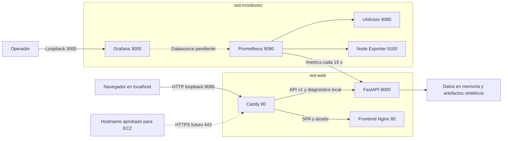

# INIT-003 — Proxy inverso, redes y seguridad

## Contexto y alcance

Implementación sobre `genni@8a049c4`, con el árbol de INIT-002 aún pendiente de commit. Se revisaron [AGENTS](../../AGENTS.md), [INIT-002](INIT-002-contenedores.md), [arquitectura TO-BE](arquitectura-to-be-y-plan-devops.md), [guía de la app](../../GUIA_COMPLETA_APP.md), [ADR](../adrs/) y el código de la aplicación. La auditoría histórica Markdown no estaba disponible. El proxy anterior servía por HTTP, Nginx duplicaba el proxy de API y la navegación de Workbox podía caer en el HTML fuera de las rutas React.

Caddy concentra el enrutamiento y las cabeceras. Nginx sirve los archivos compilados y resuelve las cinco rutas de React. El modo HTTP del laboratorio y la configuración HTTPS candidata usan archivos separados con un fragmento compartido. Esto permite validar ACME, redirección y HSTS por separado, con el Compose base sin puertos publicados y el backend productivo bloqueado con salida `78`.

## Archivos

| Estado | Rutas y cambio |
|---|---|
| Creados | `deploy/Caddyfile.dev` para loopback, `deploy/Caddyfile.common` para la política compartida, `deploy/scripts/caddy-production.sh` para validar hostname y opciones ACME, `frontend/nginx.conf` para servir la SPA, este documento. |
| Modificados | `deploy/Caddyfile` para la configuración HTTPS, `deploy/docker-compose.yml` y `deploy/docker-compose.dev.yml` para seleccionar el modo, `frontend/Dockerfile` y `frontend/vite.config.ts` para Nginx y la PWA, `.env.example` y `.gitattributes` para el contrato de variables y archivos LF. |

## Arquitectura resultante



Caddy y frontend usan `red-web`. Backend une `red-web` y `red-monitoreo`. Los cuatro servicios de monitoreo usan `red-monitoreo`. El override publica `127.0.0.1:8080 → caddy:80` y `127.0.0.1:3000 → grafana:3000`. El Compose base conserva cero publicaciones. Docker asigna las subredes. La persistencia conserva `caddy_data`, `caddy_config`, `ml_artifacts`, `prometheus_data` y `grafana_data`, separados por proyecto.

## Enrutamiento y seguridad

El bloque `route` de Caddy conserva el orden de validación. Los rechazos exactos y por subruta anteceden al proxy genérico. El entorno de desarrollo acepta el host `localhost` y reserva un 404 para los demás hosts. La ruta `/api/v1/*` conserva el prefijo. Las respuestas FastAPI por Caddy llevan `Cache-Control: no-store`. La imagen Nginx elimina el proxy redundante y su dependencia de arranque respecto al backend. La ruta `/ready` se remite a FastAPI localmente y devuelve 404 mientras siga ausente.

| Ruta | Laboratorio | Configuración HTTPS candidata |
|---|---|---|
| `/`, `/login`, `/inventario`, `/ventas`, `/predicciones` | Nginx sirve la SPA. React mantiene sus transiciones y controles de sesión existentes. | Nginx sirve la SPA. |
| `/api/v1` y `/api/v1/*` | FastAPI recibe la URI completa. Endpoints protegidos conservan 401 sin token. | FastAPI recibe la URI completa, con excepción del OpenAPI bloqueado primero. |
| `/health`, `/ready` | Diagnóstico FastAPI sin caché. `/health` es liveness y `/ready` está ausente. | 404 en gateway. Acceso solo por red interna. |
| `/docs`, `/docs/oauth2-redirect`, `/redoc`, `/api/v1/openapi.json` | Acceso HTTP local a FastAPI. | 404 antes del proxy de API. |
| `/metrics`, `/uploads` y descendientes | 404 en gateway. Prometheus usa `backend:8000/metrics` por DNS interno. | 404 en gateway. |
| `/admin`, `/grafana`, `/prometheus`, `/node-exporter`, `/cadvisor`, `/debug` y descendientes | 404. Grafana tiene su propia entrada loopback. | 404. |
| URI desconocida o asset inexistente | 404 de gateway/estático, sin fallback HTML de la SPA. | Misma política estática. |

La capa de entrada añade `X-Content-Type-Options: nosniff`, `X-Frame-Options: DENY`, `Referrer-Policy: strict-origin-when-cross-origin` y `Permissions-Policy` con cámara limitada al origen y micrófono y geolocalización deshabilitados. La CSP del frontend admite scripts y workers del mismo origen, la API por origen relativo, las fuentes actuales de Google Fonts y estilos inline de React. Imágenes se limitan al mismo origen, `data:` y `blob:`. El acceso local a Swagger/ReDoc conserva sus propias dependencias. HSTS solo se declara en el sitio HTTPS con `max-age=31536000`, sin preload ni subdominios. Nginx envía acceso a stdout sin query ni cabeceras y errores a stderr. Caddy carece de access log. Uvicorn conserva su instrumentación existente, por lo que los clientes deben mantener credenciales fuera de URL.

## Caché y PWA

| Recurso | Política |
|---|---|
| Assets Vite con hash de contenido | `public, max-age=31536000, immutable` en respuestas servidas, con tipos MIME y compresión. |
| HTML, `sw.js`, `registerSW.js`, manifest y archivos sin hash | `no-cache` para revalidación. Nginx devuelve 404 para archivos ausentes sin política immutable. |
| API, diagnósticos de FastAPI y denegaciones internas | `no-store`. Workbox deja estas solicitudes fuera de sus handlers. |
| Cache Storage | Precache de archivos públicos de build. El shell sin conexión usa la clave propia `/index.html?pwa-shell=1`, separada del HTML servido en línea. |

La regla de navegación del mismo origen replica las cinco rutas de React Router con barra final y query opcionales. Usa `NetworkOnly` para revalidar el HTML en línea y el precache del shell exclusivamente cuando falla la red. Se preserva `autoUpdate` y se limpian precaches antiguos. La API, rutas administrativas, comprobantes, diagnósticos y rutas desconocidas quedan fuera del fallback. La escritura de caja requiere API disponible. La sesión sigue usando `localStorage` por el contrato actual, independientemente de Cache Storage. [Workbox build](https://developer.chrome.com/docs/workbox/modules/workbox-build), [Nginx HTTP core](https://nginx.org/en/docs/http/ngx_http_core_module.html)

## Almacenamiento y bloqueos de Desarrollo

`backend/app/main.py` aún monta `/uploads` para red interna. `backend/app/core/s3.py` mantiene el fallback local y claves bajo `productos/`, `comprobantes/` y `ml-models/`. Las respuestas de subida de `POST /api/v1/productos/{id}/imagen` y `POST /api/v1/ventas/{id}/comprobante-s3` pueden contener URLs `/uploads/...` que devuelven 404 en el gateway. El detalle de tickets sigue en `GET /api/v1/ventas/{id}` con la autorización existente. Esta iniciativa verifica el rechazo anónimo y el bloqueo de archivo directo. El aislamiento por cajero sigue pendiente de RBAC.

Para el siguiente cambio autorizado, usar un bucket privado y referencias durables separadas. Las imágenes de catálogo públicas deben resolverse por ID mediante una ruta controlada con formatos y tamaños permitidos. Los comprobantes requieren verificación de propiedad y rol antes de devolver contenido privado `no-store`. Los modelos quedan en el volumen ML y en el prefijo privado de artefactos, accesibles solo por operación. Los respaldos PostgreSQL usan su propio destino y política de retención. Retirar el montaje genérico cuando estén establecidos los contratos privados. Ninguna de estas tareas requiere mover datos a un bucket público.

INIT-001 sigue parcial. Desarrollo debe aprobar la eliminación de la clave JWT predeterminada y demos, la verificación persistente de contraseñas, el registro, RBAC, permisos SQL y RLS, el rechazo de ventas ante PostgreSQL caído y la implementación de `/ready`. La prueba previa de RLS solo acredita la activación de políticas. El bloqueo productivo conserva prioridad sobre toda configuración del gateway.

## Integración futura con EC2

Confirmar cuenta, región, arquitectura, capacidad y costo con Cloud, y preparar EC2 Linux en una subred pública VPC asociada a una tabla con ruta a un Internet Gateway. Usar IPv4 pública estable mediante EIP o DNS dinámico autorizado según costo y operación. Confirmar A y, si aplica, AAAA. Usar IAM Instance Profile con mínimo privilegio para operaciones aprobadas de S3. Verificar Supabase desde el backend con TLS y `sslmode=verify-full`, CA apropiada y conexión directa o pooler de sesión según conectividad IPv4/IPv6. [Internet Gateway](https://docs.aws.amazon.com/vpc/latest/userguide/VPC_Internet_Gateway.html), [conexión Supabase](https://supabase.com/docs/guides/database/connecting-to-postgres)

| Puerto en SG futuro | Origen y propósito |
|---|---|
| TCP 80 | Internet, redirección o validación HTTP de ACME. |
| TCP 443 | Internet, HTTPS. |
| TCP 22 | CIDR administrativo aprobado solo si se usa SSH. Con SSM puede quedar cerrado. |
| 8000, 3000, 9090, 9100 y 8080 | Internos o loopback administrativo autorizado. Excluir del SG público y verificar bindings reales de Docker además del firewall del host. |

Después del cierre de INIT-001 y las aprobaciones AWS/go-live, preparar la publicación exclusiva de Caddy `80:80` y `443:443`, con el archivo dev fuera del candidato. Cargar `SITE_ADDRESS` con el hostname DNS completo aprobado y `ACME_EMAIL` con el contacto acordado. Mantener `ACME_CA=staging` y validar resolución, HTTP a HTTPS, challenge y certificado de ensayo. El certificado staging puede no estar en la cadena de confianza del navegador. Cambiar el selector a `production` tras la aprobación y verificar la cadena confiable y la persistencia de los volúmenes Caddy. Para separar la pareja cuenta/certificado staging de los datos definitivos, identificar los volúmenes antes del cambio y conservarlos. La validación actual cargó sintaxis sin red. [Caddy opciones globales](https://caddyserver.com/docs/caddyfile/options), [ACME staging](https://letsencrypt.org/docs/staging-environment/), [publicación Docker](https://docs.docker.com/engine/network/port-publishing/)

Si se aprueba acceso a Grafana, publicar `127.0.0.1:3000:3000` en el host y usar un túnel del operador. Ejemplos para la fase AWS, con variables del ambiente autorizadas. [SSM Port Forwarding](https://docs.aws.amazon.com/systems-manager/latest/userguide/session-manager-working-with-sessions-start.html)

```bash
ssh -N -L 127.0.0.1:3000:127.0.0.1:3000 "${EC2_USER}@${EC2_HOST}"
aws ssm start-session --target "$INSTANCE_ID" --document-name AWS-StartPortForwardingSession \
  --parameters '{"portNumber":["3000"],"localPortNumber":["3000"]}'
```

## Comandos de laboratorio

Desde la raíz, generar `.env.lab` con valores ficticios siguiendo INIT-002. Usar un proyecto distinto del anterior. Reutilizar la imagen backend de INIT-002 cuando esté disponible. [Preparación del entorno](INIT-002-contenedores.md#operación-local)

```powershell
$BaseArgs = @('--env-file', '.env.lab', '-p', 'buenvecino-init003', '-f', 'deploy/docker-compose.yml')
$LabArgs = $BaseArgs + @('-f', 'deploy/docker-compose.dev.yml')
docker compose @BaseArgs config --quiet
docker compose @LabArgs config --quiet
docker compose @LabArgs build backend frontend
docker compose @LabArgs up -d --wait --wait-timeout 120
docker compose @LabArgs ps
docker compose @LabArgs exec -T caddy caddy validate --config /etc/caddy/Caddyfile --adapter caddyfile
docker compose @LabArgs exec -T frontend nginx -t
curl.exe -si http://localhost:8080/inventario/
curl.exe -si http://localhost:8080/api/v1/productos
curl.exe -si http://localhost:8080/api/v1/openapi.json
curl.exe -si http://localhost:8080/metrics/
curl.exe -si http://localhost:8080/uploads/comprobantes/fixture.json
curl.exe -sI http://localhost:8080/sw.js
curl.exe -sI http://localhost:8080/manifest.webmanifest
docker compose @LabArgs exec -T prometheus promtool check config /etc/prometheus/prometheus.yml
docker compose @LabArgs exec -T prometheus wget -qO- http://127.0.0.1:9090/api/v1/targets
docker build --target test -t minimarket-backend:init003-tests ./backend
docker run --rm --network none minimarket-backend:init003-tests
docker compose @LabArgs stop
```

Para validar HTTPS estáticamente, cargar tres archivos en un contenedor sin red con un dominio reservado de ejemplo. El comando analiza la configuración sin iniciar listeners públicos.

```powershell
$ProdConfig = (Resolve-Path 'deploy/Caddyfile').Path
$CommonConfig = (Resolve-Path 'deploy/Caddyfile.common').Path
$GuardScript = (Resolve-Path 'deploy/scripts/caddy-production.sh').Path
docker run --rm --network none --entrypoint /bin/sh `
  --mount "type=bind,source=$ProdConfig,target=/etc/caddy/Caddyfile,readonly" `
  --mount "type=bind,source=$CommonConfig,target=/etc/caddy/Caddyfile.common,readonly" `
  --mount "type=bind,source=$GuardScript,target=/etc/caddy/caddy-production.sh,readonly" `
  -e SITE_ADDRESS=example.com -e ACME_EMAIL=operator@example.com -e ACME_CA=staging `
  caddy:2-alpine /etc/caddy/caddy-production.sh validate
```

El flujo E2E reutiliza `frontend/tests-e2e/flujos_criticos.spec.mjs` con el runner temporal de INIT-002. Para validar el worker, usar un contexto nuevo con `serviceWorkers: 'allow'`, esperar `navigator.serviceWorker.controller`, activar un segundo build con un asset público cambiado y revisar Cache Storage. Generar el segundo build en una copia temporal de `frontend/` y recrear solo el servicio `frontend` del laboratorio con su etiqueta de fixture. Volver a la etiqueta inicial antes de detener el stack. [Runner de navegador](INIT-002-contenedores.md#operación-local)

## Handoff consolidado para INIT-004

| Servicio Compose e imagen | Red | Puerto interno y entrada | Persistencia o fuente |
|---|---|---|---|
| `caddy` · `caddy:2-alpine` | `red-web` | 80 HTTP laboratorio, 443 HTTPS futuro. `127.0.0.1:8080 → 80` | `caddy_data:/data`, `caddy_config:/config` |
| `frontend` · imagen local Node 22/Nginx | `red-web` | 80 interno | Assets de la imagen y `frontend/nginx.conf` |
| `backend` · imagen local Python 3.12 | ambas | 8000 interno | `ml_artifacts:/app/app/ml/artifacts`. Un worker. |
| `prometheus` · `prom/prometheus:v2.54.1` | `red-monitoreo` | 9090 interno | `prometheus_data:/prometheus`, `monitoring/prometheus/prometheus.yml` RO, retención 7 días |
| `grafana` · `grafana/grafana:11.2.0` | `red-monitoreo` | 3000 interno, `127.0.0.1:3000 → 3000` | `grafana_data:/var/lib/grafana`, directorio de provisioning RO |
| `node-exporter` · `prom/node-exporter:v1.8.2` | `red-monitoreo` | 9100 interno | Montajes RO de `/proc`, `/sys` y `/`. Textfile pendiente. |
| `cadvisor` · `gcr.io/cadvisor/cadvisor:v0.54.1` | `red-monitoreo` | 8080 interno | Montajes Linux RO de INIT-002. |

Prometheus mantiene scrape y evaluación cada 15 s. Los jobs son `fastapi-backend` a `http://backend:8000/metrics`, `node-exporter` a `http://node-exporter:9100/metrics` y `cadvisor` a `http://cadvisor:8080/metrics`. Grafana básico se administra en `http://localhost:3000`. Prometheus se consulta por `docker compose exec` y el navegador usa el gateway para OpenAPI local. Variables Grafana `GRAFANA_ADMIN_USER` y `GRAFANA_ADMIN_PASSWORD` alimentan `GF_SECURITY_ADMIN_USER` y `GF_SECURITY_ADMIN_PASSWORD`. `GF_USERS_ALLOW_SIGN_UP`, `GF_ANALYTICS_REPORTING_ENABLED` y `GF_ANALYTICS_CHECK_FOR_UPDATES` están en `false`. Los siete servicios conservan reinicio y rotación de logs. El gateway rechaza todas las rutas administrativas y `/metrics`. El datasource debe apuntar a `http://prometheus:9090` con UID estable en el provisioning de INIT-004.

### Instrumentación y paneles

- **Infraestructura.** `node_cpu_seconds_total`, memoria disponible/total, filesystem, red y uptime. Comparar con `ip`, `/proc` y `df` de EC2 para seleccionar mounts e interfaces. Docker Desktop mide la VM Linux y los namespaces de los contenedores. Los resultados no describen Windows físico ni la futura EC2.
- **Contenedores.** Agrupar `container_memory_working_set_bytes`, CPU y tráfico por el label Compose `container_label_com_docker_compose_service` y filtrar el proyecto. Verificar que cAdvisor registra contenedores y que los mounts, cgroups, snapshotter y permisos de Docker Linux coinciden con los previstos. Revisar acceso al socket Docker. Solo lectura en el mount no restringe los métodos de la API del daemon.
- **Aplicación.** `http_requests_total` lleva `method`, `endpoint` y `status`. El histograma `http_request_duration_seconds` usa `method`, `endpoint` y `le` en buckets, sin label de status. Caddy y Nginx quedan fuera de esos contadores FastAPI. Normalizar `endpoint` a plantillas y limitar 404 antes de extender cardinalidad. `sales_registered_total` usa `metodo_pago` y `sales_revenue_soles_total` carece de labels de negocio. `ml_training_duration_seconds` y `ml_wape_score` son gauges, y `ml_predictions_generated_total` usa `nivel_alerta`. Rotular el origen sintético de estos ensayos. `backup_last_success_timestamp` se actualiza también con subidas y no acredita un respaldo. Sustituirlo por textfile de Node Exporter después de verificar dump y transferencia. [Especificación TO-BE de observabilidad](arquitectura-to-be-y-plan-devops.md#13-diseño-de-observabilidad)

Para las siete alertas, retomar ALT-01/02/03 de CPU, RAM y disco con filtros reales. ALT-04 necesita sondeo funcional y señales separadas para caída de scrape. `/health` solo comprueba vida del proceso y `/ready` está pendiente. ALT-05 debe medir `POST /api/v1/ventas` con volumen mínimo. ALT-06 depende de corregir la métrica de respaldo. ALT-07 debe excluir ventanas sin volumen y distinguir 5xx del backend de fallas en el proxy. Provisionar una sola evaluación con Grafana Alerting y configurar No Data, errores del datasource y contact points. Validar alertas con datos controlados y considerar sondeo externo si una caída completa de EC2 dejaría a Grafana indisponible. [Umbrales y reglas previstas](arquitectura-to-be-y-plan-devops.md#13-diseño-de-observabilidad)

## Evidencias académicas

| Capítulo | Evidencia de esta iniciativa |
|---|---|
| 7. Diseño de Redes Virtuales | Diagrama y bindings efectivos, membresía de redes, separación entre tráfico de navegador y scrape. |
| 8. Infraestructura de Procesamiento | Builds, siete servicios operativos, Caddy/Nginx, healthchecks y rutas React directas. |
| 10. Seguridad | Matriz de respuestas, CSP, permisos, HSTS reservado a HTTPS, comprobantes bloqueados y revisión de logs e imágenes. |
| 11. Monitoreo | Targets internos y series observadas, Grafana operativo y diferencias Docker Desktop/EC2. |
| 12. Arquitectura Empresarial y Continuidad | Validación estática HTTPS, actualización de assets, bloqueo productivo, handoff y detención conservando volúmenes. |

## Resultados del laboratorio

Ensayo del 26 de noviembre de 2026, hora de Lima. `buenvecino-init003` usó env temporal ficticio, Engine 28.5.1 Linux/amd64 y Compose 2.40.2. Los CIDR automáticos observados fueron `172.22.0.0/16` para `red-web` y `172.23.0.0/16` para `red-monitoreo`. Se inspeccionaron los siete contenedores y se contrastaron los dos bindings loopback con `netstat`.

| Prueba | Estado | Evidencia |
|---|---|---|
| Compose, montajes y segmentación | PASS | `config --quiet` en base y override. Comprobación de los siete servicios y sus redes. Montaje dev efectivo y DSN vacía. Dos bindings loopback efectivos y base sin publicaciones. |
| Frontend y validación local | PASS | `npm run build` en la imagen con la capa `npm ci` reutilizada. `caddy validate` y `nginx -t` aprobados. El backend y la imagen de pruebas de INIT-002 se reutilizaron al permanecer iguales. |
| Rutas HTTP | PASS | Las cinco rutas React y `/inventario/?demo=1` devolvieron 200. `/health` devolvió 200 y `/ready` 404 de FastAPI. Las rutas de productos y detalle de venta sin JWT dieron 401. OpenAPI JSON contiene `/api/v1/ventas`. Swagger, redirect OAuth y ReDoc sirvieron HTTP 200 local. FastAPI preservó su 307 con barra final en liveness o documentación. |
| Rechazos HTTP | PASS | Métricas, URLs de uploads, rutas administrativas, `/api/otro`, `/index`, URI desconocida y assets inexistentes dieron 404 sin HTML de la SPA. El POST anónimo del comprobante devolvió 401. Un host diferente de localhost devolvió 404. |
| Cabeceras, caché, MIME y compresión | PASS | CSP y demás cabeceras verificadas, sin HSTS por HTTP. JS/CSS con hash dieron `immutable` y gzip. HTML, `sw.js`, `registerSW.js` y manifest revalidan. Manifest `application/manifest+json`. API `no-store`. |
| Imágenes y logs | PASS | Sin archivos `.env*`, `.pem` o `.key` en rutas de aplicación de las imágenes revisadas. Sin variables de credenciales verificadas en el historial/entorno de imagen. Un marcador ficticio en `Authorization` y query estática quedó fuera de logs. El arranque HTTP no mostró solicitudes ACME. |
| Backend y bloqueo productivo | PASS | 19 pytest aprobadas con red deshabilitada. Una advertencia existente de deprecación de HTTPX. Arranque productivo bloqueado con salida 78. |
| E2E con fixtures | PASS | Chrome headless con perfil temporal y solicitudes limitadas a `localhost:8080`. Login, caja, Kardex, historial y reentrenamiento del fixture. La última corrida obtuvo `ok: true`, 5 filas acumuladas de Kardex y 28 predicciones sintéticas. |
| PWA, sesión y Cache Storage | PASS | `/sw.js` se instaló y controló navegación directa. Las rutas sensibles y recursos inexistentes respondieron fuera del worker. El detalle y la copia del ticket llevaron `no-store`, y el archivo local permaneció en 404 incluso autenticado. Cache Storage solo contenía seis recursos estáticos. El shell abrió sin red y el POST de venta falló al recuperar la respuesta. Cerrar sesión borró el token y la ruta protegida redirigió a login. Sin violaciones CSP observadas en estos flujos con terceros bloqueados por el runner. |
| Actualización PWA | PASS | Dos imágenes locales con CSS distinto. Después de `registration.update()` se observó `controllerchange`, se retiró `/assets/index-Bt-wGbeH.css` del precache y `/assets/index-DTOCBXSq.css` apareció en el precache y en las hojas de estilo del documento. Se restauró la imagen inicial. |
| Proxy HTTPS candidato | PASS | `caddy validate` sin red confirmó sintaxis y redirección automática prevista. Siete hostnames inválidos devolvieron 78. `caddy adapt` mostró el listener 443, ACME staging, HSTS y el rechazo de OpenAPI antes del proxy de API. |
| Observabilidad inicial | PASS | `promtool` válido, tres targets `up`, Grafana 11.2.0 con `database: ok`, siete servicios distintos con métricas cAdvisor y 160 series `node_cpu_seconds_total` de la VM. Presencia comprobada de solicitudes, histogramas, ventas y series ML del fixture. |
| HTTPS real, DNS, EC2 y ARM64 nativo | NOT RUN | Requiere recursos aprobados, DNS autorizado, prueba ACME y arquitectura acordada. |
| Readiness, permisos, RBAC y acceso productivo a archivos | BLOCKED | Pendientes de autorización e implementación por Desarrollo. No se modificaron contratos ni se usó Supabase o S3 real. |

Tras restaurar y verificar la imagen final, `docker compose stop` detuvo los siete servicios de `buenvecino-init003`. `docker volume ls` confirmó sus cinco volúmenes. El proyecto `buenvecino-init002` continuó detenido con los contenedores de la ejecución anterior.

## Estado Git

`git status --short --branch` deja la rama `genni` en `8a049c4`. INIT-003 añade cinco archivos y modifica siete del árbol inicial de la iniciativa. Los archivos pendientes de INIT-002 y el TO-BE se conservaron. `git diff --stat` acumulado muestra nueve archivos seguidos, 226 inserciones y 249 eliminaciones. El reporte de Git omite archivos sin seguimiento.

Propuesta de commits para revisión.

- `infra: separar el gateway HTTP local del candidato HTTPS`
- `fix: restringir la navegación PWA y revalidar el HTML`
- `docs: registrar pruebas y handoff de INIT-003`
