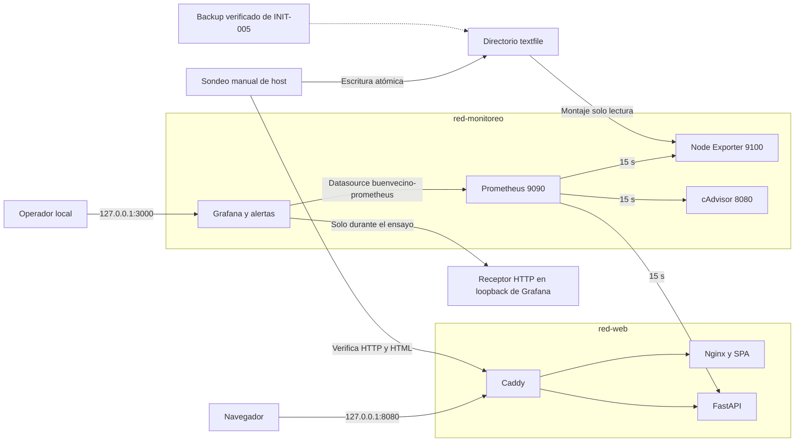

# INIT-004 — Observabilidad, dashboards y alertas

## Alcance y arquitectura

Implementación sobre `genni@8a049c4` con INIT-002 e INIT-003 aún en el árbol de trabajo. Se conservan versiones, siete servicios, redes, cinco volúmenes y publicaciones loopback. FastAPI mantiene el bloqueo productivo con salida `78`. Las pruebas usan memoria y datos sintéticos. `/ready` sigue pendiente. [Handoff de INIT-003](INIT-003-proxy-seguridad.md#handoff-consolidado-para-init-004), [arquitectura TO-BE](arquitectura-to-be-y-plan-devops.md#13-diseño-de-observabilidad), [gobernanza](../../AGENTS.md)



| Servicio o ruta | Implementación |
|---|---|
| Caddy, `frontend`, `backend` | Continuidad de INIT-003 en `red-web`. Backend también en `red-monitoreo`. Gateway público de laboratorio rechaza `/metrics`. |
| Prometheus `v2.54.1` | `prom/prometheus`, 9090 interno, `prometheus_data:/prometheus` y retención inicial de 7 días. |
| Grafana `11.2.0` | `grafana/grafana`, 3000 interno y `127.0.0.1:3000` en el override. `grafana_data:/var/lib/grafana`, directorios provisionados RO, acceso anónimo y registro desactivados. |
| Node Exporter `v1.8.2` | `prom/node-exporter`, 9100 interno. Lectura de montajes Linux y `--collector.textfile.directory=/textfile`. |
| cAdvisor `v0.54.1` | `gcr.io/cadvisor/cadvisor`, 8080 interno. Mantiene compatibilidad verificada con overlayfs de Docker Desktop. |
| Otros volúmenes | `caddy_data`, `caddy_config` y `ml_artifacts`, sin manejos de datos añadidos por INIT-004. |

## Archivos implementados

- `monitoring/prometheus/prometheus.yml` conserva los jobs y añade la etiqueta `environment`. Descarta las métricas de respaldo heredadas de FastAPI.
- `monitoring/prometheus/tests/alert-expressions.py` genera fixtures desechables para verificar las expresiones y umbrales con `promtool`.
- `monitoring/grafana/dashboards/` contiene tres JSON portables. `monitoring/grafana/provisioning/` declara datasource, provider, siete reglas, contact point y política.
- `deploy/docker-compose.yml`, `deploy/docker-compose.dev.yml` y `.env.example` integran los montajes, el entorno y el collector. `monitoring/node-exporter/textfile/.gitignore` mantiene los `.prom` fuera de Git por defecto.
- `deploy/scripts/probe-spa.py` ejecuta el sondeo por demanda. `backend/app/core/metrics.py` acota las etiquetas al instrumentar. `backend/tests/test_metrics.py` cubre el caso de rutas parametrizadas y desconocidas.

## Prometheus e inventario

`monitoring/prometheus/prometheus.yml` es la configuración versionada. Compose renderiza `/tmp/prometheus-effective.yml` con una etiqueta permitida de `MONITORING_ENVIRONMENT`. El override fija `laboratorio`, la base permite `produccion` o `sin-etiquetar`. Los intervalos de scrape y evaluación de Prometheus se mantienen en 15 s. Las reglas se evalúan exclusivamente en Grafana. [Operadores PromQL](https://prometheus.io/docs/prometheus/latest/querying/operators/)

| Job y target | Métricas y alcance |
|---|---|
| `fastapi-backend` → `backend:8000/metrics` | `http_requests_total{method,endpoint,status}` y `http_request_duration_seconds_{count,sum,bucket}` con `method`, `endpoint` y `le` en buckets. Las plantillas preservan `/api/v1`, usan `{code}` u otros parámetros declarados y asignan `unmatched` a rutas sin plantilla. No se meten IDs, códigos, JWT ni query strings en labels. |
| `fastapi-backend` → `backend:8000/metrics` | `sales_registered_total{metodo_pago}` y `sales_revenue_soles_total` son contadores operativos. Los tres métodos de pago válidos y el histograma del POST de ventas se inicializan para que un scrape previo al primer lote permita medirlo. El histograma del POST contabiliza todos los intentos HTTP, con independencia de que la venta se acepte. Las demás combinaciones HTTP aparecen con su primera solicitud y sus tasas requieren al menos dos muestras. |
| `fastapi-backend` → `backend:8000/metrics` | Gauges `ml_training_duration_seconds` y `ml_wape_score`, y contador `ml_predictions_generated_total{nivel_alerta}`. El WAPE procede del fixture en el ensayo y carece de etiqueta confiable de procedencia. El panel suprime el arranque con duración cero. |
| `node-exporter` → `node-exporter:9100/metrics` | CPU, RAM, uptime y carga Linux. `node_filesystem_*` confirmó un disco virtual ext4 en `/var/lib`. Se filtran filesystems relevantes de lectura/escritura y de tamaño positivo. `node_network_*` mostró `eth0` del namespace observado y `lo` excluida de los paneles. |
| `node-exporter` → `node-exporter:9100/metrics` | Gauges `minimarket_probe_success`, `minimarket_probe_duration_seconds`, `minimarket_probe_timestamp_seconds` y `minimarket_probe_http_status_code`, con `check="spa"`. `backup_last_success_timestamp` y `backup_last_size_bytes` se reservan para el productor verificado de INIT-005. |
| `cadvisor` → `cadvisor:8080/metrics` | `container_cpu_usage_seconds_total{cpu="total"}`, memoria usada/working set, RX/TX, `container_last_seen` y operaciones `container_fs_reads_total`/`container_fs_writes_total` con `device` identificado. Se verificaron los labels `container_label_com_docker_compose_project` y `container_label_com_docker_compose_service`. |

El disco de laboratorio es almacenamiento de la VM, no una medición del disco físico Windows. No se suman tamaños de múltiples montajes. Red y cgroups requieren una verificación de alcance en EC2. La métrica heredada de respaldos sigue existiendo en el código de FastAPI/S3 porque los setters se retiran junto con la refactorización de backup de INIT-005. El scrape la descarta y las consultas de respaldo seleccionan únicamente `job="node-exporter"`.

## Dashboards y consultas

Datasource `Prometheus`, UID `buenvecino-prometheus`, URL interna `http://prometheus:9090`, acceso proxy. Provider de archivos JSON en carpeta `Buen Vecino`, con UIDs estables y refresco de dashboards cada 30 s. La interfaz local de Grafana conserva autenticación. Credenciales mediante `GRAFANA_ADMIN_USER` y `GRAFANA_ADMIN_PASSWORD` a través de `GF_SECURITY_ADMIN_USER` y `GF_SECURITY_ADMIN_PASSWORD`. [Provisioning Grafana](https://grafana.com/docs/grafana/latest/administration/provisioning/)

| Dashboard y UID | Contenido y filtros |
|---|---|
| Infraestructura — `buenvecino-infraestructura` | Estado de scrape de Node Exporter, CPU/RAM/disco/uptime y gráficas de memoria, carga, RX/TX y espacio disponible. Filtros por entorno, instancia e interfaz. |
| Contenedores Docker — `buenvecino-contenedores` | Estado del exporter, servicios observados, CPU, RAM y working set, red, lecturas/escrituras y tabla de presencia reciente. Filtros por entorno, proyecto y servicio. Los selectores excluyen root cgroup y descartan observaciones de más de 45 s. Presencia no implica salud funcional. |
| Aplicación y Predicciones — `buenvecino-aplicacion` | Disponibilidad/tráfico, rendimiento, errores, operación y predicciones/continuidad. Filtra por entorno. Muestra recuperación del sondeo, latencia HTTP y ausencia del respaldo verificado. |

Consultas representativas. Los selectores detallados y los UIDs de datasource están en los JSON versionados. Las consultas de backups y P95 de caja omiten muestras ausentes o insuficientes. La recaudación observada no es contabilidad oficial.

```promql
100 * (1 - avg by (instance,environment) (rate(node_cpu_seconds_total{job="node-exporter",mode="idle"}[5m])))
100 * (1 - node_memory_MemAvailable_bytes{job="node-exporter"} / node_memory_MemTotal_bytes{job="node-exporter"})
time() - node_boot_time_seconds{job="node-exporter"}
histogram_quantile(0.95, sum by (le) (rate(http_request_duration_seconds_bucket{job="fastapi-backend",method="POST",endpoint="/api/v1/ventas"}[15m])))
sum by (metodo_pago) (increase(sales_registered_total{job="fastapi-backend"}[30m]))
time() - (backup_last_success_timestamp{job="node-exporter"} > 0)
```

## Alertas y notificación

Grafana Alerting es el único evaluador. Las reglas usan consultas instantáneas y umbrales de Grafana o booleanos explícitos. Las comparaciones de volumen filtran únicamente las ventanas insuficientes. La pérdida de telemetría y los errores de consulta tienen estados propios, separados de un valor elevado. Grafana 11.2.0 exige intervalos múltiplos de 10 s en el scheduler. La disponibilidad se evalúa a 30 s y Prometheus mantiene su scrape a 15 s. [Provisioning de alertas](https://grafana.com/docs/grafana/latest/alerting/set-up/provision-alerting-resources/file-provisioning/)

| Regla UID `buenvecino-alt-NN` | Condición | Evaluación y periodo pendiente |
|---|---|---|
| ALT-01 CPU elevada | >80 % de CPU según Node Exporter. | 30 s, 5 min. Sin datos se clasifica aparte. |
| ALT-02 Memoria elevada | >85 % de RAM utilizada. | 30 s, 5 min. Sin datos se clasifica aparte. |
| ALT-03 Disco elevado | >80 % en filesystem seleccionado y de lectura/escritura. | 30 s, 1 min para evitar ruido momentáneo. |
| ALT-04 Servicio indisponible | `signal=scrape` para backend/exporters, `spa_http` para fallo funcional del HTTP/HTML y `spa_sondeo_antiguo` si tiene más de 45 s. | 30 s, 2 min. El campo `job` identifica fallos de scrape. El primer sondeo habilita la señal de frescura. PostgreSQL queda pendiente de `/ready`. |
| ALT-05 Registro de ventas lento | P95 ≥1 s, con al menos 10 intentos HTTP de ventas en 15 min. | 30 s, 5 min. Sin muestra suficiente queda OK, sin declarar SLO cumplido. |
| ALT-06 Respaldo desactualizado | Edad >26 h o ausencia de timestamp válido, con Node Exporter alcanzable. | 1 min. **Pausada** hasta probar el productor real y autorizar la activación. |
| ALT-07 Errores HTTP elevados | >2 % 5xx con al menos 20 solicitudes en 5 min. | 30 s, 5 min. Sin volumen queda OK. Denominador cero se excluye. |

Los mínimos 10/15 min y 20/5 min son provisionales. Revisarlos con tráfico real antes de establecer alertas de operación. Los errores 5xx de gateway quedan fuera del contador FastAPI. El contact point de laboratorio apunta al puerto `18081` en el propio loopback de Grafana. Solo entrega cuando se inicia el receptor temporal. El canal productivo externo está pendiente de autorización. Grafana local queda indisponible ante la caída de toda EC2.

## Contrato textfile y handoff para INIT-005

Configurar `MONITORING_TEXTFILE_DIR` con un directorio dedicado existente. El valor predeterminado apunta a `monitoring/node-exporter/textfile/`. Node Exporter lo lee en `/textfile` y los operadores escriben en el directorio de host con permisos separados. La escritura debe crear un temporal con extensión distinta de `.prom`, cerrar y validar su contenido y renombrar dentro del mismo filesystem. Dejar lectura para el UID del exporter y escritura solo al productor autorizado. Verificar `node_textfile_scrape_error == 0`. [Textfile collector](https://github.com/prometheus/node_exporter)

El sondeo manual verifica HTTP 200, MIME `text/html` y las marcas `id="root"` y `/assets/`, mide un tiempo monotónico y publica el instante Unix de ejecución. Los errores y redirecciones producen `success 0`, y el código es 0 solo cuando no hubo respuesta HTTP. Para el futuro timer, usar una cadencia de unos 15 s con timeout menor que el intervalo y sin ejecuciones solapadas. Usar la URL pública HTTPS aprobada o un mecanismo interno representativo del gateway. No reutilizar `/health` para comprobar PostgreSQL. Agregar una sonda separada cuando exista `/ready` y se haya verificado PID/API y acceso PostgreSQL real.

Para habilitar ALT-06, el futuro `backup.sh` debe publicar **únicamente tras completarse** la exportación PostgreSQL, la validación del dump y la subida comprobada a S3. Usar permisos mínimos por Instance Profile. Obtener hora Unix al finalizar y tamaño real del dump en bytes. Si una etapa falla, conservar el `.prom` anterior intacto y devolver error. El backup actual tiene ramas de placeholder y de AWS CLI ausente que pueden anunciar éxito. Aislar ese script del directorio textfile hasta corregirlo y probar restauración en una base desechable. El RTO aún depende de la decisión 2 h/8 h del equipo.

```text
# TYPE backup_last_success_timestamp gauge
backup_last_success_timestamp <epoch_UTC_de_fin>
# TYPE backup_last_size_bytes gauge
backup_last_size_bytes <bytes_del_dump_verificado>
```

El bloque define el formato, no es un archivo `.prom` ejecutable. No rellenar con fechas ficticias. Retirar también los setters de respaldo asociados a subidas normales. Solo tras comprobar un respaldo válido, falla sin avance del timestamp y recuperación real, quitar `isPaused: true` de ALT-06. Usar timer diario en horario aprobado y evitar solapamientos con batch ML o despliegues. Conservar volumen TSDB y provisionar un canal operativo autorizado.

## Operación reproducible y acceso futuro

Preparar un `.env.lab` o archivo temporal con valores ficticios y sin DSN productiva. El override fija `DATABASE_URL` vacía y excluye credenciales AWS, y Compose recibe el archivo de ambiente de forma explícita. [Preparación de laboratorio](INIT-002-contenedores.md#operación-local)

```powershell
$BaseArgs = @('--env-file', '.env.lab', '-p', 'buenvecino-init004', '-f', 'deploy/docker-compose.yml')
$LabArgs = $BaseArgs + @('-f', 'deploy/docker-compose.dev.yml')
docker compose @BaseArgs config --quiet
docker compose @LabArgs config --quiet
docker compose @LabArgs build backend frontend
docker compose @LabArgs up -d --wait --wait-timeout 100
docker compose @LabArgs ps
docker compose @LabArgs exec -T prometheus promtool check config /tmp/prometheus-effective.yml
docker compose @LabArgs exec -T prometheus wget -qO- http://127.0.0.1:9090/api/v1/targets
python deploy/scripts/probe-spa.py --textfile-dir monitoring/node-exporter/textfile
docker build --target test -t minimarket-backend:init004-tests ./backend
docker run --rm --network none minimarket-backend:init004-tests
docker compose @LabArgs stop
```

Si se usa `MONITORING_TEXTFILE_DIR` distinto, pasar esa ruta al sondeo. Evitar que dos laboratorios compartan el directorio escribible. Grafana está en `http://localhost:3000`; Prometheus se consulta por API interna y mediante `docker compose exec`. En EC2, usar publicación de Grafana exclusivamente en loopback y túnel SSH o SSM cuando se autorice. Comprobar mounts, permisos y cgroups de Linux, interfaces reales, capacidad/costo y timestamps. INIT-004 no requiere abrir puertos adicionales en VPC. [Túneles y requisitos AWS](INIT-003-proxy-seguridad.md#integración-futura-con-ec2)

Para reproducir ALT-04, consultar la regla en Grafana y confirmar `up{job="fastapi-backend"} == 1`. Mantener el sondeo de la SPA cada 15 s en otra terminal para aislar la señal de scrape. Detener solo el backend del laboratorio y esperar primero `Pending` y luego `Firing` con `job=fastapi-backend` y `signal=scrape`. Volver a iniciar el backend y confirmar la recuperación. Para verificar también la entrega, ejecutar un receptor HTTP temporal que acepte `POST /alertas` y responda 2xx en `127.0.0.1:18081` dentro del namespace de red de Grafana. Un contenedor desechable puede compartir ese namespace con `--network container:<id-del-grafana-del-laboratorio>`. Registrar solo `status` y los labels de la instancia bajo prueba.

```powershell
docker compose @LabArgs stop backend
# Confirmar aquí el estado Firing en Grafana.
docker compose @LabArgs up -d --wait --no-deps backend
```

Para verificar las reglas y el provisioning por API en Grafana con autenticación local, consultar `/api/v1/provisioning/alert-rules`, `/api/prometheus/grafana/api/v1/rules`, `/api/datasources/uid/buenvecino-prometheus` y `/api/dashboards/uid/<uid>`.

Para verificar las expresiones fuera de la TSDB, usar Python con PyYAML disponible y la misma versión de Prometheus que Compose. El archivo se genera en un directorio temporal y el test se ejecuta en un contenedor desechable sin red.

```powershell
$Casos = Join-Path ([IO.Path]::GetTempPath()) ("init004-alertas-" + [guid]::NewGuid())
New-Item -ItemType Directory -Path $Casos | Out-Null
python monitoring/prometheus/tests/alert-expressions.py (Join-Path $Casos 'alert-cases.yml')
docker run --rm --network none --mount "type=bind,source=$Casos,target=/checks,readonly" --entrypoint /bin/promtool prom/prometheus:v2.54.1 test rules /checks/alert-cases.yml
```

## Correspondencia académica

| Índice | Evidencia |
|---|---|
| 5.3 Servicio de monitoreo | Stack Compose privado y directorios versionados. |
| 11.1 Arquitectura de monitoreo | Diagrama, redes, datasource proxy y textfile. |
| 11.2 Métricas e indicadores | Inventario, labels, unidades y procedencia. |
| 11.3 Implementación de Prometheus y Grafana | `promtool`, estado de targets, retención y persistencia TSDB. |
| 11.4 Dashboards | Tres JSON, capturas y consultas válidas. |
| 11.5 Sistema de alertas | Tabla ALT-01–07, ensayo de caída/recuperación y política webhook local. |
| 12.5 Monitoreo y continuidad operativa | Separación sondeo/scrape, bloqueo de ALT-06 y contrato de backup. |

## Resultados del laboratorio

Ensayo en `buenvecino-init004`, el 26 de noviembre de 2026, hora de Lima. Docker Engine 28.5.1 Linux/amd64 en Docker Desktop y Compose 2.40.2. Se reutilizó la imagen frontend validada en INIT-003 y se construyó el backend con el cambio de etiquetas. Todas las operaciones de caja y ML de la prueba son fixtures.

| Comprobación | Estado | Evidencia |
|---|---|---|
| Compose y exposición | PASS | `config --quiet` en base y override. Inspección de los siete contenedores y solo dos bindings, `127.0.0.1:3000` y `127.0.0.1:8080`. |
| Prometheus y retención | PASS | `promtool` validó plantilla y configuración efectiva. Tres targets `up`, todos con `environment=laboratorio`. La API mostró `storage.tsdb.retention.time=1w` para la opción de 7 días. Se consultó la misma muestra histórica de ventas antes y después de `up --force-recreate prometheus`. El valor se conservó. |
| Exporters | PASS | 160 series CPU de la VM, RAM disponible, uptime, carga y RX en `eth0`. Un filesystem ext4 seleccionado en `/var/lib`. Siete servicios Compose en cAdvisor. Se observaron series de lecturas y escrituras con `device`. |
| Grafana y consultas | PASS | API confirmó datasource proxy, tres dashboards provisionados y siete reglas. Prometheus aceptó 54 consultas de paneles con variables resueltas y las siete consultas A de las alertas. ALT-06 figuró pausada. |
| ALT-04 y entrega local | PASS | Se detuvo únicamente `backend` de INIT-004 durante el periodo de espera sin cambiar umbrales. Grafana detectó `job=fastapi-backend`, `signal=scrape`, pasó de pendiente a `Firing` y volvió a `Normal` al iniciar el servicio. El sondeo de la SPA siguió funcionando. El receptor local independiente registró `firing` y `resolved`. |
| Expresiones de ALT-01, 02, 03, 05, 06 y 07 con fixtures aislados | PASS | `promtool test rules` verificó normalidad, cruce y recuperación de ALT-01/02/03/05/07, los mínimos de tráfico de ALT-05/07 y la condición de ausencia de backup de ALT-06 con exporter disponible. Los casos no forman parte del runtime ni escriben en la TSDB del laboratorio. |
| Disparo y entrega en Grafana de ALT-01, 02, 03, 05 y 07 | NOT RUN | Grafana evaluó las reglas en estado normal. Las transiciones controladas se probaron en `promtool` sin forzar carga o fallos en el host. |
| Sondeo y respaldos | PASS | `/admin` dio 404 y publicó fallo. La SPA dio 200 con HTML válido y publicó recuperación, ambos visibles en Prometheus. Sin error de parseo textfile y sin serie de respaldo recolectada. |
| Backend y métricas de aplicación | PASS | 20 pruebas en contenedor sin red, incluidas plantillas HTTP. E2E y 12 ventas ficticias adicionales, además de solicitudes autorizadas de productos. Se observó el primer incremento de ventas, la instrumentación del POST y la métrica de predicciones del fixture. No apareció el valor de la ruta ficticia en labels. Los conteos con `increase` son estimaciones del intervalo. |
| Regresión de seguridad | PASS | SPA `/` 200, endpoint de salud 200, `/ready` y métricas vía Caddy 404, API sin autorización 401 y comprobante directo 404. La imagen nueva devolvió 78 en el arranque productivo. |
| Producción, AWS y receptor externo | NOT RUN | Pendientes de recursos, canal y autorizaciones. |
| Sondeo PostgreSQL y respaldo real | BLOCKED | `/ready` pendiente de Desarrollo y productor de respaldo verificado pendiente de INIT-005. |
| Cierre del proyecto | PASS | Se detuvo solo `buenvecino-init004`. `docker compose ps --all` mostró siete servicios detenidos y los cinco volúmenes permanecieron. |

### Capturas del laboratorio

Las capturas de Grafana provienen de un perfil temporal de Chrome con credenciales ficticias. Para abrir Targets sin publicar Prometheus, el navegador recibió los recursos reales de la interfaz a través de un relay de prueba que usó `docker compose exec`. La evidencia de contenedores muestra la salida real del comando `docker compose ps` en un documento HTML del runner.

- [Targets activos](evidencias/init-004/01-prometheus-targets.png)
- [Dashboard de infraestructura](evidencias/init-004/02-infraestructura.png)
- [Dashboard de contenedores](evidencias/init-004/03-contenedores.png)
- [Dashboard de aplicación](evidencias/init-004/04-aplicacion.png)
- [Listado de alertas](evidencias/init-004/05-alertas.png)
- [ALT-04 disparada](evidencias/init-004/06-alt-04-disparo.png)
- [ALT-04 recuperada](evidencias/init-004/07-alt-04-recuperacion.png)
- [Estado de los siete contenedores](evidencias/init-004/08-contenedores-compose.png)
- [Aplicación completa, predicciones sintéticas y continuidad](evidencias/init-004/09-aplicacion-continuidad.png)

## Estado Git

`git status --short --branch --untracked-files=all` mostró `genni` en `8a049c4`, con 10 archivos rastreados modificados y 35 archivos sin rastrear. El resumen acumulado de `git diff --stat` fue 10 archivos, 285 inserciones y 266 eliminaciones. Incluye cambios previos de INIT-002 e INIT-003 y deja fuera los archivos aún sin rastrear. `git diff --check` pasó con avisos de conversión de finales de línea. No se prepararon archivos para commit.

Propuesta de commits para revisión de los cambios por iniciativa

1. `feat: provisionar observabilidad privada y alertas de Grafana`
2. `fix: acotar etiquetas HTTP y medir el primer lote de ventas`
3. `docs: documentar INIT-004 y sus evidencias de laboratorio`
