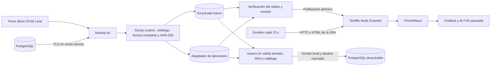

# INIT-005 — Automatización y continuidad operativa

## Resultado y alcance

Sobre `genni@8a049c4`, se implementaron el preflight, las operaciones Compose locales, el sondeo, el respaldo verificable y la restauración restringida. Se restauró un dump real de PostgreSQL 18.0 con datos identificados como fixtures, almacenado mediante el adaptador local. S3, IAM, timers activos en EC2 y validación de RPO/RTO siguen pendientes. ALT-06 permanece pausada y el backend conserva la salida productiva 78. [Arquitectura TO-BE](arquitectura-to-be-y-plan-devops.md), [contrato de observabilidad](INIT-004-observabilidad.md#contrato-textfile-y-handoff-para-init-005), [ADR de PostgreSQL y RLS](../adrs/0003-supabase-rls-security.md)



## Archivos y contratos

```text
deploy/
├── scripts/
│   ├── setup.sh
│   ├── start.sh
│   ├── stop.sh
│   ├── healthcheck.sh
│   ├── compose-common.sh
│   ├── backup.sh
│   ├── restore.sh
│   └── backup-lib.sh
├── systemd/
│   ├── buenvecino-backup.service
│   ├── buenvecino-backup.timer
│   ├── buenvecino-healthcheck.service
│   └── buenvecino-healthcheck.timer
└── tests/continuity.sh
monitoring/prometheus/tests/alert-expressions.py
docs/devops/INIT-005-automatizacion-continuidad.md
docs/devops/evidencias/init-005/
```

| Archivo | Contrato |
|---|---|
| `setup.sh` | `--check` inventaría Linux/arquitectura, herramientas, Docker, Compose, AWS CLI v2, versiones PostgreSQL, espacio y configuración de archivos. `--prepare` devuelve 3 y remite al procedimiento sujeto a aprobación. |
| `start.sh` | Exige proyecto, archivo explícito y `--mode local`. Ejecuta `config --quiet` y espera salud. Construye con `--build` y usa `--no-build` por defecto. `--mode production` devuelve 3. |
| `stop.sh` | Valida nombre y labels Compose de todos los contenedores del proyecto. Usa `compose stop` y deja imágenes y volúmenes. Protege INIT-002/003/004. |
| `healthcheck.sh` | Separa estado Docker, acceso interno, Caddy/SPA funcional y liveness de FastAPI. `/ready` 404 produce BLOCKED para PostgreSQL. `--require-ready` devuelve 3 cuando solo falta readiness. `--probe-only --url URL` usa el sondeo existente sin consultar Docker. |
| `backup.sh` | Exige `--storage fixture\|s3`. Exporta, valida y transfiere. Solo publica `backup.prom` al confirmar todos los destinos de esa ejecución. `--weekly` fuerza un adicional en la semana vigente. |
| `restore.sh` | Exige modo, clave, destino y confirmación. Acepta versión específica o fija la que devuelve HEAD, cuando existe. Solo restaura por socket Unix en una base `buenvecino_restore_*` autorizada y vacía. |
| `deploy/tests/continuity.sh` | Construye fixtures con las migraciones, compara origen y restauración, verifica concurrencia, fallos y conservación total del textfile. |

Los auxiliares comparten validaciones Compose y el contrato de almacenamiento. Los comandos pueden invocarse con `bash` desde otro directorio. Códigos 0 éxito, 2 argumentos o configuración inválida, 3 dependencia/precondición o falta de autorización, 4 fallo operativo. `--require-ready` sin endpoint usa 3. Los errores de herramientas PostgreSQL/AWS se resumen por etapa para evitar que journald registre DSN o rutas de credenciales. `SIGINT`, `SIGHUP` y `SIGTERM` limpian los temporales del respaldo/restauración. La señal no interceptable `SIGKILL` puede dejar un directorio privado de trabajo que debe revisar el operador.

`.gitattributes` fija LF para las unidades y conserva la regla existente para Bash. `.gitignore` excluye archivos libpq, dumps y metadata de dumps. `.env.example` referencia la configuración de host. Las reglas provisionadas, los puertos y las redes Compose de INIT-004 se conservan.

## Configuración y credenciales

| Variable | Consumidor |
|---|---|
| `BACKUP_PG_SERVICE` | Nombre de la sección libpq de la identidad dedicada. Solo admite letras, números, puntos, guion y guion bajo. |
| `PGSERVICEFILE`, `PGPASSFILE` | Archivos privados de la cuenta operativa, por ejemplo 0600. El servicio define hostname, base, usuario y CA de confianza. La contraseña reside en pgpass. |
| `AWS_REGION`, `AWS_S3_BACKUP_BUCKET` | Parámetros entregados por Cloud para el proceso de host. S3 usa AWS CLI v2 e Instance Profile. |
| `BACKUP_WORK_DIR` | Directorio existente, privado y propio. Contiene los locks, temporales y la última semana ISO verificada. |
| `MONITORING_TEXTFILE_DIR` | Directorio del host compartido con Node Exporter mediante el montaje RO de Compose. Los escritores requieren acceso y Node Exporter lectura. |
| `BACKUP_TIMEZONE` | `America/Lima` por defecto. Define las fechas y semanas ISO de las claves. Los logs y metadata usan UTC. |
| `BACKUP_FIXTURE_DIR` | Directorio privado, exclusivo del contenedor desechable. También se requiere una marca en el directorio textfile de INIT-005. |
| `PROBE_URL` | URL HTTPS aprobada para el sondeo de systemd. El wrapper Compose prueba `http://localhost:8080/`. |

El modo S3 valida TCP con TLS y fuerza `sslmode=verify-full`. El DSN visible solo incluye el identificador de servicio y opciones. No se reutiliza `DATABASE_URL` de la aplicación. La cuenta de respaldo debe poder leer tablas y secuencias bajo RLS con el alcance aprobado. `pg_dump` falla si la identidad no puede obtener una copia completa. Aprobar el cliente de la misma versión mayor de PostgreSQL o compatible antes de conectar a Supabase y verificar el certificado con el hostname autorizado. [libpq service files](https://www.postgresql.org/docs/current/libpq-pgservice.html), [pg_dump](https://www.postgresql.org/docs/current/app-pgdump.html)

`BACKUP_FIXTURE_FAIL=transfer|verify` inyecta fallos solo en el adaptador de laboratorio. Las pruebas usan un directorio de textfile separado. El modo S3 no consulta esa variable.

En EC2, el comando S3 descarta claves estáticas, perfiles, endpoints personalizados y credenciales de contenedor heredadas del entorno. Cloud habilitará IMDSv2, bloqueo público, versionamiento y cifrado compatible con SSE-S3. Limitar el permiso de escritura a `backups/daily/*` y `backups/weekly/*`, y conceder lectura del objeto y versión para verificación. La receta operativa de recuperación puede requerir una identidad aparte con `s3:ListBucketVersions` y `s3:GetObjectVersion`. Mantener el borrado fuera de los permisos del productor. [S3 PutObject y checksums](https://docs.aws.amazon.com/cli/latest/reference/s3api/put-object.html), [S3 GetObject y versiones](https://docs.aws.amazon.com/cli/latest/reference/s3api/get-object.html)

## Exportación, integridad y conservación

La hora de captura se lee inmediatamente antes de `pg_dump -Fc` como cota conservadora del punto recuperable. El dump abarca todo el esquema `public`. El catálogo exige las ocho tablas del proyecto, sus datos, `registrar_venta`, `get_auth_user_role` y el valor de secuencia de ventas. Una segunda lectura de `pg_restore` descomprime el contenido a `/dev/null`. El script calcula tamaño y SHA-256 antes de publicar el objeto. Las migraciones dejan dependencias fuera de `public`, en particular el rol `authenticated` y `auth.uid()`. No se incluyen servicios administrados de Supabase, Supabase Auth, roles globales o ACL de origen. Inventariar nuevas dependencias de INIT-001 antes de usar el procedimiento en una recuperación real.

La clave incluye fecha u orden semanal, timestamp UTC y sufijo único. El PUT cifrado incluye el checksum SHA-256 en Base64 y la metadata del dump con hash en hexadecimal, hora de captura y formato. HEAD verifica versión, tamaño, cifrado y metadata, y compara el SHA-256 devuelto. Si el checksum no es comparable, se descarga la versión seleccionada y se recalculan tamaño y hash. Si el proveedor devuelve un SHA-256 comparable que difiere, la ejecución falla. Se usa PUT único, sujeto al límite de objeto de esa operación. Dimensionar espacio para el dump más la posible segunda copia y medir el límite práctico de transferencia antes de EC2. [Integridad en S3](https://docs.aws.amazon.com/AmazonS3/latest/userguide/checking-object-integrity.html)

- Cada ejecución escribe en `backups/daily/AAAA-MM-DD/`. La primera exitosa de cada semana ISO genera también `backups/weekly/AAAA-Www/`. La marca local semanal avanza después de verificar el objeto. Si la primera tentativa de la semana falla, se reintenta en el siguiente respaldo. Una EC2 reconstruida puede generar otro punto de esa misma semana.
- Elegir un punto válido por periodo, usando captura y versión. Conservar los siete días más recientes con respaldo válido y las cuatro semanas más recientes con respaldo válido. Una ejecución parcial puede dejar objetos por revisar. Para contar un reemplazo, verificar que su versión pueda descargarse y que tamaño y SHA-256 coincidan. Los scripts no borran objetos ni configuran Lifecycle.
- Propuesta para Cloud. Habilitar versionamiento y Lifecycle por prefijo más etiqueta de elegibilidad. Marcar un objeto como elegible solo tras revisar el inventario y verificar que queda fuera de los siete/cuatro puntos protegidos. Aplicar una ventana conservadora en Lifecycle a los objetos etiquetados, con periodos y política de versiones no vigentes aprobados por Cloud. Evitar expiración incondicional de objetos vigentes por edad, que puede eliminar el último punto durante una racha de fallos. [Filtros y vencimientos Lifecycle](https://docs.aws.amazon.com/AmazonS3/latest/userguide/intro-lifecycle-rules.html)

Se verificaron rutas diaria y semanal, y la deduplicación semanal dentro del mismo host y semana. Acreditar la conservación completa exige ejecuciones exitosas en al menos siete días y cuatro semanas diferentes.

## Restauración aislada

El destino debe estar en `/var/run/postgresql:5432`, usar la nomenclatura de laboratorio, tener la marca `buenvecino-init005:disposable` y carecer de objetos en `public` y otras sesiones. Se comprueba antes de descargar y antes de restaurar. La confirmación interactiva o `--confirm` debe coincidir con el nombre exacto. El script comprueba versión, SHA-256 y catálogo y ejecuta `pg_restore --exit-on-error --single-transaction --no-owner --no-privileges`. Omite exclusivamente el `CREATE SCHEMA public` del catálogo, porque el destino ya contiene ese esquema vacío. Las otras entradas, incluidas las políticas, se conservan. No existe opción `--clean`.

La prueba provisiona en origen y destino un rol `authenticated` sin LOGIN y una función `auth.uid()` de laboratorio que devuelve NULL. Permiten recrear las dependencias de la migración 003. La restauración volvió a habilitar RLS en ocho tablas y recuperó las funciones y la secuencia. Esto no acredita permisos efectivos de Supabase ni aislamiento por usuario. [pg_restore](https://www.postgresql.org/docs/current/app-pgrestore.html)

## Observabilidad y scheduling

El productor reemplaza `backup.prom` mediante rename en el mismo directorio. Permisos 0644 para la muestra y directorio con un escritor autorizado. `backup_last_success_timestamp` representa el final exitoso. `backup_last_size_bytes` representa el tamaño real del dump. La versión y la captura quedan en la metadata y el journal, fuera de las etiquetas Prometheus. Un fallo conserva el archivo anterior byte a byte. El scrape mantiene el filtro del gauge histórico de FastAPI que puede actualizarse por subidas ordinarias. Retirar los setters depende de Desarrollo.

ALT-06 consume solo `job="node-exporter"`. Umbral estricto >26 h, o ausencia inicial de un timestamp válido con exporter disponible. El ensayo fuera de la TSDB validó ausencia, instante reciente, exactamente 26 h, una muestra antigua y caída del exporter. Sigue provisionada y pausada. Al disponer de un respaldo S3 verificable y aprobación, habilitar con un ensayo de error, un ensayo de recuperación y confirmación del receptor de alertas.

- `buenvecino-backup.timer` programa `03:00 America/Lima` diariamente, con `Persistent=true`. La unidad usa `flock`, timeout de 45 min, cuenta dedicada y journald.
- `buenvecino-healthcheck.timer` programa el sondeo cada 15 s, con precisión de 1 s. Su unidad oneshot limita la ejecución a 10 s y el cliente a 3 s. Una instancia activa de la misma unidad evita que systemd la solape.
- Las cuatro unidades se verificaron en systemd 257 dentro de un contenedor desechable. Para la fecha base `2026-11-26 09:00 UTC`, systemd calculó el siguiente disparo a las `08:00 UTC` del día siguiente, equivalentes a las 03:00 de Lima. La activación de timers y el entrenamiento programado quedan pendientes.

### Preparación futura de Ubuntu después de aprobación

Instalar Docker Engine y el plugin Compose v2 mediante el repositorio oficial. Instalar el cliente PostgreSQL de la versión aprobada, Python 3, `util-linux`, `coreutils`, OpenSSL y la zona horaria. Instalar AWS CLI v2 desde el paquete oficial correspondiente a amd64 o ARM64. Confirmar capacidades del sistema con `setup.sh --check`. La preparación no requiere dar acceso al socket Docker a la cuenta de tareas. [Docker Engine para Ubuntu](https://docs.docker.com/engine/install/ubuntu/), [instalación de AWS CLI v2](https://docs.aws.amazon.com/cli/latest/userguide/getting-started-install.html)

```bash
# Receta futura. Requiere aprobación de Cloud y del operador del host.
sudo apt-get install --no-install-recommends postgresql-client python3 util-linux coreutils openssl tzdata
sudo useradd --system --no-create-home --shell /usr/sbin/nologin buenvecino-ops
sudo install -d -m 0750 -o root -g buenvecino-ops /etc/buenvecino
sudo install -d -m 0700 -o buenvecino-ops -g buenvecino-ops /var/lib/buenvecino/backup
sudo install -d -m 0755 -o buenvecino-ops -g buenvecino-ops /var/lib/buenvecino/textfile
sudo install -m 0644 deploy/systemd/*.service deploy/systemd/*.timer /etc/systemd/system/
sudo systemd-analyze verify /etc/systemd/system/buenvecino-*.service /etc/systemd/system/buenvecino-*.timer
# Tras el ensayo manual, la aprobación y el daemon-reload:
sudo systemctl enable --now buenvecino-backup.timer buenvecino-healthcheck.timer
```

Para la instalación real, fijar el paquete concreto del cliente tras conocer la versión de Supabase. Configurar el checkout en `/opt/buenvecino`, los archivos de entorno de systemd en `/etc/buenvecino` y `BACKUP_WORK_DIR=/var/lib/buenvecino/backup`. El mismo path textfile se configura en la unidad y en Compose. Los archivos `backup.env` y `probe.env` deben ser del administrador y protegidos. La cuenta del servicio necesita leer su CA y archivos libpq. Verificar acceso del exporter al bind mount y validar journald antes de activar.

## Continuidad y objetivos

| Incidente | Detección y recuperación |
|---|---|
| Caída de proceso | Verificar estado y logs. Docker reinicia procesos que terminan según la política Compose. |
| Contenedor unhealthy | Usar healthchecks y alertas. Investigar y reiniciar controladamente el servicio afectado si corresponde. El estado unhealthy por sí solo no provoca un reinicio. |
| Pérdida de conectividad PostgreSQL | `/ready` pendiente. Aplicar procedimiento de INIT-001 para persistencia y rechazo de ventas. Liveness solo acredita el proceso. |
| Pérdida de datos | Identificar captura y versión, verificar el objeto y ensayar restauración desechable antes de cualquier recuperación de negocio. |
| Pérdida de EC2 | Reconstruir desde configuración e imágenes aprobadas, reconectar a Supabase, restaurar la operación y revisar los puntos de respaldo. Una sola EC2 es un punto único de fallo, incluido Grafana. |
| Fallo de predicción | Validar con Desarrollo que venta y reposición operen separadas. Pendientes pruebas concurrentes y planificación de entrenamiento. |

RPO objetivo ≤24 h, calculado desde la hora de captura del último punto realmente recuperable. Una transferencia reciente no compensa una captura antigua. RTO académico propuesto ≤8 h, con alternativa de 2 h en el plan original. El equipo debe decidir el objetivo definitivo. Medir detección, aprobación, aprovisionamiento, acceso al dump, restauración, pruebas y reapertura, además de `pg_restore`. Los tiempos del laboratorio no acreditan el RPO o RTO productivo.

## Reproducción del laboratorio

Crear un archivo explícito de entorno con `SECRET_KEY`, `GRAFANA_ADMIN_USER` y `GRAFANA_ADMIN_PASSWORD` de fixture, imágenes locales con tags exclusivos, y `MONITORING_TEXTFILE_DIR` absoluto apuntando a un directorio temporal propio. La aplicación sigue en `127.0.0.1:8080` y Grafana en `127.0.0.1:3000`. Usar valores ficticios y mantener el directorio separado de los anteriores. [Aislamiento Compose](INIT-002-contenedores.md#operación-local)

```bash
repo=$(pwd -P)
lab=$(mktemp -d)
mkdir "$lab/textfile"
touch "$lab/textfile/.buenvecino-init005-fixture"
cat > "$lab/lab.env" <<ENV
ENVIRONMENT=development
SECRET_KEY=fixture-init005-local-key-for-tests
GRAFANA_ADMIN_USER=admin
GRAFANA_ADMIN_PASSWORD=fixture-init005-local-grafana
BACKEND_IMAGE=minimarket-backend:init005-lab
FRONTEND_IMAGE=minimarket-frontend:init005-lab
MONITORING_TEXTFILE_DIR=$lab/textfile
ENV
options=(--project buenvecino-init005 --env-file "$lab/lab.env" --mode local)
bash deploy/scripts/start.sh "${options[@]}" --build
bash deploy/scripts/healthcheck.sh "${options[@]}" --textfile-dir "$lab/textfile"

pg_image='postgres@sha256:073e7c8b84e2197f94c8083634640ab37105effe1bc853ca4d5fbece3219b0e8'
docker run -d --name buenvecino-init005-postgres --network none \
  --tmpfs /var/lib/postgresql --tmpfs /lab:mode=1777 \
  --mount "type=bind,source=$repo,target=/repo,readonly" \
  --mount "type=bind,source=$lab/textfile,target=/collector" \
  -e POSTGRES_HOST_AUTH_METHOD=trust "$pg_image"
docker exec buenvecino-init005-postgres bash -c '
  touch /lab/.buenvecino-init005
  timeout 60 bash -c "until gosu postgres pg_isready -h /var/run/postgresql -d postgres; do sleep 1; done"
'
# En Linux nativo, dar escritura a postgres en este único bind temporal.
# docker exec buenvecino-init005-postgres chown postgres:postgres /collector
docker exec -u postgres buenvecino-init005-postgres bash /repo/deploy/tests/continuity.sh
# Tras la exportación y restauración, comprobar las series de respaldo en Grafana.
bash deploy/scripts/stop.sh "${options[@]}"
docker stop buenvecino-init005-postgres
```

En Linux nativo, dar escritura al UID de PostgreSQL únicamente en el directorio temporal textfile del ensayo, con el mecanismo de permisos del host. La imagen probada usa PostgreSQL 18.0 y el volumen padre `/var/lib/postgresql`. El contenedor de PostgreSQL usa tmpfs y red deshabilitada. Su stop descarta las bases desechables. Los cinco volúmenes Compose se conservan. Para probar nuevamente desde cero, usar un contenedor PostgreSQL inicializado desde tmpfs, conservando el nombre exclusivo.

## Resultados y evidencias

Ensayo del 26 de noviembre de 2026 en Docker Desktop, Engine 28.5.1 Linux/amd64 y Compose 2.40.2. Primera captura final `2026-11-26T15:17:36Z`. La exportación tardó 128 ms, la validación y hash 132 ms, y el dump tuvo 44 582 bytes. Después de descargar y volver a verificar el dump en 206 ms, `pg_restore` tardó 110 ms y las comprobaciones posteriores 52 ms. Son mediciones de la muestra de laboratorio.

| Validación | Estado y resultado |
|---|---|
| Bash y ShellCheck | PASS. Bash validó los scripts y ShellCheck v0.10.0 pasó los entrypoints, auxiliares importados y harness. |
| Exportación e integridad | PASS. Dump real, catálogo, lectura completa y SHA-256 independiente. Una segunda ejecución diaria conservó el punto semanal. |
| Restauración | PASS. Una fila por tabla, ticket relacionado, stock 8, secuencia `1:true` antes de la comprobación de venta y dos funciones. Una venta de fixture posterior pudo ejecutarse y se revirtió. |
| Fallos controlados | PASS. Conexión ausente, dump vacío y corrupto, versión incorrecta, hash distinto, archivo remoto alterado, dependencias y credenciales libpq ausentes, fallo de transferencia y verificación, destino denegado, falta de confirmación y concurrencia. Se comprobó conservación del textfile y limpieza de los temporales del script. |
| Textfile, ALT-06 y panel | PASS en laboratorio. Dos gauges desde Node Exporter y prueba de expresión fuera de TSDB. La captura identifica el almacenamiento simulado. |
| Regresión y salud | PASS. Siete servicios, tres targets, tres dashboards, Compose, Caddy, Nginx y promtool. `/metrics` en Caddy dio 404. Suite de 20 pruebas de backend y exit 78 conservados. |
| Timers | PASS estático. Integración y disparos en EC2 **NOT RUN**. |
| S3 e Instance Profile reales, retención histórica y RPO/RTO | **NOT RUN**. Pendientes de recursos y ventanas reales. |
| PostgreSQL del backend y activación operativa de ALT-06 | **BLOCKED**. Requieren `/ready`, respaldo S3 verificado y aprobación. |
| Cierre de INIT-005 | PASS. Siete servicios Compose y PostgreSQL desechable detenidos. Los cinco volúmenes Compose se conservaron. |

Evidencias para el informe universitario. Almacenamiento, PostgreSQL, integridad y recuperación corresponden a 9.2–9.5. Gestión de identidad a 10.4. La serie textfile y ALT-06 a 11.5. Los escenarios, RPO/RTO, monitoreo y pruebas a 12.3–12.5 y 12.7.

- [Exportación, SHA-256, restauración y fallos](evidencias/init-005/postgresql-laboratorio.txt)
- [Salud, regresión, ALT-06 y systemd](evidencias/init-005/validaciones-laboratorio.txt)
- [Panel de respaldos con datos de laboratorio](evidencias/init-005/panel-respaldo-laboratorio.png)

## Handoff para INIT-006

Usar un runner Linux con Bash, Docker Engine y Compose v2. Crear entorno, tags y nombre de proyecto exclusivos. Los pasos PostgreSQL van en un contenedor con red deshabilitada, con el driver de storage fixture y los datos del harness. Los tests de backend usan un contenedor sin red. No compartir el directorio textfile, usar el `.env` real ni subir los dumps, metadata, configuración de credenciales o temporales como artefactos.

```bash
base=(--env-file "$lab/lab.env" -p buenvecino-ci -f deploy/docker-compose.yml)
dev=("${base[@]}" -f deploy/docker-compose.dev.yml)
docker compose "${base[@]}" config --quiet
docker compose "${dev[@]}" config --quiet
docker compose "${dev[@]}" build backend frontend
docker build --target test -t minimarket-backend:ci-test ./backend
docker run --rm --network none minimarket-backend:ci-test
(cd frontend && npm ci && npm run build)
for source in deploy/scripts/*.sh deploy/tests/*.sh; do bash -n "$source"; done
shellcheck -x deploy/scripts/{setup,start,stop,healthcheck,backup,restore}.sh deploy/tests/continuity.sh
docker compose "${dev[@]}" up -d --no-build --wait
docker compose "${dev[@]}" exec -T caddy caddy validate --config /etc/caddy/Caddyfile --adapter caddyfile
docker compose "${dev[@]}" exec -T frontend nginx -t
docker compose "${dev[@]}" exec -T prometheus promtool check config /tmp/prometheus-effective.yml
python3 monitoring/prometheus/tests/alert-expressions.py "$lab/alert-cases.yml"
docker run --rm --network none -v "$lab/alert-cases.yml:/case.yml:ro" \
  --entrypoint /bin/promtool prom/prometheus:v2.54.1 test rules /case.yml
docker compose "${dev[@]}" stop
```

Usar Node.js 22 para el build frontend y PyYAML para el generador de casos de PromQL. El target backend `test` fija las dependencias de pruebas y el target runtime conserva UID/GID 10001. El flujo E2E anterior usa Playwright y los fixtures de la app. Para probar Caddy HTTPS estáticamente, montar el candidato en un contenedor desechable sin publicar puertos y ejecutar `caddy validate` con variables de sintaxis. Mantener el gate de producción y no habilitar emisiones ACME en el runner. En jobs compartidos que ejecuten Compose con las publicaciones de laboratorio, reservar 8080 y 3000 o aislar cada runner. No compartir tags de laboratorio entre jobs paralelos. 

Para producción quedan por aprobar arquitectura EC2, política IAM/S3 y Lifecycle, DNS/TLS, credenciales libpq, receptor de alertas y cierre de INIT-001. La validación es amd64 en Docker Desktop. ARM64 requiere disponibilidad de manifest para las imágenes base, build y smoke test nativos, y medición de las dependencias de LightGBM y cAdvisor en el host candidato. La convención de tags inmutables por SHA y la publicación de imágenes se acordarán en INIT-006.

## Estado Git

`git status --short --branch --untracked-files=all` mostró `genni@8a049c4`, 11 archivos rastreados modificados y 51 sin rastrear. `git diff --stat` acumuló 412 inserciones y 315 eliminaciones en 11 archivos rastreados, incluidos cambios anteriores. `git diff --check` pasó con avisos de finales de línea de archivos previos. Los scripts y unidades de esta iniciativa pasaron la verificación LF.

Propuesta de commits separados

1. `feat: automatizar preflight, ciclo Compose y sondeo de salud`
2. `feat: verificar respaldos PostgreSQL y restaurar en laboratorio`
3. `infra: agregar timers de respaldo y sondeo`
4. `test: cubrir continuidad, fallos y edad del respaldo`
5. `docs: registrar INIT-005 y sus evidencias`
