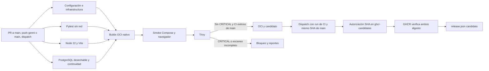

# INIT-006 — Integración continua y candidatos GHCR

## Alcance

El CI se ejecuta con permisos de lectura. La publicación manual utiliza los OCI probados y escaneados de un CI exitoso del mismo SHA de `main`. El manifiesto conserva el bloqueo de producción, `production_approved: false`, y ALT-06 sigue pausada. Se trabaja sobre `genni@8a049c4` con cambios acumulados sin commit. La validación realizada en esta fase es local. GitHub Actions, GHCR y AWS quedan pendientes de autorización y ejecución. [Gobernanza](../../AGENTS.md), [handoff de INIT-005](INIT-005-automatizacion-continuidad.md#handoff-para-init-006)



## Archivos y jobs

```text
.github/workflows/{ci,publish}.yml
deploy/scripts/candidate.py
deploy/tests/{ci-stack.sh,ci-images.sh,ci_checks.py}
frontend/tests-e2e/{run-ci.mjs,package.json,package-lock.json}
.gitattributes
docs/devops/INIT-006-integracion-continua.md
docs/devops/evidencias/init-006/
```

`.gitattributes` fija LF para workflows y código E2E. Los helpers reutilizan Dockerfiles, Compose, migraciones, tests RLS, ensayo de continuidad y pruebas de PromQL. La dependencia de navegador vive en el directorio E2E fuera del contexto frontend.

| Workflow y job | Responsabilidad |
|---|---|
| CI · `static` | actionlint, ShellCheck, Bash, YAML/JSON, LF, patrones de secretos, bases Docker por digest, provisioning, promtool, Caddy y systemd. |
| CI · `backend` | Target `test`, pip check, Pytest sin red y JUnit sanitizado. |
| CI · `frontend` | Node 22, npm ci con caché por lockfile, TypeScript, build Vite, salida PWA y detección de patrones de secretos en dist. |
| CI · `postgres` | PostgreSQL 18.0 fijado por digest, socket local y sin red. Migraciones, restore, SHA-256, fallos, RLS activo, CHECK de stock y FK. |
| CI · `images` | Tras los cuatro jobs previos, Buildx OCI, smoke Compose, E2E, Trivy y manifiesto del candidato. |
| Publish · `verify-ci` | Comprueba por API el workflow, repositorio, rama y misma revisión de un CI exitoso. |
| Publish · `publish` | Exige SHA autorizado, descarga el artefacto de ese intento, vuelve a verificar archivos y publica sin reconstrucción. |

CI se activa por PR a `main`, push a `genni` y `main`, y despacho manual. La concurrencia cancela CI obsoleto del mismo evento, referencia y arquitectura. Un push a `genni` con PR abierto conserva la cobertura del commit y del resultado de integración. Se mantienen las convenciones de ramas `feature/`, `fix/`, `infra/`. Publish se limita a despacho manual desde `main`.

CI tiene `contents: read`, sin credenciales persistidas por checkout. Verificar el run y descargar el artefacto requieren `actions: read`. Solo la publicación concede `packages: write`. El token de GitHub se pasa por stdin para GHCR y el authfile es temporal. Los runners son alojados por GitHub. El ensayo usa la app de memoria, PostgreSQL y Pytest con red deshabilitada y navegador limitado a localhost.

| Action | Versión y SHA firmado comprobado en el repositorio oficial |
|---|---|
| Checkout | v7.0.0 · `9c091bb21b7c1c1d1991bb908d89e4e9dddfe3e0` |
| Setup Node | v7.1.0 · `949feb2413d6458794dcd2491c4babbbce0c15c1` |
| Upload Artifact | v7.0.0 · `bbbca2ddaa5d8feaa63e36b76fdaad77386f024f` |
| Download Artifact | v8.0.0 · `70fc10c6e5e1ce46ad2ea6f2b72d43f7d47b13c3` |

[Checkout](https://github.com/actions/checkout/releases/tag/v7.0.0), [Setup Node](https://github.com/actions/setup-node/releases/tag/v7.1.0), [Upload Artifact](https://github.com/actions/upload-artifact/releases/tag/v7.0.0), [Download Artifact](https://github.com/actions/download-artifact/releases/tag/v8.0.0)

Se fijan las imágenes de actionlint 1.7.12, Trivy 0.76.2, Skopeo 1.21.0 y PostgreSQL 18.0 por digest. Playwright Core 1.65.1 está fijado en su lockfile. Los controles de secretos informan conteos sin mostrar valores. Las credenciales demo históricas forman parte de los bloqueos de INIT-001.

## OCI, smoke y arquitectura

Buildx genera un OCI por componente. Skopeo lo prepara para carga Docker. Se comprueba el hash exacto de configuración del tar, el orden e identidad de las capas descomprimidas, los labels OCI y la arquitectura en Docker Engine. En Docker Desktop el ID asignado a una imagen cargada puede ser diferente del config digest del OCI. El smoke usa copias de las mismas capas e incluye los siete servicios, puertos privados, Caddy, Nginx, imports, usuario 10001, un worker y guard de producción 78. Comprueba tres targets, tres dashboards, siete reglas, ALT-06 pausada y una muestra histórica de Prometheus. El alcance de cAdvisor puede variar según el runner. [Exportadores OCI](https://docs.docker.com/build/exporters/oci-docker/)

El E2E reutiliza login demo, venta ficticia, Kardex, historial y predicción sintética. El wrapper comprueba logout, registro de service worker, rutas protegidas y que la respuesta privada de la API esté ausente offline. En PostgreSQL se valida RLS habilitado y presencia de políticas con el stub de INIT-005. La prueba de aislamiento efectivo entre usuarios en Supabase sigue pendiente.

Configuración estándar `ubuntu-24.04`, `linux/amd64`. El despacho `arm64` requiere `CI_ARM64_ENABLED=true`, runner `ubuntu-24.04-arm` e identidad de arquitectura del Engine. Los cuatro jobs previos se conservan en amd64 y las comprobaciones de runtime, Compose y navegador se ejecutan en la plataforma candidata. Los manifests de Python, Node, Nginx, cAdvisor, Trivy y Skopeo incluyen amd64 y ARM64. Quedan pendientes runner disponible, build y prueba nativa, wheels, OpenMP de LightGBM, psycopg2 y compatibilidad de los demás servicios en ARM64. QEMU se puede evaluar para empaquetado. [Runners alojados](https://docs.github.com/en/actions/reference/runners/github-hosted-runners)

## Seguridad, GHCR y manifiesto

Trivy revisa paquetes del sistema, las bibliotecas detectables y la configuración de ambas imágenes. También analiza el lockfile frontend y sus dependencias de desarrollo. Reportes JSON y log quedan como evidencia. CRITICAL o un reporte requerido ausente bloquean el artefacto publicable. HIGH exige revisión. Resolver aplicabilidad y versión corregida con Desarrollo antes de modificar dependencias. [Trivy](https://trivy.dev/docs/latest/guide/target/container_image/)

Solo el CI exitoso de `main` conserva archivos OCI publicables. Nombres `ghcr.io/<owner>/<repositorio>-backend` y `ghcr.io/<owner>/<repositorio>-frontend`, normalizados a minúsculas. Etiqueta `candidate-<sha-completo>-<arch>-<ci-run-id>-<attempt>`. El despacho verifica la autorización exacta `GHCR_APPROVED_SHA` del administrador, el run y la integridad de los archivos antes del login. La copia usa `--preserve-digests` y compara el manifest remoto. Se impide reemplazar etiquetas si el digest difiere. Si solo una copia se completa, el job no emite `release.json`. Se puede reintentar con el mismo artefacto. [GHCR](https://docs.github.com/en/packages/working-with-a-github-packages-registry/working-with-the-container-registry), [Skopeo](https://github.com/podman-container-tools/skopeo/blob/main/docs/skopeo-copy.1.md)

`candidate.json` registra repositorio, SHA, arquitectura, UTC, identificación de build, estados de pruebas y escaneo, imagen, digest OCI, config digest y SHA-256 de cada tar, hashes de archivos de configuración y bloqueos. El ensayo local marca `build.source=working-tree` y no incluye un run ID de GitHub. `release.json` añade identificación de publicación y `registry_verified: true` después de verificar ambos digests. INIT-008 debe consumir `imagen@sha256:...` y el SHA de configuración.

La retención inicial es 5 días para reportes, 3 para OCI y 14 para release, ajustables con `CI_REPORT_RETENTION_DAYS`, `CI_OCI_RETENTION_DAYS` y `CI_RELEASE_RETENTION_DAYS`. Se excluyen entornos, tokens, dumps, estado del navegador y los detalles crudos de Pytest. Los costos dependen de minutos, almacenamiento y transferencia. Los OCI solo se guardan en CI exitoso de main, la ejecución ARM64 es opt-in y se usa caché npm. Mantener un registro aprobado de releases retenidos para rollback independiente de la expiración del artefacto de Actions. [Facturación de Actions](https://docs.github.com/en/billing/concepts/product-billing/github-actions)

## Reproducción local

Desde la raíz, con Docker Engine Linux, Buildx, Compose, Bash, Python 3.12, PyYAML para las pruebas estáticas y Node 22. En Windows se puede usar Docker Desktop y Git Bash. Configurar `GITHUB_REPOSITORY` con el owner/repositorio real de origin.

```bash
lab=$(mktemp -d)
project=buenvecino-init006
if [[ -n $(docker ps -aq --filter "label=com.docker.compose.project=$project") ]]; then
  project="buenvecino-ci-local-$(date +%s)"
fi
export GITHUB_SHA="$(git rev-parse HEAD)"
export CI_ARCH=amd64
docker build --target test -t minimarket-backend:ci-tests ./backend
docker run --rm --network none minimarket-backend:ci-tests
docker run --rm --network none minimarket-backend:ci-tests python -m pip check
(cd frontend && npm ci --no-audit && npm run build)
python3 deploy/tests/ci_checks.py bundle frontend/dist
bash deploy/tests/ci-stack.sh static "$lab" "$project"
bash deploy/tests/ci-stack.sh postgres "$lab" "$project"
bash deploy/tests/ci-images.sh build "$lab" "$project"
npm --prefix frontend/tests-e2e ci --no-audit
(cd frontend/tests-e2e && node node_modules/playwright-core/cli.js install chromium)
CI_BACKEND_IMAGE=minimarket-backend:$project CI_FRONTEND_IMAGE=minimarket-frontend:$project \
  CI_RUN_E2E=1 bash deploy/tests/ci-stack.sh smoke "$lab" "$project"
bash deploy/tests/ci-images.sh scan "$lab" "$project"
python3 deploy/scripts/candidate.py create "$lab" --repository "$GITHUB_REPOSITORY" \
  --sha "$GITHUB_SHA" --arch "$CI_ARCH" --source working-tree --tests passed
python3 deploy/scripts/candidate.py verify "$lab" --repository "$GITHUB_REPOSITORY" \
  --sha "$GITHUB_SHA" --arch "$CI_ARCH"
```

El helper smoke exige un nombre de proyecto nuevo y ejecuta `stop` al salir, conservando sus volúmenes. PostgreSQL desechable se elimina por nombre exacto. Para el navegador local se puede indicar `PLAYWRIGHT_CHROMIUM_EXECUTABLE`. Si OneDrive mantiene binarios abiertos, compilar en un contenedor Node 22 con el checkout RO y su copia de trabajo temporal.

## Activación remota tras autorización

1. Revisar y autorizar los commits de INIT-002–006. Publicar la rama mediante el proceso de PR acordado y comprobar que el workflow está en la rama por defecto.
2. Esperar CI exitoso en el SHA revisado de `main`. Confirmar arquitectura, reporte de Trivy y artefacto OCI. Anotar run ID e intento.
3. Acordar visibilidad y acceso de paquetes con el administrador. Configurar `ghcr-candidates` para `main`, proteger con revisores si el plan lo permite y definir `GHCR_APPROVED_SHA` con el SHA completo autorizado. Si el plan no permite los controles exigidos, mantener la publicación pendiente. Retirar o renovar el SHA después del despacho. [Entornos](https://docs.github.com/en/actions/how-tos/deploy/configure-and-manage-deployments/manage-environments)
4. Ejecutar **Publicar candidato en GHCR** desde `main` con `ci_run_id` y `architecture`. Revisar aprobación, referencias de GHCR y ambos digests. Guardar `release.json` y evidencia del run. [Eventos Actions](https://docs.github.com/en/actions/reference/workflows-and-actions/events-that-trigger-workflows#workflow_dispatch)

## Handoff para INIT-007 e INIT-008

Cloud debe entregar cuenta y región de AWS, VPC/subred/rutas, arquitectura y tipo de EC2 confirmados, AMI Ubuntu, EBS, política DNS/TLS, conectividad Supabase con TLS, Instance Profile S3 y canal de avisos. Confirmar repositorio y visibilidad de cada paquete GHCR, acceso de lectura para el host con rotación aprobada y configuración de administración por SSM con IAM y auditoría o SSH con acceso limitado y host verificado. Entregar nombres de variables y secretos por canal autorizado, sin valores en manifiestos.

| Destino | Parámetros y credenciales a entregar |
|---|---|
| GitHub y GHCR | Owner/repo real, visibilidad privada aprobada, `GHCR_APPROVED_SHA`, revisión de entorno, acceso Actions/Packages y cuenta o mecanismo de lectura de paquetes para EC2. |
| Compose EC2 | `BACKEND_IMAGE`, `FRONTEND_IMAGE` fijados por digest, `SITE_ADDRESS`, `ACME_EMAIL`, `ACME_CA`, `MONITORING_TEXTFILE_DIR`, `GRAFANA_ADMIN_USER` y `GRAFANA_ADMIN_PASSWORD` bajo custodia. |
| Aplicación y continuidad | `DATABASE_URL`, `SECRET_KEY` y RBAC pendiente con Desarrollo. `AWS_REGION`, `AWS_S3_BACKUP_BUCKET`, identidad de backup, `BACKUP_PG_SERVICE`, `PGSERVICEFILE`/ `PGPASSFILE` y CA aprobada desde el host. |
| Despliegue | ID EC2, arquitectura, mecanismo SSM/SSH, path de trabajo, digest de ambos candidatos, SHA de configuración, canal de escalamiento y fecha de validación del rollback. |

INIT-008 necesita release con digests verificados, arquitectura, SHA de configuración, versión anterior compatible y política de retención. El futuro despliegue debe verificar aprobación y digests, usar Compose fijado por digest, verificar liveness y readiness, mantener pares de imágenes y proceder con rollback compatible con estado, migraciones y secretos. Persistencia obligatoria, autenticación, JWT, RBAC, permisos SQL y comprobantes siguen en Desarrollo. ALT-06 exige un respaldo S3 comprobado.

### Alineación académica

Capítulo 8, procesamiento reproducible. Capítulo 10, permisos, integridad y escaneo. Capítulo 11, regresión de targets, paneles y alertas. Capítulo 12, continuidad, respaldo y rollback. Capítulo 13, consumo y retención. Gestión del proyecto, evidencia por job, SHA, digest e intento.

## Resultados reales

Ensayo del 26 de noviembre de 2026 sobre `genni@8a049c4` y el working tree, en Docker Desktop 28.5.1 Linux/amd64, Compose 2.40.2 y Buildx 0.29.1. Actionlint y ShellCheck pasaron. El primer npm ci en Windows encontró binarios abiertos en OneDrive. Se repuso la instalación local y se reprodujo la compilación en un contenedor Node 22.23.5 con el checkout en solo lectura.

| Comprobación | Estado |
|---|---|
| Dos workflows, Bash/LF, YAML/JSON, Caddy y systemd estático | **PASS** |
| Backend, dependencias y JUnit | **PASS** · 20 aprobadas, 0 fallidas, 0 omitidas |
| Node 22, composición Vite y PWA | **PASS** |
| PostgreSQL 18.0 aislado, RLS activo, restricciones, SHA-256 y restauración | **PASS** |
| OCI amd64, paridad de capas, `nginx -t`, imports y salida 78 | **PASS** |
| Compose, siete servicios, tres scrapes, tres dashboards, siete reglas y persistencia TSDB | **PASS** |
| Fixture E2E en Chrome local, logout y API ausente offline | **PASS** |
| Trivy de ambas imágenes y lockfile, manifiesto candidato, rechazo de plataforma incongruente | **PASS** |
| Build y pruebas nativas ARM64, GitHub Actions, GHCR y AWS | **NOT RUN** |
| Promoción productiva | **BLOCKED** · INIT-001, verificación S3 y aprobaciones futuras |

Trivy 0.76.2 usó una base actualizada el `2026-11-26T13:14:47Z`. Conteos por ocurrencia y objetivo escaneado.

| Objetivo | CRITICAL | HIGH | MEDIUM | LOW | UNKNOWN |
|---|---:|---:|---:|---:|---:|
| Imagen backend | 0 | 54 | 105 | 99 | 15 |
| Imagen frontend | 0 | 1 | 5 | 0 | 0 |
| Lockfile frontend | 0 | 0 | 2 | 0 | 0 |

En backend, los 54 HIGH proceden de paquetes Debian. En frontend, el HIGH es `DS-0002` por el usuario de inicio de la imagen Nginx. Revisar con Desarrollo y Cloud la aplicabilidad de los avisos Debian y una configuración no-root de Nginx que mantenga las rutas y permisos actuales. Los conteos representan hallazgos del scanner, algunos repetidos por paquete. Repetir con la base actualizada sobre el candidato de `main`.

Los dos tar OCI sumaron aproximadamente 231 MB decimales en este ensayo. El manifiesto local queda en estado `validated`, con `registry_verified: false` y `production_approved: false`. Solo se detuvo el Compose de INIT-006 y se conservaron sus cinco volúmenes. PostgreSQL y BuildKit del ensayo se retiraron. 

- [Validaciones locales](evidencias/init-006/validaciones-locales.txt)
- [JUnit sanitizado](evidencias/init-006/pytest.xml)
- [Hallazgos Trivy](evidencias/init-006/trivy-resumen.json)
- [Manifiesto OCI local](evidencias/init-006/candidate-local.json)

## Git

`git status --short --branch --untracked-files=all` muestra `genni`, 11 archivos rastreados modificados y 65 sin rastrear. `git diff --stat` acumulado muestra 11 archivos, 412 inserciones y 315 eliminaciones. Incluye las iniciativas anteriores y excluye los archivos sin rastrear. Continúan los avisos de finales de línea de archivos anteriores. No hubo commits ni push.

Agrupación propuesta

1. Conservar INIT-002 a INIT-005 en commits separados por contenedores, proxy, observabilidad y continuidad conforme a sus handoffs.
2. `feat: automatizar validaciones y build OCI en GitHub Actions`
3. `test: ejecutar los fixtures E2E y verificar la PWA`
4. `feat: publicar candidatos GHCR con aprobación y digest verificado`
5. `docs: registrar el CI, evidencias y handoff de INIT-006`
