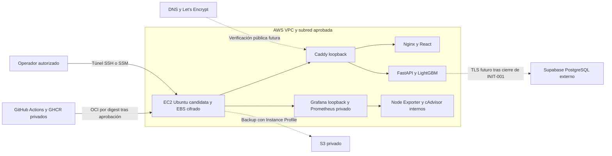

# INIT-007 — Integración DevOps con AWS

## Estado verificado

| Subfase | Estado | Alcance |
|---|---|---|
| INIT-007A | PASS | Contrato, preflight, validación de release, runbook y pruebas sin AWS. |
| INIT-007B | BLOCKED | Falta un contrato con recursos reales y autorización de lectura de la cuenta, el host y los endpoints. |
| INIT-007C | BLOCKED | Falta EC2 autorizada, capacidad/arquitectura confirmadas, acceso privado y origen de imágenes compatible para fixtures. |

La API pública de GitHub confirmó `genni@6c14322f9b5033d7853017b6164ae8168bb42894`, commit «Subiendo avance DevOps», y el CI #1 con cinco jobs exitosos. Run ID `45861866603`, 5 min 14 s entre inicio y última actualización. Los pasos de Trivy y del gate crítico finalizaron con éxito. La retención del OCI de publicación se omitió por ejecutarse en `genni`. Los cinco artefactos están listados. La descarga del reporte de imágenes devolvió HTTP 401 sin autenticación. La consulta anónima de GHCR devolvió HTTP 403 para los dos paquetes. El estado de publicación, sus digests y los conteos remotos de Trivy siguen sin confirmarse. [CI #1](https://github.com/Joan2022Laurente/minimarket-stock-ia/actions/runs/45861866603)

INIT-001 sigue parcial. El entrypoint del backend conserva el código 78 en modo productivo. Siguen pendientes autenticación persistente, demo y contraseñas genéricas, JWT, RBAC, persistencia obligatoria, comprobantes, permisos SQL efectivos y `/ready`. El respaldo real e IAM quedan sujetos a autorización. ALT-06 sigue pausada. [Gobernanza](../../AGENTS.md), [INIT-006](INIT-006-integracion-continua.md#handoff-para-init-007-e-init-008)

## Arquitectura y datos de Cloud



Servicios principales de AWS previstos. EC2 y EBS, VPC y subred pública o privada de acuerdo con el acceso, IGW cuando exista ruta pública, tablas de rutas, SG, S3, IAM y AWS Budgets. SSM, IPv4 estática mediante Elastic IP, CloudWatch, Route 53 y Parameter Store dependen de aprobación y costo. El diseño inicial usa Docker Compose en una sola instancia.

Dentro de EC2 quedan Ubuntu, Docker Engine/Compose, Caddy, Nginx, React, FastAPI, LightGBM, Prometheus, Grafana, Node Exporter, cAdvisor, Bash, Python, systemd, AWS CLI y cliente PostgreSQL. Fuera de la cuenta quedan Supabase, GitHub, Actions, GHCR, Docker Hub, Let's Encrypt y el DNS externo si se aprueba.

**Datos confirmados de AWS**. AWS es el proveedor elegido. Graviton/ARM64 es la propuesta histórica. Las imágenes y pruebas previas amd64 corresponden a laboratorio. Faltan región y presupuesto, cuenta, ID/tipo/AMI y plataforma efectiva, RAM y vCPU, EBS cifrado y su capacidad real, VPC/subred/rutas/IGW/SG, perfil IAM, acceso e IP, buckets, DNS, endpoint aprobado de Supabase y release de GHCR. Cloud debe entregar los datos por el canal acordado. [Contrato JSON y fuentes de cada dato](../../infra/aws/README.md), [reglas de red](../../infra/aws/security-groups.md), [ADR de arquitectura](../adrs/0001-aws-graviton-provider.md)

No extrapolar el CI amd64 a ARM64 en EC2. En la plataforma autorizada verificar manifests de las siete imágenes, librerías de LightGBM y psycopg2, `libgomp`, CPU/RAM/espacio, ingestión TSDB y E/S de EBS. En una instancia burstable, registrar modo de créditos, saldo y consumo durante el ensayo. El efecto del entrenamiento se mide por separado y con fixtures.

## Implementación de INIT-007A

- `infra/aws/` contiene el contrato JSON sin valores reales, su guía y reglas de red.
- `deploy/scripts/ec2-preflight.sh` llama a `ec2_preflight.py`. Inspecciona Linux, arquitectura, CPU, RAM visible, filesystem y disco libre, herramientas, reloj, listener local, permisos y Docker Engine local. Por defecto no consulta AWS, no establece conexión PostgreSQL y no instala paquetes.
- `candidate.py verify-release` comprueba un `release.json` obtenido del run autorizado. Exige repositorio, SHA, plataforma, run de publicación, hashes del checkout, escaneo sin CRITICAL, par de imágenes y estado publicado. Imprime referencias inmutables. Rechaza el manifiesto local, discrepancias de arquitectura y cualquier uso productivo mientras siga INIT-001. La validación es local y no autentica por sí sola el origen del JSON ni consulta GHCR.
- `deploy/tests/test_ec2_preflight.py` cubre el diagnóstico y el contrato de releases con fixtures. `.gitignore` deja fuera la copia local con datos operativos.

```bash
python3 -m unittest discover -s deploy/tests -p test_ec2_preflight.py -v
bash -n deploy/scripts/ec2-preflight.sh
shellcheck deploy/scripts/ec2-preflight.sh
bash deploy/scripts/ec2-preflight.sh --contract-only
```

La plantilla devuelve 3 porque los campos están pendientes. Para CI local de configuración, ejecutar `bash deploy/tests/ci-stack.sh static "$TEMP_DIR" buenvecino-ci-init007` con un directorio temporal existente. Se reutilizan los controles de Compose/Grafana/Promtool/Caddy sin repetir el CI completo.

## Runbook B — Validación de infraestructura real

### 1. Autorización y acceso

Obtener autorización de lectura y el contrato por el canal de Cloud. Su identidad de inspección requiere lectura EC2 de instancia, tipo, AMI, EBS y VPC/SG/rutas, lectura de configuración de los buckets declarados y consulta de presupuesto cuando aplique. Separar esa identidad del Instance Profile runtime. Validar SG, IMDS, egress, arquitectura y almacenamiento antes de operar. Los comandos de describe se detallan en [reglas de red](../../infra/aws/security-groups.md).

Preferir SSM si el agente está disponible, tiene permisos acotados y conecta a los endpoints regionales. En el cliente usar Session Manager plugin. Abrir un túnel por puerto mediante sesiones separadas:

```bash
aws ssm start-session --region "$AWS_REGION" --target "$INSTANCE_ID" \
  --document-name AWS-StartPortForwardingSession \
  --parameters '{"portNumber":["3000"],"localPortNumber":["3000"]}'
# Para la aplicación sustituir ambos 3000 por 8080 en otra sesión.
```

Si se autoriza SSH, usar el CIDR administrativo, llave fuera del repo, host fingerprint entregado por Cloud y verificación estricta:

```bash
ssh -N -T -o StrictHostKeyChecking=yes -o ExitOnForwardFailure=yes \
  -L 127.0.0.1:8080:127.0.0.1:8080 -L 127.0.0.1:3000:127.0.0.1:3000 \
  "$EC2_USER@$EC2_ADDRESS"
```

[Inicio de sesión y túneles SSM](https://docs.aws.amazon.com/systems-manager/latest/userguide/session-manager-working-with-sessions-start.html)

### 2. Preflight de host y preparación Linux

Tras acceder a EC2 por el mecanismo autorizado, ejecutar primero diagnóstico. Añadir flags de red únicamente para destinos y cuenta autorizados:

```bash
bash deploy/scripts/ec2-preflight.sh --contract "$CONTRACT"
bash deploy/scripts/ec2-preflight.sh --contract "$CONTRACT" --identity
bash deploy/scripts/ec2-preflight.sh --contract "$CONTRACT" --supabase-tls --pg-ca-file "$PG_CA_FILE"
```

`--identity` compara instancia, tipo, AMI, región y arquitectura con el documento IMDSv2, y el perfil con IAM metadata. No lee claves del endpoint de credenciales. Verificar `HttpTokens=required` por DescribeInstances. `--supabase-tls` informa familias DNS utilizables y tiempo del sondeo, con SNI y verificación TLS del nombre. El sondeo no autentica ni ejecuta SQL. [Opciones IMDS](https://docs.aws.amazon.com/AWSEC2/latest/UserGuide/configuring-instance-metadata-options.html), [TLS Supabase](https://supabase.com/docs/guides/database/psql)

Si se aprueba Ubuntu 24.04 y **se autoriza instalar software**, usar el repositorio oficial de Docker para Ubuntu. Verificar arquitectura y paquetes existentes antes de preparar apt. No cambiar usuarios o grupos que ya existan sin revisión.

```bash
sudo apt-get update
sudo apt-get install -y ca-certificates curl python3 jq iproute2 dnsutils openssl util-linux tzdata
sudo install -m 0755 -d /etc/apt/keyrings
sudo curl -fsSL https://download.docker.com/linux/ubuntu/gpg -o /etc/apt/keyrings/docker.asc
sudo chmod a+r /etc/apt/keyrings/docker.asc
. /etc/os-release
printf '%s\n' 'Types: deb' 'URIs: https://download.docker.com/linux/ubuntu' \
  "Suites: ${UBUNTU_CODENAME:-$VERSION_CODENAME}" 'Components: stable' \
  "Architectures: $(dpkg --print-architecture)" 'Signed-By: /etc/apt/keyrings/docker.asc' \
  | sudo tee /etc/apt/sources.list.d/docker.sources >/dev/null
sudo apt-get update
sudo apt-get install -y docker-ce docker-ce-cli containerd.io docker-buildx-plugin docker-compose-plugin
sudo apt-get install -y "postgresql-client-$PG_MAJOR"
docker compose version
pg_dump --version
```

Seleccionar `PG_MAJOR` tras conocer la versión de Supabase. Si el paquete no existe en la distribución, acordar el repositorio oficial PostgreSQL y verificar compatibilidad antes de instalar. Para AWS CLI v2 usar el ZIP oficial según `uname -m` y comprobar su firma antes de `sudo ./aws/install`. No agregar usuarios indiscriminadamente al grupo Docker. Mantener UTC/NTP en el host, timezone America/Lima en el calendario y rotación Compose existente. Aplicar parches en ventana acordada. [Docker en Ubuntu](https://docs.docker.com/engine/install/ubuntu/), [AWS CLI v2](https://docs.aws.amazon.com/cli/latest/userguide/getting-started-install.html)

Preparar `/opt/buenvecino` para el checkout revisado, `/etc/buenvecino` para configuración restringida, `/var/lib/buenvecino/releases` para manifiestos aprobados y `/var/lib/buenvecino/backup` para temporales (0700). Directorios `textfile` y `textfile-lab` separados, con owner `buenvecino-ops` y lectura para Node Exporter. Usar journald y la rotación de Docker. Reservar `/var/log/buenvecino` solo si se acuerdan archivos de log con su propia rotación. Los archivos de entorno y libpq tienen acceso restringido, con pgpass 0600. Aplicar la receta de rutas y permisos de INIT-005 y comprobarla mediante `setup.sh --check`. [Preparación Linux y systemd](INIT-005-automatizacion-continuidad.md#preparación-futura-de-ubuntu-después-de-aprobación)

### 3. S3, Supabase y DNS

Cloud verifica región, Block Public Access, default SSE-S3, versionamiento y Lifecycle mediante `aws s3api get-bucket-location`, `get-public-access-block`, `get-bucket-encryption`, `get-bucket-versioning` y `get-bucket-lifecycle-configuration`. El productor runtime necesita PutObject y lectura para HEAD/descarga de verificación, incluyendo GetObjectVersion cuando haya versión. Limitar al bucket de laboratorio y los prefijos de backup. La identidad que verifica configuración de bucket es distinta; los permisos de administración y borrado quedan fuera del productor. [Operaciones S3](https://docs.aws.amazon.com/AmazonS3/latest/API/Welcome.html)

Separar objetos de catálogo, comprobantes privados, backups y artefactos de modelo. Usar un **bucket de laboratorio dedicado** para el fixture S3, con permisos para `backups/daily/` y `backups/weekly/`, que son los prefijos que usa `backup.sh`. Tras autorizar escritura y con un origen PostgreSQL de prueba con TLS, aplicar `backup.sh --storage s3` y `restore.sh` de INIT-005 con env/libpq protegidos. Validar versión, checksum remoto, restauración aislada y textfile en `textfile-lab`. Ante error verificar que la muestra anterior permanezca. Mantener siete diarios y cuatro semanales del diseño previo. La transferencia de un fixture acredita el mecanismo de laboratorio; ALT-06 requiere respaldo real y aprobación independiente. [Contrato de backup](INIT-005-automatizacion-continuidad.md#exportación-integridad-y-conservación)

Para Supabase, usar los datos exactos del panel Connect. El endpoint directo necesita la familia IP que el proyecto soporte. Para IPv4 sin salida IPv6 ni add-on puede corresponder el pooler de sesión en puerto 5432. Validar CA, hostname y timeouts. Tras autorización para conectar, hacer únicamente una consulta de lectura con identidad aprobada y libpq protegido:

```bash
PGCONNECT_TIMEOUT=5 psql -X -w \
  "service=$PG_SERVICE sslmode=verify-full" -v ON_ERROR_STOP=1 -c 'SELECT 1'
```

`/health` acredita el proceso del backend, mientras `/ready` aún no está. Con pooler distinguir TLS cliente→pooler de TLS pooler→PostgreSQL. El backup existente verifica `pg_stat_ssl`; si el pooler no cumple ese criterio, revisar SSL Enforcement o el endpoint directo antes de continuar. [Conexión directa y pooler](https://supabase.com/docs/guides/database/connecting-to-postgres), [TLS y pg_stat_ssl](https://supabase.com/kb/troubleshooting/pg_stat_ssl-shows-ssl-false-when-connecting-via-the-connection-pooler-59edc3)

Para DNS verificar A/AAAA contra la IP y la familia autorizadas, y que SG/route table correspondan. Decidir estabilidad de IP o Elastic IP con impacto en costo. Hasta cerrar INIT-001, validar Caddy de forma estática y sin red. En una fase aparte y autorizada, usar primero ACME staging de Caddy con hostname y `ACME_EMAIL` aprobados, exposición temporal de los puertos que exija el desafío y persistencia de `caddy_data` / `caddy_config`. Verificar TLS, cadena, redirección, HSTS y renovación antes de plantear ACME de producción.

## Runbook C — Laboratorio privado

Usar el proyecto `buenvecino-ec2-lab`. En un entorno aprobado, recibir `release.json` directamente de un run exitoso de `publish.yml` del mismo SHA de `main`. Con el checkout de esa revisión y valores autorizados:

```bash
refs=$(python3 deploy/scripts/candidate.py verify-release "$RELEASE_JSON" \
  --repository "$REPO" --sha "$RELEASE_SHA" --arch "$ARCH" --publish-run "$PUBLISH_RUN_ID")
export BACKEND_IMAGE=$(jq -er '.BACKEND_IMAGE' <<< "$refs")
export FRONTEND_IMAGE=$(jq -er '.FRONTEND_IMAGE' <<< "$refs")
docker pull --platform "linux/$ARCH" "$BACKEND_IMAGE"
docker pull --platform "linux/$ARCH" "$FRONTEND_IMAGE"
docker image inspect "$BACKEND_IMAGE" "$FRONTEND_IMAGE" --format '{{.Os}}/{{.Architecture}} {{json .RepoDigests}}'
```

En paquetes privados, usar credencial aprobada de solo lectura para ambos paquetes. Si se adopta PAT clásico, limitarlo a `read:packages` y habilitar SSO si corresponde. Usar `docker login ghcr.io --username "$GHCR_USER" --password-stdin` con el gestor aprobado, configuración Docker protegida, rotación y logout al finalizar. El `GITHUB_TOKEN` de Actions es para el job autorizado. Sin candidato GHCR verificable, el laboratorio solo puede usar imágenes de fixture autorizadas de su arquitectura, con referencias locales separadas. Se mantiene el gate `main`, CI del mismo SHA, `ghcr-candidates` y `GHCR_APPROVED_SHA`. GitHub confirmó `main` como rama por defecto, y la consulta de ejecuciones de `publish.yml` devolvió 404. [GHCR y auth](https://docs.github.com/en/packages/working-with-a-github-packages-registry/working-with-the-container-registry)

Crear el env de laboratorio protegido con `SECRET_KEY` y `GRAFANA_ADMIN_PASSWORD` exclusivos de fixtures, `DATABASE_URL` vacía y `MONITORING_TEXTFILE_DIR=/var/lib/buenvecino/textfile-lab`. Configurar las imágenes explícitas y retener el archivo fuera del checkout.

```bash
args=(--project buenvecino-ec2-lab --env-file "$LAB_ENV" --mode local)
bash deploy/scripts/start.sh "${args[@]}"
bash deploy/scripts/healthcheck.sh "${args[@]}" --textfile-dir /var/lib/buenvecino/textfile-lab
```

Ejecutar las verificaciones entre inicio y detención mediante los túneles de 8080 y 3000. Confirmar bindings, rutas(`/health`, `/metrics` 404), siete servicios, tres targets, tres dashboards, siete reglas, retención TSDB de siete días y cAdvisor observando los contenedores. Comparar `node_exporter` con `free`, `findmnt`, `lsblk`, `ip -brief addr` y uptime. Confirmar si la métrica de red refleja el namespace esperado. Medir CPU, memoria, espacio libre, EBS, E/S y créditos CPU en reposo y con un escenario funcional de fixtures. Registrar versiones y hora. No interpretar métricas de Docker Desktop como métricas de EC2.

Al cerrar el ensayo ejecutar `bash deploy/scripts/stop.sh "${args[@]}"` con el mismo archivo de entorno y proyecto. Conservar los volúmenes y sanitizar el registro de resultados.

Validar systemd con `systemd-analyze verify` sobre las cuatro unidades. Respaldo a las 03:00 America/Lima, sondeo cada 15 s, timeout, lock y journald. Verificar /etc/buenvecino y textfile. La activación de timers queda sujeta a autorización. Evaluar CloudWatch si se necesita visibilidad ante caída de EC2. Una caída de la instancia interrumpe Grafana y Prometheus locales.

## Revisión de hallazgos HIGH y costo

El informe **local** INIT-006 registra 54 ocurrencias HIGH Debian, 14 CVE distintos. 36 ocurrencias están asociadas a los cuatro avisos compartidos por binarios y bibliotecas de util-linux. La presencia de esos paquetes acredita superficie instalada. Para priorizar, revisar versión, corrección de Debian y si el proceso real carga la biblioteca o permite invocar el ejecutable. Debian confirma la corrección de `CVE-2026-124851` para trixie en `1.5.7+dfsg-1+deb13u1`. El laboratorio reportó `libzstd1` en `1.5.7+dfsg-1`. Es un candidato a actualización dirigida de la base/runtime, seguida de verificación de imports, un worker, E2E y un escaneo nuevo. Las otras ocurrencias requieren triage por CVE y paquete fuente. [Corrección Debian](https://security-tracker.debian.org/tracker/CVE-2026-124851), [reporte Trivy local](evidencias/init-006/trivy-resumen.json)

`DS-0002` aplica al arranque de la imagen frontend. El Dockerfile y la configuración de usuario de la imagen local muestran arranque predeterminado. Proponer en un cambio separado una base oficial Nginx sin privilegios, con revisión de puerto interno, PID/tempfiles, Caddy, healthcheck, caché y PWA. Validar el UID efectivo, rutas y escaneo en ambas arquitecturas antes de sustituir la imagen. [Nginx Unprivileged](https://github.com/nginx/docker-nginx-unprivileged)

Inventario potencialmente facturable. Cómputo EC2 y créditos si corresponden, EBS y snapshots, IPv4 pública/EIP, S3 por almacenamiento, versiones, requests y transferencia. Los opcionales CloudWatch, Route 53, endpoints privados o Parameter Store se evalúan según modalidad. GitHub Actions y GHCR dependen del plan, minutos, almacenamiento y transferencia. Sin región, uso, arquitectura y presupuesto aprobados no hay estimación definitiva ni consumo EC2 medido. Configurar AWS Budgets y alertas solo con aprobación. [EC2](https://aws.amazon.com/ec2/pricing/), [EBS](https://aws.amazon.com/ebs/pricing/), [IPv4 en VPC](https://aws.amazon.com/vpc/pricing/), [S3](https://aws.amazon.com/s3/pricing/)

## Handoff INIT-008

Cloud debe entregar región, ID EC2, AMI y plataforma, vCPU/RAM/EBS, acceso SSM o SSH y configuración de red/DNS. DevOps debe entregar ruta `/opt/buenvecino`, releases en `/var/lib/buenvecino/releases`, env protegido, proyecto de laboratorio `buenvecino-ec2-lab`, y nombre productivo aprobado posterior. El entorno define imágenes por digest, `ENVIRONMENT`, `SITE_ADDRESS`, `ACME_CA`, `ACME_EMAIL`, `MONITORING_TEXTFILE_DIR`, credenciales Grafana, DSN/JWT cuando Desarrollo cierre bloqueos, y parámetros de AWS y respaldo por canal seguro. 

Si se aprueba SSM para CD, usar identidad temporal OIDC con confianza limitada al repositorio y entorno aprobados. Acotar Run Command a la instancia y documento acordados. Confirmar por separado alcance SSH, verificación de host y rotación si se elige ese mecanismo. [OIDC GitHub con AWS](https://docs.github.com/en/actions/how-tos/secure-your-work/security-harden-deployments/oidc-in-aws)

Entregar ambos digests y run en `release.json` autenticado, sha del checkout, identidad de lectura GHCR y autorización de promoción. El futuro `deploy.yml` debe separar promoción, aprobación y verificación de readiness. Verificar el par de imágenes, el gate productivo, healthchecks y compatibilidad de migraciones. Un rollback requiere guardar el par anterior por digest, su SHA de configuración, cambios reversibles y compatibilidad de datos y volúmenes. `/ready` pendiente y ALT-06 pausada bloquean afirmaciones de disponibilidad productiva.

Alineación con el informe universitario. Capítulo 6 para arquitectura y contrato. 7 para VPC, SG y túneles. 8 para EC2, Docker y plataformas. 9 para EBS y S3. 10 para IAM, IMDS y permisos. 11 para métricas nativas. 12 para continuidad, timers y rollback. 13 para presupuesto y recursos facturables.

## Resultados y evidencias

| Prueba | Resultado y ámbito |
|---|---|
| Git, branch remoto y CI #1 | **PASS**. SHA, run, cinco jobs, pasos de Trivy y artefactos verificados mediante API pública. |
| Descarga Trivy remoto | **BLOCKED**. El ZIP requiere autenticación. Los conteos documentados pertenecen a INIT-006 local. |
| ShellCheck, Bash y 11 pruebas dirigidas | **PASS** local. Rechazo de ingress inseguro, CIDR incompatible, manifiesto sin publicar, plataforma distinta, CRITICAL y producción. |
| Preflight Linux de solo lectura | **PASS** de la prueba. Contenedor desechable sin red y sin socket Docker. El diagnóstico devolvió 3 por campos/capacidades pendientes. No son mediciones EC2. |
| Compose base y dev, Caddy dev/HTTPS, Nginx, Prometheus y Grafana | **PASS** local estático. Se usó env temporal, HTTPS de sintaxis sin certificados públicos, y se comprobó ALT-06 pausada. |
| Backend de la revisión actual | **PASS**. Imagen local aislada devolvió 78 al probar su guard productivo. |
| Timers | **PASS** estático de los archivos y calendario declarado. Activación y ejecución EC2 **NOT RUN**. |
| GHCR, IAM, S3, Supabase, SG reales, métricas nativas y laboratorio EC2 | **BLOCKED** por falta de acceso o datos autorizados. Pruebas reales **NOT RUN**. |

- [Evidencia de GitHub CI](evidencias/init-007/github-ci-1.json)
- [Validaciones locales y límites](evidencias/init-007/validaciones-locales.txt)

## Git y propuesta

La base confirmada es `genni@6c14322`, sin divergencia con `origin/genni` ni con la consulta pública de la rama al iniciar este trabajo. No se hicieron merge, commits ni push.

1. `infra: definir contrato AWS y preflight de EC2`
2. `feat: verificar releases GHCR para laboratorio por digest`
3. `test: cubrir preflight y gate de release sin red`
4. `docs: registrar runbook AWS y handoff de INIT-007`
