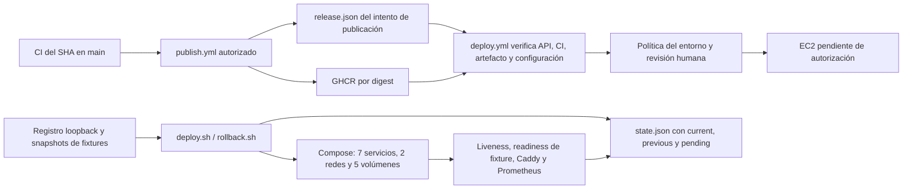

# INIT-008 — Despliegue continuo y recuperación de releases

El repositorio incorpora un verificador de releases de GitHub y un ciclo de despliegue y recuperación en Compose. El laboratorio usa imágenes de prueba fijadas por digest y reutiliza Caddy y el stack de observabilidad. La versión activa se confirma después de verificar liveness, readiness de fixture y rutas.

| Subfase | Estado | Condición |
|---|---|---|
| INIT-008A | PASS en laboratorio | El ciclo confirmó A, B y el rollback a A. Se conservó el marcador de datos y los cinco volúmenes. |
| INIT-008B | BLOCKED | INIT-007B/007C, EC2 autorizada, arquitectura, transporte y candidato verificable en GHCR. |
| INIT-008C | BLOCKED | Cierre de INIT-001, readiness real, revisión de escaneo por digest y autorización de producción, además de los requisitos anteriores. |

## Flujo



## GitHub Actions

`deploy.yml` usa `workflow_dispatch` desde `main`. Recibe `publish_run_id`, `git_sha` completo, `architecture` (`amd64` o `arm64`), `target` (`ec2-lab` o `production`) y `operation` (`verify`, `deploy` o `rollback`). El identificador resulta de SHA, plataforma, run e intento de publicación. Los jobs tienen tiempo límite y se serializan por entorno.

- **Procedencia.** La API identifica el run exitoso de `publish.yml` y verifica repositorio, rama, SHA e intento. El workflow exige un artefacto vigente con digest y activa `digest-mismatch: error`. `candidate.py verify-release` verifica los hashes de configuración, el escaneo y el contrato del par. La API comprueba el intento exacto de CI. Skopeo contrasta ambos manifiestos y sus configuraciones OCI con GHCR. El token de solo lectura se guarda temporalmente fuera del checkout. [Workflow runs de GitHub](https://docs.github.com/en/rest/actions/workflow-runs), [artefactos](https://docs.github.com/en/rest/actions/artifacts)
- **Protecciones.** El job exige un entorno con revisores requeridos, revisión propia bloqueada y la rama `main` como única regla. La ausencia de protecciones o permisos de lectura devuelve `BLOCKED`. Para `deploy` y `rollback` se verifica además en la API una aprobación independiente vinculada al entorno en un dispatch nuevo. [Entornos](https://docs.github.com/en/rest/deployments/environments), [políticas de ramas](https://docs.github.com/en/rest/deployments/branch-policies), [historial de aprobación](https://docs.github.com/en/rest/actions/workflow-runs#get-the-review-history-for-a-workflow-run)
- **Interfaz remota.** El job asociado al entorno informa `BLOCKED` y sale con código 3. El workflow usa permisos de lectura y carece de credenciales AWS e `id-token`. El contrato sigue exigiendo `production_approved: false`. `publish.yml` conserva el control de rama y `GHCR_APPROVED_SHA`. Checkout v7.0.0, download-artifact v8.0.0 y Skopeo usan las referencias inmutables de la integración precedente.

La ejecución GitHub y la lectura de paquetes quedan pendientes tras el push autorizado y la existencia de un candidato publicado. Una vez aprobados los cambios y las protecciones, ejecutar manualmente la operación `verify` desde el SHA en `main` con el run de publicación que le corresponde. Las operaciones de transporte permanecen bloqueadas para ambas plataformas.

```bash
gh workflow run deploy.yml --ref main -f publish_run_id="$PUBLISH_RUN_ID" \
  -f git_sha="$CONFIG_SHA" -f architecture="$ARCHITECTURE" -f target=ec2-lab -f operation=verify
```

## Contrato local y recuperación

`deploy.sh` y `rollback.sh` invocan `release.py`. Requieren Python 3.11 o posterior, Bash para los wrappers y Docker Linux local con Compose v2. El preflight verifica arquitectura, capacidad, rutas y titularidad. Solo se publica Caddy en `127.0.0.1:8080` y Grafana en `127.0.0.1:3000`. El registro temporal escucha en el loopback del Engine, que en Docker Desktop corresponde a la VM Linux. Las credenciales ficticias viven en `lab.env` fuera del checkout. Se fija la DSN vacía y se deshabilitan metadata y archivos AWS en el backend.

Cada manifiesto fixture contiene dos referencias por digest, plataforma, esquema, checksums por archivo y un hash canónico del snapshot. El operador local fija la huella del manifiesto al aplicar. Esta huella autoriza la ejecución del fixture. La procedencia GitHub se comprueba por separado con el workflow. Los snapshots A y B usan la configuración revisada del checkout y las imágenes identifican la versión. El cambio de configuración entre releases queda pendiente de un contrato de promoción de EC2.

Un lock serializa la raíz de laboratorio en escrituras. Compose conserva el nombre `buenvecino-init008`, las redes `red-web` y `red-monitoreo` y los volúmenes `ml_artifacts`, `prometheus_data`, `grafana_data`, `caddy_data` y `caddy_config`. El textfile se monta desde la raíz temporal. Los tres punteros viven en un único `state.json` con escritura atómica y los tiempos UTC en `events.jsonl`.

| Situación | Operación |
|---|---|
| Despliegue o rollback explícito | Valida configuración e imágenes, registra `pending`, aplica Compose sin build y verifica el servicio antes de actualizar `current` y `previous`. |
| Error al validar o descargar el candidato | Conserva los punteros y los contenedores confirmados. |
| Error después de comenzar | Intenta una vez reactivar y verificar la versión confirmada. Si falla el primer despliegue, detiene su propio stack. Los volúmenes se conservan. |
| Interrupción con versión confirmada | `rollback --recover --apply` retoma `current`. Si la interrupción ocurrió durante Compose, comprobar primero que terminó la invocación y revisar el estado del Engine. El ensayo terminó el orquestador durante la comprobación posterior a Compose. |
| Interrupción inicial o recuperación crítica | Revisar el diario y los contenedores. Si se necesita aislar el incidente, detener solo el proyecto etiquetado. Conservar volúmenes, imágenes y estado para investigar. |

El indicador de esquema protege las pruebas de recuperación. Para el caso real se requiere una receta SQL aprobada y compatibilidad con el esquema activo. Los scripts operan sobre imágenes y contenedores. La única instancia introduce posibles interrupciones al recrear servicios. Los tiempos del laboratorio corresponden a la operación completa.

## Reproducción

```bash
python3 -B -m unittest discover -s deploy/tests -p 'test_*.py' -v
actionlint .github/workflows/deploy.yml
bash -n deploy/scripts/deploy.sh
bash -n deploy/scripts/rollback.sh
shellcheck deploy/scripts/deploy.sh deploy/scripts/rollback.sh
python3 -B deploy/tests/release-lifecycle.py
```

En Windows se puede usar `$env:PYTHONUTF8='1'` y `python`. El ciclo completo inicial exige el nombre de proyecto reservado disponible, los puertos 8080 y 3000 libres y las imágenes de terceros del Compose en caché. El harness conserva los volúmenes al detener sus contenedores y elimina con `--rm` su registro temporal. `--resume-initial` permite repetir la inicialización sobre la misma raíz si el intento anterior dejó el estado vacío. Para repetir el ciclo desde cero después de una versión confirmada, usar otro Engine aislado y conservar los volúmenes existentes.

```bash
bash deploy/scripts/deploy.sh --environment laboratory --root "$LAB_ROOT" \
  --release release-a --approve-sha256 "$MANIFEST_SHA256"
bash deploy/scripts/deploy.sh --environment laboratory --root "$LAB_ROOT" \
  --release release-a --approve-sha256 "$MANIFEST_SHA256" --apply
bash deploy/scripts/rollback.sh --environment laboratory --root "$LAB_ROOT" --apply
bash deploy/scripts/rollback.sh --environment laboratory --root "$LAB_ROOT" --recover --apply
```

El primer comando es de lectura. Para aplicar, el registro fixture debe seguir disponible y el manifiesto debe corresponder a la raíz. Salidas `0` exitosa, `2` configuración inválida, `3` precondición o bloqueo, `4` operación fallida y `5` estado crítico para reconciliar.

## Cloud, seguridad y handoff INIT-009

Cloud debe confirmar región e ID EC2, AMI, capacidad, plataforma nativa, VPC/SG, método de acceso, directorios y propietario del servicio, nombres de entorno y revisores de GitHub, acceso privado de lectura a ambos paquetes y release concreto (run, SHA e imágenes por digest). Mantener `/opt/buenvecino/releases/` para configuración, `/etc/buenvecino/` para entorno protegido y `/var/lib/buenvecino/` para datos del host. Reservar espacio para ambos pares de imágenes y usar un único proyecto por entorno.

Preferir Systems Manager con OIDC si Cloud aprueba la instancia administrada, un documento de Run Command acotado y un rol de corta duración limitado al repositorio y entorno. Si Cloud aprueba SSH, verificar la host key y mantener restringido el origen administrativo. [OIDC con AWS](https://docs.github.com/en/actions/how-tos/secure-your-work/security-harden-deployments/oidc-in-aws), [Systems Manager Run Command](https://docs.aws.amazon.com/systems-manager/latest/userguide/run-command-setting-up.html)

INIT-009 debe repetir en EC2 nativa el preflight, la descarga, el smoke, el rollback y la conservación de datos. También debe verificar el workflow remoto y el artefacto, comprobar readiness PostgreSQL, medir la indisponibilidad desde un cliente independiente y ensayar recuperación con el esquema aprobado. Sigue pendiente cerrar autenticación, credenciales demo y genéricas, JWT, RBAC, fallback a memoria, `/ready`, comprobantes y permisos SQL. ALT-06 permanece pausada. El escaneo previo reportó 54 ocurrencias HIGH en backend, 36 ligadas a cuatro CVE repetidos en util-linux, y una HIGH en frontend ligada al usuario de inicio de Nginx. Obtener un escaneo correspondiente a los dos digests del candidato antes de promoverlo.

## Evidencias académicas

Consultar los [resultados sanitizados](evidencias/init-008/). Cubren los capítulos 8 (orquestación), 10 (procedencia y privilegios), 11 (targets y alertas), 12 (rollback y persistencia) y 13 (almacenamiento de artefactos y capacidad). La estimación de costos depende de región y dimensionamiento aprobados.
