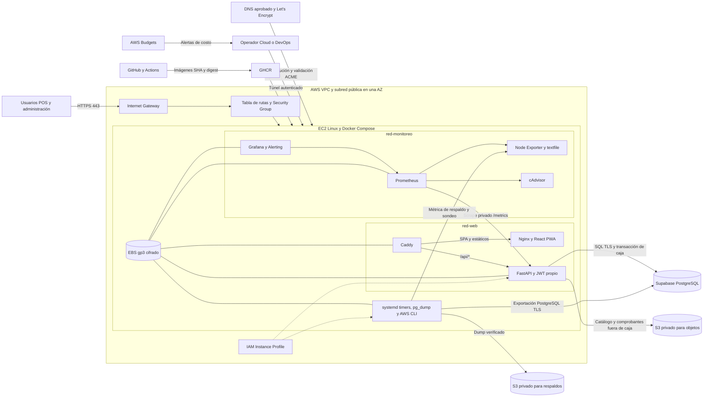

# Arquitectura TO-BE y plan Cloud & DevOps

Minimarket «El Buen Vecino» · Diseño para revisión del equipo · Línea base `genni@8a049c4`

## 1. Resumen ejecutivo

Una EC2 Linux en una subred pública alojará el monolito existente y su observabilidad mediante Docker Compose. Caddy terminará HTTPS y enviará las solicitudes de API a FastAPI y las de la SPA a Nginx. Supabase PostgreSQL seguirá siendo la fuente de verdad de ventas. S3 conservará respaldos y objetos privados. La tienda inicia con un administrador y dos cajeros. El objetivo de caja es p95 < 1 s, medido con PostgreSQL y HTTPS en el entorno candidato.

El orden propuesto es cerrar los cinco P0, validar el stack local, publicar imágenes reproducibles, verificar AWS y Supabase en un entorno autorizado y ensayar un despliegue reversible. La arquitectura de CPU, el costo y la exposición pública quedan sujetos a decisión de Cloud. Este documento registra revisión estática y verificaciones de lectura. Las pruebas, métricas y resultados de aceptación descritos son futuros.

## 2. Validación del diagnóstico AS-IS

`HEAD` era `8a049c47e2c276616c45da60b392ddeb0ac1fd52` en `genni`. `git diff --name-status 8a049c4 HEAD` y `git status --porcelain=v1 --untracked-files=all` devolvieron salida vacía antes de crear este documento. La comparación cubre el checkout local y sus referencias disponibles. La auditoría `auditoria-as-is-minimarket-stock-ia.md` no apareció en el repositorio, historial disponible ni ubicaciones locales revisadas. La coincidencia de commit se comprueba directamente. La concordancia con el texto completo de la auditoría queda pendiente de recibirla. Los P0 de la solicitud se contrastaron con el código.

Fuentes del proyecto consultadas. [AGENTS.md](../../AGENTS.md), [guía de la aplicación](../../GUIA_COMPLETA_APP.md), [plan original](<../../Plan de implementación sistema web con IA para gestión predictiva de inventarios.md>), [ADR 0001](../adrs/0001-aws-graviton-provider.md), [ADR 0002](../adrs/0002-lightgbm-predictive-engine.md), [ADR 0003](../adrs/0003-supabase-rls-security.md).

| Componente | Evidencia del checkout y consecuencia para el diseño |
|---|---|
| API y venta | FastAPI monta `/api/v1`. `POST /api/v1/ventas` invoca `public.registrar_venta` con psycopg2 y hace commit. SQL bloquea filas y actualiza venta, detalle y kardex en la transacción. Si falla la conexión, `DatabaseManager` fija el modo memoria y la venta puede responder éxito sin persistir en PostgreSQL. El respaldo del ticket es una operación separada. [API](../../backend/app/main.py), [conexión](../../backend/app/core/database.py), [venta](../../backend/app/modules/ventas/service.py), [función SQL](../../db/migrations/002_registrar_venta.sql) |
| Identidad y RLS | El login usa JWT propio. El registro almacena el hash solo en memoria y PostgreSQL acepta contraseñas genéricas para perfiles activos. Hay cuentas demo en backend y UI. Las políticas SQL usan `auth.uid()` y el código conecta directamente con una DSN. Deben verificarse el rol real, los `GRANT` y la identidad SQL antes de atribuirle a RLS el aislamiento por cajero del ADR 0003. [Autenticación](../../backend/app/modules/auth/router.py), [esquema](../../db/migrations/001_initial_schema.sql), [RLS](../../db/migrations/003_rls_policies.sql) |
| Build y entrada | Falta `python-multipart` para la ruta `UploadFile`. Hay dependencias abiertas y pytest en el archivo de runtime. El backend usa usuario sin privilegios y dos workers. Ambos Dockerfiles copian el contexto completo y carecen de `.dockerignore`. Compose utiliza una red, publica 80/443 y tiene una contraseña de Grafana predefinida. Caddy escucha en `:80, :443`, reenvía `/metrics` y carece de hostname productivo configurado. OpenAPI JSON está bajo `/api/v1`. Nginx incluye otro proxy `/api/`. [Requisitos](../../backend/requirements.txt), [Dockerfile backend](../../backend/Dockerfile), [Dockerfile frontend](../../frontend/Dockerfile), [Compose](../../deploy/docker-compose.yml), [Caddyfile](../../deploy/Caddyfile) |
| S3 y respaldos | El cliente mezcla imágenes, comprobantes y modelos en el bucket configurado para respaldos. Devuelve URL directa de S3 o escribe en disco y devuelve `/uploads/...`. FastAPI monta toda la carpeta estática. El proxy actual manda `/uploads` a Nginx, por lo que tampoco garantiza que las imágenes locales funcionen vía Caddy. El POST de imagen actualiza `imagen_url`, pero la columna no aparece en la migración inicial. El script anuncia éxito con un archivo de muestra o sin AWS CLI, y Node Exporter aún no consume su archivo. [S3](../../backend/app/core/s3.py), [productos](../../backend/app/modules/productos/router.py), [esquema](../../db/migrations/001_initial_schema.sql), [backup](../../deploy/scripts/backup.sh) |
| ML | El POST administrativo `/api/v1/predicciones/run` llama al pipeline de forma síncrona. Con pocos datos usa un generador sintético. El resumen puede devolver valores predefinidos de WAPE y MAE. El split se hace por posición tras ordenar por fecha, así que puede cortar un día. El flujo estima demanda reciente a partir de predicciones sobre características históricas. Un error de persistencia puede quedar en log y el pipeline devolver éxito. El código no demuestra pronóstico prospectivo de siete días ni mejora ante un baseline. [Pipeline](../../backend/app/ml/pipeline.py), [modelo](../../backend/app/ml/model.py), [servicio](../../backend/app/modules/predicciones/service.py) |
| Observabilidad y entrega | Prometheus tiene scrape/evaluación a 15 s y Compose fija 15 días de retención. Los directorios de provisioning Grafana, workflows e infraestructura contienen marcadores, no implementaciones. La guía y el plan describen pruebas históricas u objetivos. La presencia de archivos de prueba no acredita su ejecución actual. [Prometheus](../../monitoring/prometheus/prometheus.yml), [Grafana](../../monitoring/grafana), [workflows](../../.github/workflows), [infraestructura](../../infra) |

## 3. Arquitectura TO-BE

Una VPC y una AZ con una EC2, EBS gp3 cifrado y Docker Compose. La única entrada pública de la aplicación es Caddy por TCP 80/443. El backend escribe en Supabase via TLS con un rol PostgreSQL dedicado. Devuelve éxito de venta solo tras confirmar la transacción. El navegador conserva el carrito si caja recibe `503`. La consulta y el respaldo de comprobantes tienen su propia autorización y pueden fallar sin afectar una venta ya registrada.

Las imágenes de catálogo se sirven por una ruta pública controlada desde un bucket privado. Los comprobantes se obtienen mediante la API autorizada. Los dumps salen del host hacia S3 con una identidad temporal de EC2. Prometheus recolecta en la red de monitoreo y Grafana se opera por túnel. La caída de EC2 interrumpe la aplicación y sus alertas locales, por lo que la recuperación consiste en reconstruir el host y conectar de nuevo a Supabase, o restaurar datos si PostgreSQL también se pierde. No hay alta disponibilidad en este alcance.

## 4. Diagrama Mermaid



## 5. Stack tecnológico definitivo propuesto

| Capa | Tecnología |
|---|---|
| Cliente | React 18.3.1, Vite 6.4.6, TypeScript 5.7.3, Zustand y Vite PWA. Node.js 22 en el build, Nginx en runtime |
| Aplicación | Python 3.12, FastAPI, Pydantic v2, Uvicorn con un worker inicial, JWT propio, psycopg2 y boto3 |
| Datos y ML | Supabase PostgreSQL, `registrar_venta` PL/pgSQL, LightGBM con Pandas, NumPy, scikit-learn y joblib |
| Empaquetado y operación | Linux LTS como candidato, Docker Engine y Compose v2, Caddy, Bash, systemd, AWS CLI, `psql`, `pg_dump` y `pg_restore` |
| Observabilidad y entrega | Prometheus, Grafana Alerting, Node Exporter, cAdvisor, GitHub Actions y GHCR. Versiones de imágenes verificadas, escaneadas y fijadas por digest |

## 6. Servicios nativos de AWS

| Servicio | Decisión propuesta |
|---|---|
| EC2 y EBS | Una VM burstable en una AZ. Evaluar 30 GiB gp3 cifrados como punto de partida, con tamaño final según imágenes, rollback, TSDB y área temporal del dump. Verificar créditos de CPU y modo de excedente configurable. Mantener capacidad para recrear el host y evaluar snapshot EBS como complemento operativo. |
| VPC, subred pública, IGW y tablas | Candidato VPC `10.42.0.0/16`, pública `10.42.1.0/24` con `0.0.0.0/0 → IGW` y ruta local. Confirmar CIDR con Cloud. Reservar `10.42.2.0/24` en el diseño académico. Crear la subred privada vacía solo si el curso lo exige, con ruta local y sin NAT. IPv6 se agrega si se prefiere la conexión directa y se prueba de extremo a extremo. |
| Security Groups e IAM Instance Profile | Entrada pública 80/443. TCP 22 únicamente desde CIDR administrativo aprobado si SSM no está disponible. Rol EC2 con permisos limitados por bucket, prefijo y operación, y permisos de agente SSM si se aprueban. IAM de CI separado. |
| S3 | Dos buckets privados propuestos, uno para dumps y otro para objetos `productos/`, `comprobantes/` y `ml-models/` si se usa. Bloqueo público, TLS obligatorio, cifrado SSE-S3 inicial, ACL deshabilitadas y versionamiento con retención de versiones antiguas acordada. Sin permisos de borrado para el rol habitual. |
| AWS Budgets | Presupuesto mensual y alertas de consumo real y previsto al correo de Cloud. Los USD 25/50 históricos son referencias pendientes de aprobación. Las alertas no constituyen un tope inmediato. |

Costear por región y fecha EC2 on-demand, EBS y snapshots, IPv4 pública, S3 por volumen y operaciones, egreso, posibles cargos por CPU, DNS y observabilidad opcional. Añadir costos de Supabase y GitHub cuando correspondan. Confirmar créditos, moneda, impuestos y vencimiento en la cuenta. El costo y el margen de memoria citados por el ADR 0001 siguen sin verificación para este despliegue. [EC2 T4g](https://aws.amazon.com/ec2/instance-types/t4/), [EC2 T3/T3a](https://aws.amazon.com/ec2/instance-types/t3/), [precios VPC e IPv4](https://aws.amazon.com/vpc/pricing/), [AWS Budgets](https://docs.aws.amazon.com/cost-management/latest/userguide/budgets-managing-costs.html)

| Opcional | Valor y condición |
|---|---|
| Systems Manager | Preferido para Session Manager y Run Command si la cuenta admite agente, endpoints e IAM. Evita entrada SSH. SSH manual por origen permitido es el respaldo. |
| Elastic IP | Adoptar si se exige una IP persistente para DNS, restricciones de Supabase o recuperación. Evaluar el costo de la IPv4 pública incluso al quedar asignada sin uso. Con dirección dinámica, comprobar actualización DDNS tras reemplazo o stop/start. |
| CloudWatch | Aprovechar métricas EC2 para fallas del host si se aprueba. Un canary HTTP externo verifica también proxy, TLS y DNS, con costo estimado y notificación independiente. Diferir agente y duplicación de logs. |
| SSM Parameter Store | Diferir al MVP posterior salvo requisito de gestión central. Evaluar `SecureString`, KMS, permisos y rotación. Un archivo de entorno protegido en EC2 es suficiente para el arranque, bajo control humano. |
| ECR | Diferido. GHCR publica las imágenes de aplicación. Reevaluar si el acceso privado a GHCR requiere un token de larga duración que el equipo no apruebe. |
| Route 53 | Diferido mientras exista DNS aprobado. Elegir si el equipo decide operar su propio dominio y zona con AWS. |

[Session Manager](https://docs.aws.amazon.com/systems-manager/latest/userguide/session-manager.html), [CloudWatch Synthetics](https://docs.aws.amazon.com/AmazonCloudWatch/latest/monitoring/CloudWatch_Synthetics_Canaries.html)

## 7. Tecnologías alojadas en EC2

Docker Engine y plugin Compose sobre Linux LTS. Siete contenedores para Caddy, Nginx/React, FastAPI/LightGBM, Prometheus, Grafana, cAdvisor y Node Exporter. Bash, systemd, AWS CLI y herramientas PostgreSQL en el host. El eventual proceso batch usa la misma imagen del backend con un comando de trabajo explícito, recursos acotados y un volumen compartido. Sus activaciones quedan a cargo de DevOps una vez superados los criterios de ML. El grupo Docker se trata como acceso administrativo.

## 8. Servicios externos

| Servicio | Función |
|---|---|
| Supabase PostgreSQL | Base de datos administrada. Entornos y credenciales diferenciados para pruebas y producción. El navegador consume FastAPI con JWT propio. |
| GitHub, Actions y GHCR | Fuente, revisiones, CI/CD y registro de las imágenes de aplicación. Confirmar visibilidad, cuotas y permisos. |
| Docker Hub y upstreams oficiales | Imágenes base y servicios. cAdvisor usa el registro upstream declarado, sujeto a comprobar disponibilidad y plataforma. |
| DuckDNS | Posible DNS con actualización autorizada por el equipo. También puede usarse un DNS ya disponible. |
| Let's Encrypt | Certificado público emitido después de aprobar el nombre DNS y verificar el challenge. |

## 9. Decisiones arquitectónicas y alternativas

| Decisión | Propuesta y prueba que la condiciona |
|---|---|
| ARM64 `t4g.small` | Candidato del ADR: 2 vCPU, 2 GiB, Graviton2. Probar wheels de Python 3.12, carga nativa de LightGBM con OpenMP, `psycopg2` y NumPy, manifiestos de las siete imágenes y fixtures de entrenamiento. CI ARM64 nativo si está disponible y autorizado. Buildx/QEMU sirve para compatibilidad de construcción, con mayor tiempo potencial y prueba funcional final en CPU nativa. |
| x86-64 `t3.small` o `t3a.small` donde esté disponible | 2 vCPU y 2 GiB como comparación homogénea. Alinea Docker Desktop, CI amd64 y EC2. Comparar tiempos build frío/caliente, arranque, pico RSS, swap, CPU, tiempo batch y p95 de caja contra ARM en mediciones nativas. Si el stack carece de margen, evaluar 4 GiB y actualizar costo antes de decidir. |
| Caddy + Nginx | Reaprovecha la imagen frontend y concentra HTTPS, redirección, renovación y rutas en Caddy. Nginx se limita a servir assets y resolver la SPA. Nginx frontal + Certbot requeriría integrar challenge, renovación, recarga y persistencia de claves. La infraestructura actual ofrece una transición más corta con Caddy. |
| Una VM + Compose | Adecuado para tres usuarios y equipo pequeño. Crecimiento inicial por RAM, disco y CPU según medición. Separar observabilidad o cómputo batch solamente si compiten con caja. Se descartan Kubernetes, Hadoop/Spark, RDS duplicado, LLM, OCI, NAT Gateway y microservicios para el MVP. |

Cloud conserva la decisión de arquitectura. Verificar cada manifiesto con `docker buildx imagetools inspect`, construir con `--platform` y ejecutar importación, smoke y carga en la plataforma candidata. La memoria disponible depende del perfil de uso y la concurrencia. [Instancias de propósito general](https://docs.aws.amazon.com/ec2/latest/instancetypes/gp.html), [LightGBM y dependencias nativas](https://lightgbm.readthedocs.io/en/stable/Installation-Guide.html), [HTTPS automático de Caddy](https://caddyserver.com/docs/automatic-https)

## 10. Matriz de correcciones P0

| P0 y rutas | Cambio necesario | Responsable y dependencias | Riesgo y aceptación | Prueba futura y aprobación |
|---|---|---|---|---|
| **01 Dependencias** `backend/requirements.txt`, nuevo `backend/requirements-dev.txt`, `backend/Dockerfile` | Incorporar `python-multipart`, mover pytest y dependencias de prueba al archivo dev y validar instalación reproducible de dependencias directas y transitivas con versiones exactas y hashes por plataforma cuando sean necesarios. Conservar `libgomp1` y las librerías de PostgreSQL requeridas en runtime. Mantener build tools en builder. | Desarrollo ejecuta, DevOps valida imagen. Entrada a INIT-001/002. | Wheels, ABI y upgrades incompatibles. La imagen importa `app.main`, LightGBM y psycopg2, procesa multipart y arranca sin pytest. | Build limpio, importación, smoke multipart y `pip check` para cada candidato. Coordinación con Desarrollo para versiones y lock. |
| **02 Dockerfiles** `backend/Dockerfile`, `frontend/Dockerfile`, ambos `.dockerignore`, `deploy/docker-compose.yml` y override dev | Un worker Uvicorn. UID/GID fijo sin privilegios y mounts con dueño verificable. Excluir secretos, entornos, dependencias locales, cachés, dumps, uploads y artefactos; revisar el contenido del contexto y de capas finales. Confirmar que el prefijo de instalación del backend esté en `sys.path`, o usar venv multi-stage con ruta estable. | DevOps. Depende de P0-01 para smoke y de Cloud para plataforma final. | Módulos no encontrados, UID incompatible, artefactos inaccesibles, manifests faltantes. Build y ejecución correctos con volúmenes limpios y tras recreación. | Build amd64/arm64, inspección de usuario y entorno, escritura y lectura de archivos, importación nativa y prueba de imágenes. Cloud aprueba plataforma y cambios AWS por separado. |
| **03 JWT y autenticación** `backend/app/core/{config,security}.py`, `backend/app/modules/auth/`, `backend/app/modules/{productos,inventario,ventas,predicciones}/`, `db/migrations/`, `frontend/src/features/auth/LoginPage.tsx`, pruebas | Clave HS256 aleatoria de al menos 32 bytes, obligatoria para producción y sin default reutilizable. Eliminar contraseñas genéricas y demos productivas. Guardar hash salteado y versionado en credenciales propias vinculadas a `perfiles.id`. Aprovisionar tres cuentas mediante script administrativo interactivo y parametrizado. Deshabilitar `/auth/register` en producción. Validar claims, usuario activo y rol en operaciones sensibles. Aprobar matriz de acceso y restricciones SQL del rol de servicio. | Desarrollo aprueba y ejecuta con apoyo Cloud para secretos e identidades. Depende de migración aditiva y bootstrap. | Incompatibilidad con perfiles y JWT previos, bloqueo de cajeros o datos de otro usuario. Mantener IDs existentes, reasignar contraseñas por canal aprobado y rotar clave en corte. | Persistencia de login tras reinicio, cuenta inactiva, registro bloqueado, matriz RBAC, ausencia de credenciales en bundle y acceso SQL restringido. Aprobación explícita de Desarrollo y del usuario para secretos iniciales de producción. |
| **04 Persistencia** `backend/app/core/{config,database}.py`, `backend/app/main.py`, servicios `auth`, `productos`, `inventario`, `ventas` y `predicciones`, `db/tests/` | Modo `postgres` obligatorio en producción y `memory` explícito en dev/test. Conexión fallida en modo `postgres` levanta error propagable a `503`; eliminar capturas que puedan devolver datos simulados o permitir escrituras aparentes. `/health` local al proceso y `/ready` con `SELECT 1` y timeout. Ejecutar la venta en la transacción existente, validar el resultado antes del commit y acotar espera. Definir recuperación ante commit incierto mediante idempotencia durable o reconciliación manual sin reintento automático. | Desarrollo. Cloud confirma DNS y TLS del origen Supabase. | Datos fantasma, dependencia regional y duplicación si se pierde la respuesta. Cero venta falsa durante falla. Readiness recupera sin reiniciar al volver la DB. | DB desechable, falla antes/durante operación, recuperación, última unidad concurrente, carrito con SKU repetido, confirmación y reintento. Desarrollo revisa semántica y cambios SQL. Se requiere autorización para cualquier migración destructiva en producción. |
| **05 Almacenamiento y métricas** `deploy/Caddyfile`, `backend/app/{main.py,core/s3.py,core/metrics.py}`, rutas de productos/ventas, `deploy/scripts/backup.sh`, `monitoring/prometheus/` | Cerrar `/metrics` y `/uploads` genérico. Dar URL estable solo a catálogo de imágenes, autorizar comprobantes antes de leer/escribir y mantener objetos privados. Retirar gauge de respaldo del backend. Publicar timestamp solamente tras dump, validación y transferencia comprobada, mediante textfile de Node Exporter. | Desarrollo para acceso/objetos, DevOps para proxy/backup y Cloud para IAM/S3. Depende de RBAC y del collector. | Fuga de tickets y falsos éxitos. Sin acceso anónimo a comprobantes, sin avance del timestamp por subidas normales o fallas. | Negativos por HTTP y acceso S3, falla inyectada de dump/transferencia/validación, `promtool` y restauración. Cloud aprueba bucket/políticas y cambios AWS. |

## 11. Diseño de Docker Compose

Usar `deploy/docker-compose.yml` como base de producción y `deploy/docker-compose.dev.yml` como override. Mantener nombres de servicio para DNS y retirar `container_name` al probar proyectos simultáneos. `red-monitoreo` será un bridge sin entrada publicada salvo Grafana en loopback. Mantendrá la salida necesaria para SMTP si se elige ese canal. El backend seguirá alcanzando PostgreSQL por `red-web` y participará en ambas redes. Compose no aísla rutas HTTP entre pares. Caddy y los permisos del host aplican la política de entrada.

| Servicio | Redes y puertos | Persistencia, salud y arranque |
|---|---|---|
| `caddy` | `red-web`, 80/443 públicos en producción. Dev `127.0.0.1:8080 → 80` por HTTP | `caddy_data:/data`, `caddy_config:/config`, Caddyfile de solo lectura. Validar configuración y sondear HTTP/TLS. Iniciar aunque PostgreSQL esté en recuperación para servir SPA y entregar el error de caja. |
| `frontend` | `red-web`, 80 interno | Imagen inmutable con `frontend/nginx.conf`; `GET /index.html` como smoke o healthcheck. Sin mounts de escritura necesarios. |
| `backend` | Ambas redes, 8000 interno | `ml_artifacts` en `/app/app/ml/artifacts`. Montar CA de PostgreSQL de solo lectura si se usa `verify-full`. `/health` para Docker y `/ready` para aceptación de tráfico de caja y CD. Sin dependencia Compose de Supabase. |
| `prometheus` | `red-monitoreo`, 9090 interno | `prometheus_data:/prometheus`, configuración RO, siete días y límite adicional por tamaño según EBS. Salud en `/-/healthy` y readiness en `/-/ready`. Puede arrancar con targets caídos. |
| `grafana` | `red-monitoreo`, 3000 interno y `127.0.0.1:3000` por túnel | `grafana_data:/var/lib/grafana`, provisioning/JSON RO. Health en `/api/health`. Puede iniciar antes de que el datasource esté disponible. |
| `cadvisor` | `red-monitoreo`, 8080 interno | Limitar mounts de host y usar solo lectura donde sea viable. Justificar cualquier acceso al socket Docker, que da acceso a la API del daemon aunque el mount sea RO. Revisar cgroup v2 y permisos de la versión fijada. Comprobar scrape y series propias del proyecto. [cAdvisor](https://github.com/google/cadvisor/blob/master/docs/running.md) |
| `node-exporter` | `red-monitoreo`, 9100 interno | Mounts RO de proc/sys/rootfs y del directorio textfile persistente del host. Comprobar scrape y métricas del filesystem correcto. |

Producción resuelve `BACKEND_IMAGE` y `FRONTEND_IMAGE` con referencias `@sha256` prescritas en un manifiesto de release. El override añade `build`, nombres locales y `pull_policy: build`. Sustituye la lista de puertos de Caddy, incluso los de wildcard heredados, con la sintaxis soportada por la versión mínima de Compose acordada (`!override` requiere Compose 2.24.4 o posterior). Usa una dirección de sitio explícita `http://localhost` y un proyecto/volúmenes diferentes. Los exporters de host pueden quedar bajo un perfil de observabilidad local. `uploads` solo será volumen local explícito con directorios de catálogo y comprobantes separados. Los tests Postgres apuntarán a una BD local desechable o a un proyecto Supabase de pruebas identificado y autorizado. [Merge de archivos Compose](https://docs.docker.com/reference/compose-file/merge/)

Desde la raíz se prevé `docker compose --env-file .env -f deploy/docker-compose.yml -f deploy/docker-compose.dev.yml config --quiet`. Producción usa `-f deploy/docker-compose.yml` con `.env` de su raíz de release o una ruta absoluta protegida. Los scripts resuelven rutas con `BASH_SOURCE` y pasan `--env-file` explícito. Los caminos declarados por Compose se resuelven desde `deploy/`, el directorio del primer YAML. Validar el resultado del merge con un archivo de valores de prueba. Las variables de shell pueden prevalecer; los scripts deben validar el ambiente resultante sin imprimir secretos. `--env-file` sirve para interpolación, y `environment` asigna un subconjunto explícito por servicio. Evitar valores obligatorios en la base que impidan resolver el override local antes del merge; el preflight productivo exige sus valores efectivos y rechaza defaults de desarrollo.

| Destino | Variables y controles previstos |
|---|---|
| Backend | `ENVIRONMENT`, `APP_DB_MODE`, `DATABASE_URL`, `SECRET_KEY`, `ALLOWED_ORIGINS`, `FILE_STORAGE_MODE`, `AWS_REGION`, `AWS_S3_OBJECTS_BUCKET`, `ML_MODEL_PATH`, `ML_METADATA_PATH`, `ML_LOOKBACK_DAYS`, `ML_FORECAST_HORIZON_DAYS`. Producción exige sus valores aplicables y secretos independientes. `/api/v1` es contrato, la SPA usa URL relativa. Sin claves estáticas AWS productivas. Retirar del Compose las claves Supabase que el acceso psycopg2 no necesita. |
| Caddy y releases | `SITE_ADDRESS`, `ACME_EMAIL` si procede, `BACKEND_IMAGE`, `FRONTEND_IMAGE`, `COMPOSE_PROJECT_NAME`. El frontend solo recibe valores públicos de build si se requieren. |
| Monitoreo | `GRAFANA_ADMIN_USER`, `GRAFANA_ADMIN_PASSWORD`, configuración SMTP o credencial de webhook, y etiquetas explícitas del entorno. La contraseña inicial de Grafana se aplica al crear su DB; rotarla después desde el mecanismo de Grafana. |
| Host y backup | `BACKUP_DATABASE_URL` o servicio libpq con `PGPASSFILE` 0600, `AWS_REGION`, `AWS_S3_BACKUP_BUCKET`, `BACKUP_WORK_DIR`, `TEXTFILE_DIR`. Usar identidad y configuración de destino distintas en restauración. |

Aplicar `restart: unless-stopped` a servicios persistentes y rotación desde el inicio, por ejemplo `json-file` con límites provisionales `10m × 3`. Partir de healthchecks livianos cada 30 s con timeout 5 s, 3 reintentos y periodo inicial medido. Usar `depends_on` con `service_started` para que Caddy arranque después de `frontend` y `backend` sin exigir readiness de DB. El monitoreo puede iniciar y detectar targets ausentes. Un `unhealthy` cambia el estado de salud. El reinicio por Compose/Docker responde a la terminación del proceso según la política, y el chequeo de readiness gobierna validaciones y alertas. Caddy debe poder servir páginas estáticas con el backend indisponible. Mantener herramientas de probe solo si están presentes en cada imagen. Fijar límites tras medir `docker stats`, RSS, OOM, I/O, swap, TSDB, disco y p95. Como criterio inicial en la VM candidata, exigir cero OOM, ausencia de swap sostenido y margen de RAM de al menos 20 % en el escenario acordado. Medir caja también durante backup y durante un batch de prueba. [Modelo Compose](https://docs.docker.com/compose/intro/compose-application-model/), [variables Compose](https://docs.docker.com/compose/how-tos/environment-variables/envvars/)

## 12. Diseño de redes y seguridad

- **CIDR.** En Docker Desktop `desktop-linux` se encontraron redes en `172.17.0.0/16`, `172.18.0.0/16` y `172.19.0.0/16`. Las rutas privadas activas de Windows cubrían `192.168.1.0/24`, `192.168.56.0/24` y `192.168.112.0/20`. `172.20.0.0/24` y `172.21.0.0/24` no se solapan con lo observado. Preferir asignación automática para el MVP, que usa DNS de servicio. Si el informe exige rangos fijos, parametrizarlos y repetir `docker network inspect`, `route print -4` o `ip route`, con VPN conectada cuando aplique y en EC2.
- **Firewall y operación.** Aplicar SG y verificar binding efectivo de Docker desde fuera. Bloquear 8000, 3000, 9090, 9100 y 8080 de exporters en red pública. Autorizar egress necesario para DNS, HTTPS y destino Supabase 5432, además del canal de alertas aprobado. Usar rangos soportados y monitorear cambios de resolución antes de restringir destinos con IP variables. SSM o túnel SSH con alcance definido para Grafana, con autenticación de Grafana activa. Administrar TLS por Caddy y revisar reglas de host compatibles con el NAT de Docker.
- **PostgreSQL.** Consultar el endpoint y la región real en el panel. Si el directo es IPv6 y no existe una ruta IPv6 funcional desde el contenedor o la VM, probar Supavisor en modo sesión por IPv4 en 5432. Usar conexión directa para dump cuando sea viable y validar explícitamente que la alternativa de sesión funciona para todo el dump/restauración. Validar DNS, TLS con `sslmode=verify-full` y CA apropiada, `SELECT 1`, `current_user`, límites de conexión y latencia desde host y backend. Usar timeouts acotados de conexión, consulta y locks. Ajustar pool local pequeño solo si la medida lo exige. El método transaccional de pool no es el punto de partida para este host persistente. [Conexión Supabase](https://supabase.com/docs/guides/database/connecting-to-postgres), [restricciones de red](https://supabase.com/docs/guides/platform/network-restrictions)
- **Identidad AWS.** Exigir IMDSv2. Mantener hop limit 1 para el host si el backend no usa S3; si boto3 necesita acceso desde el bridge, validar hop limit 2 y restringir acceso a IMDS a los contenedores necesarios mediante controles del host comprobados. El backend autorizado y el backup comparten el límite de privilegios del perfil EC2. Los prefijos restringen a qué objetos accede ese perfil, por lo que un compromiso del backend con acceso a IMDS podría escribir en las ubicaciones de backup permitidas. Usar versionamiento sin permiso de borrar versiones y considerar mayor separación si cambia el riesgo. [IMDS y contenedores](https://docs.aws.amazon.com/AWSEC2/latest/UserGuide/instancedata-data-retrieval.html)

**Orden de rutas Caddy.** Usar bloques `handle` mutuamente excluyentes y matchers de rutas exactas y subrutas donde proceda. Mantener `/api/v1` con `reverse_proxy`, sin `handle_path` que quite el prefijo. Probar cada ruta con el Host y protocolo previstos.

| Ruta | Producción y desarrollo |
|---|---|
| `/metrics`, `/ready`, `/health` | Internas en FastAPI. La entrada pública devuelve 404; Prometheus accede a `/metrics` por DNS privado y el host comprueba `/ready` mediante `docker compose exec -T`. El sondeo HTTPS utiliza la SPA y valida HTML esperado. |
| `/docs`, `/docs/oauth2-redirect`, `/redoc`, `/api/v1/openapi.json` | Deshabilitar en FastAPI de producción y denegar en Caddy antes del matcher API. En dev se pueden habilitar por loopback. Para una revisión restringida usar un entorno privado y la identidad del operador. |
| `/uploads` y `/uploads/*` | Denegar por defecto y retirar el montaje estático genérico de FastAPI. En dev, servir solo imágenes de `productos/` mediante la misma ruta de catálogo de la API. |
| `/api/v1/catalogo/imagenes/{id}` propuesta | Lectura pública mediante un ID resuelto a un objeto de catálogo aprobado, nunca a una ruta de disco o clave arbitraria. Límites de tamaño, allowlist MIME por contenido, `nosniff`, nombres generados y formatos de imagen seguros. Guardar referencia durable mediante migración aditiva y adaptar el catálogo. Salvar o regenerar imágenes antiguas antes de retirar URLs. |
| `/api/v1/ventas/{id}` y comprobante | Autenticar y autorizar en FastAPI antes de consultar o descargar. Propuesta: administrador accede a toda la tienda, cajero solo a sus tickets; revisar con Desarrollo. Entregar el comprobante desde la API con `Cache-Control: private, no-store` y disposición de descarga. Evitar entregar URLs permanentes o que el navegador archive credenciales/tickets. S3 fuera de `POST /ventas`. |
| `/api/*` restante | FastAPI, con autorización por endpoint. Validar subida por streaming o límite previo al parseo. Bloquear respuestas exitosas de almacenamiento local en modo S3. |
| SPA, manifest y service worker | Nginx entrega `index.html` a rutas React. Assets inexistentes, manifest y service worker faltantes devuelven 404. `index.html` y `sw.js` revalidan, los assets con hash tienen caché larga. Workbox excluye rutas API, instalaciones administrativas y comprobantes de navegación y cachés. Limpiar cachés heredadas y probar cambios de versión. El POS sólo confirma ventas online y HTTP local en `localhost` permite probar el contexto seguro del service worker. |

Eliminar el proxy `/api/` del Nginx en INIT-003. El proxy Vite queda para desarrollo nativo. En producción Caddy usa exclusivamente el hostname aprobado, DNS A/AAAA coherente y emisión Let's Encrypt con staging para ensayos y luego CA pública. Mantener volúmenes ACME persistentes. Habilitar HSTS tras verificar HTTPS estable, sin preload ni `includeSubDomains` hasta que se aprueben expresamente. [Caddy y validación ACME](https://caddyserver.com/docs/automatic-https)

## 13. Diseño de observabilidad

Reutilizar `monitoring/prometheus/prometheus.yml` con scrapes y evaluación de 15 s, jobs `fastapi-backend`, `node-exporter` y `cadvisor`. Retención inicial siete días. Etiquetar dev y producción según configuración efectiva; quitar la etiqueta fija de producción en el entorno local. Grafana provisiona datasource Prometheus con UID estable a `http://prometheus:9090`, provider de dashboards, JSON versionados, reglas, políticas y contact points. El canal aprobado (SMTP o webhook) recibe sus secretos del entorno operativo. Grafana Alerting será el único evaluador de reglas del stack. [Provisioning Grafana](https://grafana.com/docs/grafana/latest/alerting/set-up/provision-alerting-resources/file-provisioning/)

| Serie real | Etiquetas y alcance |
|---|---|
| `http_requests_total` | `method`, `endpoint`, `status`. Middleware mide solicitudes a FastAPI y excluye `/metrics` y `/health`. Código actual normaliza segmentos numéricos. Cambiar a plantilla de ruta con marcador fijo para 404 y excluir `/ready`, de modo que códigos de barra y rutas desconocidas no multipliquen series. Confirmar `POST` y `endpoint="/api/v1/ventas"` después del cambio. Las respuestas de Caddy/Nginx quedan fuera del contador. |
| `http_request_duration_seconds` | Histograma con `method` y `endpoint`. `_bucket` incorpora `le`; cuenta todos los códigos, incluidos fallos del endpoint. La latencia solo de respuestas `201` requiere instrumentación adicional acordada, no un filtro `status` en el histograma actual. |
| `sales_registered_total`, `sales_revenue_soles_total` | El primer contador lleva `metodo_pago`, el segundo no tiene labels de aplicación y acumula soles. Interpretar con `increase`/`rate`, no como libro contable ni saldo. Asegurar incremento tras commit confirmado en producción. |
| `ml_training_duration_seconds`, `ml_wape_score` | Gauges sin labels de aplicación. WAPE ya está en porcentaje. ML en proceso aparte no modifica el registro Prometheus de FastAPI. Proponer que `/metrics` lea por collector, desde metadata durable, solo resultados completos y válidos con label acotado `origen_datos`. Inicial sin serie o con panel «Sin evaluación». |
| `ml_predictions_generated_total` | Contador con `nivel_alerta` (`critico`, `advertencia`, `optimo`). Tras separar el job, exponer un acumulado durable por nivel y origen desde el mismo collector del backend, actualizado una vez por lote confirmado. Hasta entonces se interpreta como contador del proceso que ejecutó el pipeline. |
| `backup_last_success_timestamp` | Gauge en segundos Unix. Eliminar todos sus setters y registro del backend en el mismo cambio o antes de activar el collector. Única serie desde `job="node-exporter"`. `backup_last_size_bytes` acompaña el último respaldo válido. |

Etiquetar la precisión como sintética, real o mixta según la procedencia efectiva. Excluir datos sintéticos de promociones productivas y de sus indicadores de venta. Validar baseline y retirar valores WAPE/MAE por defecto y previsiones fijas que hoy se presentan como resultados. Exponer «Sin modelo validado» y «Sin datos» en UI y dashboards según corresponda.

| Dashboard | Paneles y ejemplos previstos |
|---|---|
| Infraestructura | CPU por `node_cpu_seconds_total`, RAM por `node_memory_MemAvailable_bytes` y `node_memory_MemTotal_bytes`, disco en los mounts de EBS esperados, red RX/TX de la interfaz Linux que se verifique y uptime `time() - node_boot_time_seconds`. Excluir pseudo-filesystems e interfaces duplicadas. |
| Contenedores | CPU, memoria working set, tráfico RX/TX y presencia reciente en `container_last_seen`. Verificar labels Compose/cgroup reales de cAdvisor bajo la imagen elegida, filtrar por proyecto y servicio y descartar root cgroup. `up` indica si se puede scrapear al exporter, y la disponibilidad funcional viene del sondeo dedicado. |
| Aplicación | RPS por método/endpoint, P95 general y de POST de caja, 5xx por ruta, `sum by (metodo_pago) (increase(sales_registered_total{job="fastapi-backend"}[1h]))`, `sum(increase(sales_revenue_soles_total{job="fastapi-backend"}[1h]))`, disponibilidad, WAPE, duración del último batch, predicciones por nivel/origen, edad y tamaño de respaldo. Mostrar las ventanas y la fuente. |

Node Exporter con `--collector.textfile.directory=/textfile` y montaje RO de directorio persistente, por ejemplo `/var/lib/buenvecino/textfile` en EC2. El script escribe temporal fuera del patrón `*.prom`, aplica permisos legibles y renombra en el mismo filesystem. Comprobar `node_textfile_scrape_error` y antigüedad. Montar el rootfs y proc/sys de Linux según el runtime, verificar CPU, memoria, discos y uptime contra utilidades del host. Con Node Exporter en bridge, validar el namespace de red. Si sus contadores muestran la red del contenedor, excluirlos del panel de host y publicar RX/TX de la interfaz EC2 mediante textfile del sondeo local. En Docker Desktop los exporters describen principalmente los contenedores y su VM Linux, con alcance dependiente de mounts. El dashboard debe identificar ese entorno y distinguirlo de Windows físico y de EC2. [Node Exporter](https://github.com/prometheus/node_exporter)

**Sondeo de servicio.** Un timer de host a 15 s comprueba la SPA por Caddy y el `/ready` interno. Escribe `minimarket_probe_success{check="https_spa|db_ready"}` con una serie por check y `minimarket_probe_timestamp_seconds` para frescura. Usar timeouts inferiores al intervalo y validar HTTPS con el nombre aprobado y resolución local cuando corresponda. Probar separadamente DNS público desde fuera. Registrar código de salida y hora aunque falle un check. En dev usar HTTP y etiqueta de entorno local.

| Alerta | PromQL o evaluación Grafana prevista | Intervalo y tratamiento |
|---|---|---|
| ALT-01 CPU | `100 * (1 - avg by (instance) (rate(node_cpu_seconds_total{job="node-exporter",mode="idle"}[5m]))) > 80` | Evaluar cada 30 s, pendiente 5 min. |
| ALT-02 RAM | `100 * (1 - node_memory_MemAvailable_bytes{job="node-exporter"} / node_memory_MemTotal_bytes{job="node-exporter"}) > 85` | Cada 30 s, pendiente 5 min. |
| ALT-03 disco | `100 * (1 - node_filesystem_avail_bytes{job="node-exporter",mountpoint=~"/(srv/buenvecino)?"} / node_filesystem_size_bytes{job="node-exporter",mountpoint=~"/(srv/buenvecino)?"}) > 80` | Cada 30 s, pendiente inicial 1 min. Ajustar la selección a los mounts efectivos y omitir los de solo lectura y capacidad cero. |
| ALT-04 indisponibilidad | `up{job="fastapi-backend"} == 0` o `minimarket_probe_success{job="node-exporter"} == 0`, o probe ausente/antiguo > 45 s, con identificación diferenciada de servicio y telemetría. | Cada 15 s, pendiente 2 min. Agrupar notificaciones para caída común. Verificar recuperación y dependencia del host. |
| ALT-05 caja lenta | `histogram_quantile(0.95, sum by (le) (rate(http_request_duration_seconds_bucket{job="fastapi-backend",method="POST",endpoint="/api/v1/ventas"}[15m]))) >= 1` condicionado a `sum(increase(http_request_duration_seconds_count{job="fastapi-backend",method="POST",endpoint="/api/v1/ventas"}[15m])) >= 10` | Cada 30 s, pendiente inicial 5 min. Umbral de volumen provisional. Con menos intentos, mostrar cantidad y estado «Muestra insuficiente». El p95 de aceptación se calcula en prueba de carga con tiempos crudos. |
| ALT-06 respaldo | `time() - backup_last_success_timestamp{job="node-exporter"} > 26 * 3600` o `absent(backup_last_success_timestamp{job="node-exporter"})` | Evaluar cada 1 min. Ausencia alerta al activar producción tras el primer respaldo exigido. Mostrar por separado edad > 24 h frente al RPO. |
| ALT-07 5xx | `sum(increase(http_requests_total{job="fastapi-backend",status=~"5.."}[5m])) / sum(increase(http_requests_total{job="fastapi-backend"}[5m])) > 0.02` condicionado a un mínimo inicial de 20 solicitudes en 5 min | Cada 30 s, pendiente 5 min. Inicializar o tratar numerador ausente como cero solo cuando existe tráfico. Mostrar errores absolutos y usar ALT-04 para fallas completas de bajo tráfico. |

En reglas Grafana usar consultas que preserven valores numéricos y umbrales Grafana equivalentes a los de la tabla, o comparaciones `bool` con condición final. Filtrar `NaN` y denominadores cero. Configurar `No Data` por regla. Sin tráfico, ALT-05/07 no alarma de rendimiento y los paneles informan falta de muestras. Pérdida de scrape, ausencia de probe y error del datasource se notifican como telemetría indisponible. No sustituir datos faltantes por métricas de negocio cero. Para caída total de EC2, Cloud compara alarma de status de la instancia con canary HTTP independiente. Si se aprueba, configurar un canal externo con prueba de recepción, sin que evalúe las mismas reglas locales. [Funciones PromQL](https://prometheus.io/docs/prometheus/latest/querying/functions/), [estados de alertas Grafana](https://grafana.com/docs/grafana/latest/alerting/fundamentals/alert-rule-evaluation/nodata-and-error-states/)

## 14. Diseño de automatización y respaldos

Los scripts Bash propuestos tendrán LF, rutas absolutas relativas a `BASH_SOURCE`, `set -Eeuo pipefail` cuando corresponda, validación explícita, timeout, logs con UTC y códigos de salida documentados. No imprimir DSN, tokens, secretos ni payloads de tickets. Usar `umask 077` para temporales y configuraciones sensibles; publicar textfiles con permisos de lectura adecuados. Validar con `bash -n`, ShellCheck y fixtures desechables. Convención de salida propuesta: `0` éxito, `2` uso/configuración inválidos, `3` precondición incumplida, `4` operación fallida. Separar tareas que necesitan privilegios de las que pueden ejecutarse como usuario operativo. Declarar LF para `*.sh` y unidades en `.gitattributes`.

| Script | Contrato previsto |
|---|---|
| `setup.sh` | Verificar Linux/arquitectura, espacio, paquetes, unidades, UID/GID y directorios. Preparar el host de forma idempotente y con preflight; aprovisionamiento inicial y secretos se ejecutan con autorización. |
| `start.sh`, `stop.sh` | Usar proyecto y release explícitos con `compose up -d` y `compose stop`. Conservar volúmenes. Reservar `stop` para ventana operativa. |
| `healthcheck.sh` | Verificar procesos, `/health`, `/ready`, HTML y TLS de Caddy según ambiente. Timeout global, checks con log individual y, en modo sondeo host, publicación atómica de resultados. |
| `deploy.sh`, `rollback.sh` | Exclusión mutua con `flock`. Validar release y digests, descargar antes del corte, aplicar configuración, esperar salud/readiness y comprobar rutas. Conservar manifiestos actual y anterior. Rollback reaplica imágenes y configuraciones previas compatibles con el esquema. Si PostgreSQL está caído, diagnosticar dependencia y evitar bucle de rollbacks. |
| `backup.sh` | Reutilizar y reemplazar las ramas de muestra. Credenciales y bucket obligatorios, sin fallback. Exportar, verificar y subir, y solo entonces actualizar el textfile. |
| `restore.sh` | Descargar versión identificada, verificar checksum y destino desechable vacío, y restaurar con comprobaciones de salida. Rechazar destino productivo y opciones destructivas por defecto. |

**Flujo de backup.** Ejecutar diariamente a las 03:00 `America/Lima` como horario inicial, con timer systemd `Persistent=true`, `flock` y timeout. Validar calendario con `systemd-analyze calendar` y dimensionar tiempo/disco antes de programar. Evitar solapamiento con batch ML, copia EBS o cambios de esquema. La detección de una instancia caída depende de las alertas externas aprobadas. Un timer persistente permite una ejecución de recuperación tras arrancar. El RPO depende de puntos exitosos y su frescura.

1. Usar `pg_dump -Fc` con cliente compatible con el major del servidor y TLS, sobre los esquemas de aplicación inventariados. Usar servicio libpq y archivo de contraseña 0600 para evitar contraseñas en argumentos. Validar con un rol de respaldo con cobertura demostrada de todas las filas necesarias a pesar de RLS. Incluir cadena de migraciones, dependencias de funciones, roles/grants recreables y cualquier `auth.uid()` requerido por políticas. Documentar por separado qué cubre Supabase administrado, qué cubren los objetos S3 y qué queda fuera del dump.
2. Crear temporal restringido, confirmar salida exitosa, tamaño > 0, catálogo válido por `pg_restore --list`, presencia de tablas esperadas y checksum SHA-256. El ensayo de restauración verifica integridad lógica y catálogos completos.
3. Subir a S3 con cifrado y checksum verificable, y comprobar el objeto persistido mediante tamaño, versión y checksum de objeto completo verificable, o descargar y recalcular cuando el modo de checksum no sea comparable. No interpretar ETag como hash de contenido. Conservar registros de versión y timestamps sin credenciales. Si falla una etapa, devolver error y conservar el timestamp exitoso anterior.
4. Conservar hasta siete slots diarios y cuatro semanales activos. El slot diario rota por día calendario de Lima y el semanal por semana de lunes a domingo. Tras el primer respaldo exitoso de cada semana, publicar una copia verificada en el slot semanal correspondiente; si falla, reintentar en el siguiente backup exitoso de esa semana. Cada objeto conserva fecha real de captura y checksum. Reemplazar slots solo con exportaciones válidas, preservar versiones anteriores por una ventana de recuperación adicional aprobada y expirar versiones no vigentes por Lifecycle. La cobertura ideal requiere que los jobs hayan corrido en fechas distintas. Tras un fallo no se rellena un día perdido con copias de muestra.
5. Publicar `backup_last_success_timestamp` con la hora de finalización y `backup_last_size_bytes` por rename atómico después de la copia diaria y de la semanal si correspondía a esa ejecución. Asignar éxito y código `0` en ese mismo estado. Mantener journald y liberar temporales por política local. Probar que una falla al producir la copia semanal no anuncie un éxito integral, aunque la exportación diaria pueda quedar recuperable.

**Restauración.** Elegir el punto y versión S3. Consumir con una identidad de lectura y guardar hashes de verificación. Verificar explícitamente nombre y host de un destino de pruebas de una allowlist, confirmación de operador, y ausencia de objetos de aplicación. Preparar roles, extensiones y dependencias (incluido `auth.uid()` si se usa PostgreSQL local). Ejecutar `pg_restore --exit-on-error --single-transaction` y decidir `--no-owner`/`--no-privileges` según la receta de permisos del destino. Verificar perfiles, productos, ventas, kardex, secuencias, conteos de control, prueba de login y venta con datos de laboratorio. No usar `--clean`. Ejercitar reconstrucción de VM y configuración con manifiestos versionados para medir el RTO del servicio completo. Proteger y retirar las copias restauradas según su sensibilidad. Probar al iniciar y tras cambios relevantes de esquema.

RPO académico propuesto ≤24 h, calculado como edad del último punto recuperable al incidente, usando la hora de captura del dump y no la de carga. RTO propuesto ≤8 h desde detección hasta reanudar el servicio verificado. El plan previo fija ≤2 h en Fase 5 y §8. El equipo debe decidir el objetivo final antes de reportar aceptación. Registrar tiempo de recuperación total y contrastarlo con ambos umbrales hasta entonces. [Plan original](<../../Plan de implementación sistema web con IA para gestión predictiva de inventarios.md>), [pg_dump](https://www.postgresql.org/docs/current/app-pgdump.html), [integridad de objetos S3](https://docs.aws.amazon.com/AmazonS3/latest/userguide/checking-object-integrity.html)

**Condición para programar ML.** Deshabilitar `/predicciones/run` público-productivo mientras entrena inline. Primero un proceso batch manual de la misma imagen, fuera de horario, con lock, límites de CPU/RAM/hilos OpenMP, timeouts y sin llamadas desde caja. Mover evaluación/preparación a funciones reutilizables y comparar WAPE/MAE con baseline temporal sin compartir fechas. Para un horizonte de siete días, evaluar sobre fechas futuras relativas al origen del pronóstico con features disponibles en ese momento. Distinguir demanda histórica estimada y pronóstico. Si el denominador de WAPE es cero, reportarlo como no evaluable. Etiquetar el origen incluyendo seeds SQL y generador. Publicar predicciones por batch con una transacción y modelo/metadata como candidatos versionados; activar solo cuando ambos estén verificados, con puntero de publicación recuperable y versión anterior disponible. Mantener `model_latest.joblib` como ruta de consumo versionada por el procedimiento. Restringir escritura y carga de `.joblib` a artefactos propios y verificados. Solo después de un ensayo simultáneo con caja inferior al objetivo de p95 y de verificar persistencia, aislamiento, fallas y procedencia, proponer habilitación de timer nocturno al equipo.

## 15. Diseño de CI/CD

**CI.** Pull requests y rama de integración acordada. Jobs con permisos de lectura, actions fijadas por SHA y sin credenciales productivas en PR. Ejecutar pytest en runner desechable, `APP_DB_MODE=memory` explícito, AWS simulado o deshabilitado y artefactos/uploads dirigidos a `tmp_path` o al área temporal del runner. PostgreSQL y RLS se prueban en job de integración aislado con dependencias SQL compatibles. Ejecutar `npm ci` y `npm run build` en `frontend/`. Validar Compose base y override con `.env` temporal sin secretos, `caddy validate`, `nginx -t`, `promtool check config`, `bash -n` y ShellCheck. Construir frontend/backend y hacer smoke. Evaluar escaneo de imágenes y dependencias con Trivy u otro aprobado; bloquear críticas para integración a `main`, registrar clasificación y evidencia. Probar arquitectura nativa elegida antes de promoción. El archivo E2E actual exporta una función y usa accesos demo; adaptarlo a un runner y fixtures autorizados antes de presentarlo como una suite CI.

**Publicación.** Para SHA aprobados en la rama protegida, job con `packages: write` y `GITHUB_TOKEN` publica solo las dos imágenes propias en GHCR. Registrar SHA, digest, plataforma, informe de escaneo y revisión de configuraciones. No reconstruir al promover. Definir la visibilidad de GHCR. Si es privado, provisionar pull-only con rotación en host únicamente después de aprobación o evaluar ECR si la política excluye credenciales de GHCR. [GHCR](https://docs.github.com/en/packages/working-with-a-github-packages-registry/working-with-the-container-registry)

**CD.** Workflow manual con SHA/digest verificables y un único job de producción concurrente. Usar aprobación de GitHub Environments si el plan y visibilidad lo soportan. Si no, registrar aprobación con el equipo y ejecutar promoción manual por el operador autorizado. Mantener secretos fuera de imágenes, outputs, artefactos y parámetros de despliegue. Preferir rol temporal OIDC restringido por `aud`, `sub` del repositorio y entorno protegido y permisos Run Command para la instancia etiquetada y un documento/entrada autorizados. Permitir solo referencias de release conocidas y parámetros validados para limitar ejecución arbitraria. Session Manager es para operadores y túneles. SSH manual por origen permitido es el respaldo si SSM está bloqueado; evitar abrir SSH a rangos cambiantes de runners. [GitHub OIDC en AWS](https://docs.github.com/en/actions/how-tos/secure-your-work/security-harden-deployments/oidc-in-aws), [GitHub Environments](https://docs.github.com/en/actions/how-tos/deploy/configure-and-manage-deployments/manage-environments)

**Secuencia.** Descargar manifiesto e imágenes, validar configuración y versión de esquema, aplicar Compose, verificar health/readiness y smoke HTTP de mínimo impacto. Registrar versión y duración. Si falla el release, reaplicar el manifiesto previo con sus digests y configuración, preservar volúmenes y repetir pruebas. La VM única puede tener una ventana de interrupción breve, que debe medirse. Migraciones aditivas se aplican en paso explícito con revisión y compatibilidad hacia atrás. Cambios destructivos y primer despliegue requieren confirmación. El rollback de imágenes no revierte datos ni el esquema.

## 16. Árbol definitivo del repositorio

`[E]` existe y se reutiliza, `[M]` existe y se propone modificar, `[C]` se propone crear. Listado de las rutas de entrega y sus dependencias directas. Las carpetas y archivos de aplicación existentes que no se enumeran siguen en sus ubicaciones. El documento de diseño se entrega en esta fase. El árbol restante es un objetivo para futuras iniciativas.

```text
.
├── AGENTS.md [E]
├── GUIA_COMPLETA_APP.md [M]
├── Plan de implementación sistema web con IA para gestión predictiva de inventarios.md [E]
├── .env.example [M]
├── .gitattributes [C]
├── backend/
│   ├── Dockerfile [M]
│   ├── .dockerignore [C]
│   ├── requirements.txt [M]
│   ├── requirements-dev.txt [C]
│   ├── app/
│   │   ├── main.py [M]
│   │   ├── core/{config,database,security,metrics,s3}.py [M]
│   │   ├── ml/{model,pipeline,feature_engineering}.py [M]
│   │   ├── ml/artifacts/ [E, volumen runtime]
│   │   ├── modules/auth/{router,schemas}.py [M]
│   │   ├── modules/auth/service.py [C]
│   │   └── modules/{productos,ventas,inventario,predicciones}/ [M, rutas/servicios/esquemas aplicables]
│   └── tests/ [M, fixtures y regresiones P0]
├── frontend/
│   ├── Dockerfile [M]
│   ├── .dockerignore [C]
│   ├── nginx.conf [C]
│   ├── vite.config.ts [M]
│   ├── src/features/{auth,pos,ventas,predicciones}/ [M]
│   ├── src/services/api.ts [M]
│   └── tests-e2e/flujos_criticos.spec.mjs [M]
├── db/
│   ├── migrations/001_initial_schema.sql a 003_rls_policies.sql [E]
│   ├── migrations/004_auth_runtime_access.sql [C]
│   ├── migrations/005_catalog_image_reference.sql [C]
│   ├── seeds/ [E, solo datos aprobados por entorno]
│   └── tests/rls_tests.sql [M]
├── deploy/
│   ├── Caddyfile [M]
│   ├── docker-compose.yml [M]
│   ├── docker-compose.dev.yml [C]
│   ├── scripts/backup.sh [M]
│   ├── scripts/{setup,start,stop,healthcheck,deploy,restore,rollback}.sh [C]
│   ├── systemd/buenvecino-backup.{service,timer} [C]
│   └── systemd/buenvecino-healthcheck.{service,timer} [C]
├── infra/
│   ├── environments/prod/ [E, propuesta Terraform si se aprueba]
│   └── modules/{vpc,compute,security,storage}/ [E, módulos si se aprueba]
├── monitoring/
│   ├── prometheus/prometheus.yml [M]
│   ├── grafana/provisioning/datasources/prometheus.yml [C]
│   ├── grafana/provisioning/dashboards/default.yml [C]
│   ├── grafana/provisioning/alerting/{rules,contact-points,policies}.yml [C]
│   └── grafana/dashboards/{infraestructura,contenedores,aplicacion}.json [C]
├── docs/
│   ├── adrs/{0001-aws-graviton-provider,0002-lightgbm-predictive-engine,0003-supabase-rls-security}.md [E]
│   └── devops/
│       ├── arquitectura-to-be-y-plan-devops.md [documento de esta fase]
│       ├── operacion-y-recuperacion.md [C]
│       └── matriz-y-evidencias-de-validacion.md [C]
└── .github/workflows/{ci,publish,deploy}.yml [C]
```

El bootstrap se expone como comando administrativo del módulo `auth` sin endpoint público. Si se decide idempotencia durable como parte del MVP, agregar una migración versionada después de la última aprobada. Crear las unidades de ML solo tras cumplir §14. El manifiesto de release es un artefacto generado por CI. Mantener los archivos de estado Terraform y secretos fuera de Git. Si se aprueba Terraform, concretar los archivos `.tf` en los módulos existentes y el entorno `prod`, con backend de estado y bloqueo aprobados. Si se difiere, mantener parámetros y pasos reproducibles en `docs/devops/operacion-y-recuperacion.md` y acordar su reconciliación con el principio de infraestructura versionada de AGENTS.

## 17. Roadmap de iniciativas

Los comandos de estas fichas son verificaciones previstas. Ejecutarlos solo en el entorno indicado y con su configuración autorizada. Cada iniciativa se revisa por separado y puede dividirse en PR pequeños.

### INIT-001 — Remediación de bloqueos críticos

- **Objetivo y alcance.** Corregir P0-01, 03 y 04. Separar dependencias, persistir credenciales, eliminar demos productivas, aplicar RBAC y recuperar readiness tras una caída. Resolver el contrato de reapertura/reintento de caja y bloquear el entrenamiento síncrono en producción. Fuera de alcance: TLS, despliegues, IAM, cambios destructivos y reescritura integral de ML.
- **Dependencias, rutas y responsable.** Desarrollo. Requiere revisión de la matriz de roles y plan de bootstrap. `backend/requirements*.txt`, `backend/app/core/`, `backend/app/main.py`, módulos de dominio, `db/migrations/`, `db/tests/`, vistas/cliente afectados y tests. Ver §25.
- **Aceptación y evidencia.** Importación y subida multipart correctas, JWT sin default, credenciales resistentes a reinicio, RBAC verificado, DB caída implica `503`, DB recuperada devuelve `/ready` 200, última unidad se vende una sola vez. Prever `python -m pytest`, `python -m pip check`, `psql -X -v ON_ERROR_STOP=1` contra destino desechable y `curl -fsS` en endpoints internos. Guardar resumen de tests y evidencia de atomicidad con datos de laboratorio.
- **Rollback, riesgos y estado.** Usar migraciones aditivas y mantener perfiles; revertir un candidato en pruebas. Si una reversión recupera contraseñas genéricas o fallbacks, mantener cerrado el acceso público. Riesgo de perder compatibilidad de sesiones y perfiles. Pendiente e iniciable sin AWS; cambios de auth sujetos a aprobación de Desarrollo.

### INIT-002 — Contenedorización y entorno local

- **Objetivo y alcance.** Cerrar P0-02. Ajustar contextos, usuario, worker, volúmenes, redes, healthchecks, rotación, override y pruebas de plataforma. Fuera de alcance: emisión TLS, creación EC2, configuración de Grafana IA y tuning final de recursos.
- **Dependencias, rutas y responsable.** DevOps. Puede preparar contextos y Compose en paralelo con INIT-001. El smoke final necesita P0-01/04. `backend/Dockerfile`, `frontend/Dockerfile`, `.dockerignore` por contexto, `deploy/docker-compose*.yml`, `.env.example`.
- **Aceptación y evidencia.** `docker compose --env-file .env -f deploy/docker-compose.yml -f deploy/docker-compose.dev.yml config --quiet`, `docker compose ... build`, `docker compose ... ps`, `docker network inspect`, `docker buildx imagetools inspect` y smoke de contenedor. Capturar topología, UID, puertos, persistencia tras recrear y resultados por plataforma sin secretos.
- **Rollback, riesgos y estado.** Reaplicar la configuración anterior en proyecto de prueba sin borrar volúmenes. Riesgos de permisos, merge heredado y paquetes nativos. Pendiente e iniciable sin AWS. Perfil de producción y plataforma quedan sujetos a medición y decisión Cloud.

### INIT-003 — Proxy inverso y seguridad

- **Objetivo y alcance.** Terminar HTTP local y diseñar/validar configuración HTTPS, SPA, docs privadas, exclusión de métricas y almacenamiento seguro de P0-05. Retirar proxy redundante, adaptar URLs y PWA, verificar que el POS no dependa de S3. Excluye DNS real, certificados públicos y políticas AWS hasta INIT-007.
- **Dependencias, rutas y responsable.** DevOps con Desarrollo para contratos de aplicación. Depende de INIT-001/002 para prueba integrada y de Cloud para el hostname final. `deploy/Caddyfile`, `frontend/nginx.conf`, `frontend/vite.config.ts`, API/almacenamiento, módulos productos y ventas, migración aditiva de referencia de imagen si corresponde.
- **Aceptación y evidencia.** `caddy validate`, `nginx -t` vía sus imágenes y `curl -i` sobre rutas del §12. Pruebas de SPA profunda, MIME, no caché privada, no tránsito anónimo de comprobantes, negativa de rutas de monitoreo y regresión PWA. Matriz de rutas con estados sanitizados y captura del service worker.
- **Rollback, riesgos y estado.** Restaurar conjunto gateway/frontend compatible, sin reabrir métricas, docs ni comprobantes. Cambios de cache y URLs antiguas requieren prueba de actualización. Pendiente. HTTP y preparación TLS sin AWS; HTTPS productivo depende de INIT-007.

### INIT-004 — Observabilidad

- **Objetivo y alcance.** Provisionar Prometheus, exporters, tres dashboards, reglas ALT-01–07 y contact points. Corregir cardinalidad y métrica de backup. Configurar sondas y verificación de ventanas, frescura y datos ausentes. Excluye segunda pila de alertas y compromisos de SLA.
- **Dependencias, rutas y responsable.** DevOps con Desarrollo para instrumentación. Compose estable de INIT-002 y métrica/probes de INIT-005 para integración completa. `monitoring/`, `backend/app/core/metrics.py` y adaptaciones de métricas ML/S3. Puede empezar con métricas de laboratorio rotuladas.
- **Aceptación y evidencia.** `promtool check config`, targets up en UI privada, consultas PromQL contra tráfico controlado, provisioning limpio y notificaciones de disparo/recuperación. Capturar paneles, labels, respuesta de alerta y prueba de ausencia; verificar métricas EC2 en INIT-007.
- **Rollback, riesgos y estado.** Revertir reglas y provisioning preservando volúmenes. Riesgos de ruido con tráfico bajo, identidad de contenedores y caída del host. Pendiente e iniciable sin AWS; canal y monitor externo requieren decisión.

### INIT-005 — Automatización y continuidad operativa

- **Objetivo y alcance.** Scripts, timers, 7 diarios/4 semanales, retención, simulación de fallos y restauración de prueba. Preparar manuales y gates para batch ML. Fuera de alcance: restauración sobre producción y automatizar entrenamiento antes de validarlo.
- **Dependencias, rutas y responsable.** DevOps con Desarrollo para cobertura de esquema y Cloud para IAM/S3. Semántica de INIT-001 y contrato de collector INIT-004. `deploy/scripts/`, `deploy/systemd/`, `.gitattributes`, runbook. Usar fixture o destino desechable hasta que Cloud apruebe un bucket.
- **Aceptación y evidencia.** `bash -n`, ShellCheck, `systemd-analyze verify`, `systemd-analyze calendar`, `pg_restore --list`. Ensayar restore y fallas declaradas en §21. Guardar hash, versión de objeto, tiempo por paso, punto de recuperación y journal censurado. Verificación S3 real tras INIT-007.
- **Rollback, riesgos y estado.** Desactivar timer defectuoso, mantener los últimos dumps válidos y usar ejecución supervisada autorizada. Riesgo de dump incompleto por RLS y retención fallida. Pendiente, iniciable sin AWS; cierre integral depende de S3 aprobado.

### INIT-006 — Integración continua

- **Objetivo y alcance.** Checks de PR, builds, escaneo y publicación por SHA en GHCR. Excluye invocar AWS y desplegar desde PR. Publicación solo tras confirmar repositorio, permisos y visibilidad.
- **Dependencias, rutas y responsable.** DevOps con Desarrollo para fixtures. INIT-001/002 para build y tests, INIT-003/004/005 para activar validaciones de configuraciones y scripts disponibles. `.github/workflows/{ci,publish}.yml`, fixtures de tests y Dockerfiles.
- **Aceptación y evidencia.** Ejecutar en runner desechable `python -m pytest`, `npm ci`, `npm run build`, checks de configuración, `docker buildx build` y escaneo. `docker buildx imagetools inspect` verifica digest/plataforma de publicación. Guardar enlaces a runs, tiempos y evidencia de escaneo.
- **Rollback, riesgos y estado.** Suspender job de publicación y revertir workflow candidato. Conservar imágenes referenciadas por releases. Riesgos de permisos a forks, cuotas, plataformas y credenciales de pull privado. Pendiente e iniciable sin AWS, sujeto a acceso GitHub/GHCR para cierre.

### INIT-007 — Integración con AWS

- **Objetivo y alcance.** Confirmar región, plataforma, presupuesto, VPC/SG/IGW, EC2/EBS, IAM/S3, acceso SSM o SSH, conectividad Supabase y DNS/TLS. Preparar y probar candidato de forma privada. Excluye corte productivo sin aprobación y recursos no justificados.
- **Dependencias, rutas y responsable.** Cloud con DevOps. Preparar diseño y cotización ya. Integración con releases de INIT-006 y P0 cerrados por INIT-001/002/003/004/005 para abrir Internet. `infra/` si Terraform se aprueba, `deploy/`, doc de operación.
- **Aceptación y evidencia.** `aws sts get-caller-identity`, lecturas AWS `describe`, `getent ahosts`, `psql` contra destino candidato autorizado, `curl`, verificación de puertos acordada y S3 con rol. Capturar mapa red, configuración aprobada, estimate, digest, conectividad/TLS, métricas EC2 y comprobación de permisos.
- **Rollback, riesgos y estado.** Cerrar exposición mediante cambio autorizado, conservar datos y volver a configuración aprobada. Toda acción que altere AWS requiere confirmación. Riesgos de cuota, región, créditos, IPv6 y memoria. Pendiente y dependiente de recursos cloud para ejecución.

### INIT-008 — Despliegue continuo y rollback

- **Objetivo y alcance.** Aprobar una versión inmutable, desplegar con Run Command u operación manual aprobada, verificar y recuperar el release previo. Excluye migraciones destructivas automáticas y alta disponibilidad.
- **Dependencias, rutas y responsable.** DevOps, con Cloud para IAM/SSM y usuario para go-live. Requiere INIT-005/006/007 y versión anterior desplegable en ensayo. `.github/workflows/deploy.yml`, `deploy/scripts/{deploy,rollback,healthcheck}.sh` y manifiestos de release.
- **Aceptación y evidencia.** Ensayar `deploy.sh` y `rollback.sh` con candidato defectuoso en entorno autorizado. `docker compose ps`, probes, SHA/digests y comparación de esquema/volúmenes. Guardar registro de gate y tiempos de recuperación.
- **Rollback, riesgos y estado.** Reaplicar el manifiesto previo y preservar EBS/Supabase. Si una migración rompe compatibilidad, pausar, recuperar compatibilidad hacia delante con revisión o elevar recuperación a Cloud/Desarrollo. Pendiente; diseño y ensayo local posibles, automatización real depende de Cloud.

### INIT-009 — Validación y documentación final

- **Objetivo y alcance.** Ejecutar pruebas funcionales, carga, seguridad, fallas, recuperación y ensayo académico. Documentar límites, resultados observados, tiempos, responsabilidades y operación. Excluye afirmar cumplimiento sin medición y pruebas mutantes hacia producción.
- **Dependencias, rutas y responsable.** DevOps coordina, Desarrollo valida dominio y Cloud red/costo/riesgo. Ensayos locales disponibles desde INIT-001; evidencia final requiere INIT-001 a INIT-008. `docs/devops/`, `GUIA_COMPLETA_APP.md`, `backend/tests/`, `db/tests/` y `frontend/tests-e2e/`.
- **Aceptación y evidencia.** Ejecutar suite acordada, carga concurrente desde un cliente autorizado, ensayo S3→BD de prueba, pruebas ALT y fail/recover de imagen. Registrar comandos, fecha, ambiente, roles anonimizados, tamaño y procedencia de muestra, p95, RPO/RTO y aprobación.
- **Rollback, riesgos y estado.** Revertir solo releases fallidos según INIT-008, conservar evidencias y corregir hallazgos. Riesgo de confundir demo o datos sintéticos con producción. Pendiente, preparación sin AWS; evaluación final depende del entorno candidato.

## 18. Matriz de dependencias

| Iniciativa | Condición de integración o cierre | Trabajo local que puede adelantarse |
|---|---|---|
| 001 | Decisión Desarrollo en auth, roles y política de reintento | P0 dependencias, configuración, fixtures, DB caída/recuperada |
| 002 | 001 para smoke final; Cloud para plataforma del release | Builds, redes, volúmenes y perfiles |
| 003 | 001 + 002; 007 para DNS/TLS real | Rutas HTTP, cache, PWA, pruebas de autorización |
| 004 | 002 + contratos de 001/003; 005 para backup/sonda | Métricas, dashboards, provisioning y reglas |
| 005 | 001 + contrato 004; 007 para validación de S3 | Scripts, tests con DB desechable y restore local |
| 006 | 001 + 002. Añadir checks 003/004/005 al incorporar entregables | CI, escaneo y publicación tras autorización de GitHub |
| 007 | Aprobación AWS y decisiones Cloud. Releases de 006 y P0 cerrados antes de apertura pública | Diseño/cotización y preparación privada aprobada. Valida TLS, S3 y métricas de 003–005 |
| 008 | 005 + 006 + 007, autorización de CD | Rollback y manifiestos en laboratorio |
| 009 | 001–008 para evidencia final | Plan de prueba y evidencia local incremental |

Dividir la integración de INIT-004 e INIT-005 por contrato. El dashboard puede usar el nombre acordado sin esperar el script. Igual para INIT-007, que puede habilitar recursos en un entorno privado aprobado mientras se completan pruebas de integración. El acceso público tiene su propia puerta de aceptación.

## 19. Distribución de responsabilidades

| Responsable | Propiedad y autorización |
|---|---|
| Desarrollo | Dependencias Python y fixtures, JWT, perfiles, RBAC, PostgreSQL y transacción, datos de prueba, protección de objetos de negocio, instrumentación y veracidad de ML. Aprueba cambios de identidad y contratos de frontend. |
| DevOps | Contenedores, Caddy/Nginx, redes Compose, observabilidad, scripts, CI/CD, runbook, ensayos y captura académica. Coordina el cierre de P0 compartidos. |
| Cloud | Región, arquitectura y capacidad, costo, VPC/SG, IAM, EC2/EBS, S3, acceso operativo, DNS/TLS y conectividad Supabase. Presenta evidencia al equipo antes de solicitar provisión. |
| Usuario y equipo | Autorizan cambios de AWS, IAM/SG, secretos iniciales, migraciones destructivas y go-live según AGENTS. Definen RTO, DNS, visibilidad GHCR y destinos de alertas. |

**Estrategia Git.** Conservar `genni` intacta y acordar con el equipo si `8a049c4` será el base de integración o se integrará primero por PR en la rama compartida. Proponer `fix/p0-auth-persistencia`, `infra/compose-local`, `infra/proxy-seguro`, `feature/observabilidad`, `infra/continuidad`, `infra/ci`, `infra/aws-ec2`, `infra/cd-rollback` y `feature/validacion-operativa`. Crear ramas dependientes desde el último commit aceptado o usar PR encadenados con bases explícitas. Commit pequeño por cambio lógico con `fix:`, `feat:`, `infra:`, `test:` o `docs:`. Exigir checks verdes y sin hallazgos críticos para fusionar a `main`. No se cambió de rama ni se creó commit durante el diseño.

## 20. Criterios de aceptación

| Puerta | Condición de cierre |
|---|---|
| Laboratorio | P0-01–04 pasan sus pruebas aplicables en imágenes limpias, usuario backend no root, Compose saludable y almacenamiento local separado. Postgres de pruebas recupera readiness y los tests fijan un origen aislado. |
| Candidato sin exposición | P0-05 cerrado y política de rutas verificada. Release/digests reproducibles, roles aprobados, DB productiva sin credenciales genéricas, IAM/SG y costos verificados, prueba S3 y restore aprobada. Está listo para solicitar autorización de apertura. |
| Caja | Carga representativa de tres usuarios y hasta dos ventas concurrentes con datos aislados. P95 < 1 s en HTTPS extremo a extremo y desglose API/DB. Confirmar commit único, stock consistente, venta independiente de S3 y ML y rechazo temporal ante falla DB. |
| Operación | Solo 80/443 públicos en la ruta SSM, o SSH de origen administrativo aprobado. HTTPS válido, dashboards con datos reales del ambiente, ALT-01–07 probadas, backup diario, recuperación ensayada, decisión RTO firmada y rollback medido. |
| ML | Puede ir diferido. Para habilitar, demostrar WAPE/MAE contra baseline, procedencia, evaluación para el horizonte declarado, promoción segura y ausencia de impacto de caja. |
| Go-live | Desarrollo, DevOps y Cloud revisan su evidencia. Usuario confirma explícitamente el primer despliegue. El release previo aceptable y el procedimiento de contención están identificados. |

## 21. Plan de pruebas

| Prueba | Método previsto y resultado esperado | Evidencia |
|---|---|---|
| P0 y permisos | Unit pytest en memoria explícita. Integración con Postgres desechable, perfiles de rol y JWT vencido o inválido, cuenta inactiva, login tras reinicio, registro bloqueado, acceso cruzado a comprobantes e inventario/costo. Verificar políticas y permisos con rol de runtime, no solo con propietario. | Run CI, tabla endpoint/rol/resultado y sesión antes/después sin token visible. |
| Atomicidad y reintento | Dos cajeros concurren por última unidad, venta con segundo ítem inválido, SKU repetido, desconexión antes del commit y pérdida de respuesta tras commit. SQL confirma cabecera/detalle/kardex y stock. Comprobar que el cliente conserva el carrito cuando procede y no duplica la venta. | Snapshot de laboratorio y correlación por identificadores de prueba. |
| Carga POS | Una corrida de calentamiento y al menos 100 ventas de muestra distribuidas entre los dos cajeros, más navegación admin, con dataset y concurrencia documentados. Repetir con backup y con lote ML solo si se estudia habilitarlo. Reportar rango, tasa, errores, p50/p95, latencia DB, RAM/CPU y créditos de la instancia. | CSV de tiempos anonimizados, condiciones, digests y dashboard del ensayo. |
| Fallo de dependencia | Detener DB de laboratorio, observar `/health` 200 y `/ready` 503, intentar venta y volver a levantar DB. Simular error S3 y ML aislado, mantener caja operativa si PostgreSQL está disponible. | Códigos HTTP, logs, tiempos de detección y recuperación. |
| Proxy/PWA | Verificar DNS/TLS en entorno autorizado, puertos, rutas negadas, descarga privada, MIME, 404 de assets, actualización de SW y limpieza de caché al actualizar. Intentar confirmar offline y verificar que no se anuncia una venta. | Estados HTTP, salida TLS y panel de almacenamiento del navegador. |
| Backup y restore | Inyectar DSN inválida, binario ausente, fallo de subida y checksum incorrecto, siempre en laboratorio. Simular rotación de slots con fecha controlada. En destino S3 aprobado recuperar versión, restaurar en prueba y validar login/venta, conteos y archivos privados según alcance. | Timestamps, métricas sin avance ante fallos, checksums, versiones y tiempos RPO/RTO. |
| Observabilidad | Generar tráfico y fallas controladas. Validar labels, volúmenes mínimos, umbrales, `No Data`, estado recuperado y contact point. Con VM apagada de modo autorizado, comprobar la limitación local o alerta externa si se adoptó. | Gráficas rotuladas por entorno, notificaciones y tiempos de disparo. |
| Entrega | Build limpio por plataforma, smoke nativo, scan y publicación de prueba. Desplegar candidato con healthcheck deliberadamente fallido en ensayo y restaurar digests anteriores. | CI, manifiesto, comprobantes de aprobación y duración de rollback. |

## 22. Cobertura académica

El informe universitario con el índice oficial de los capítulos 6–13 no estaba disponible en el checkout revisado. La correspondencia siguiente propone dónde adjuntar evidencias. Confirmar numeración y títulos con el informe antes de incorporarlos.

| Iniciativa | Temas de Servicios Cloud | Capítulos propuestos y evidencia |
|---|---|---|
| 001 | Seguridad, resiliencia y tolerancia a fallas | 6 requisitos y 9 seguridad. Matriz RBAC, transacción, pruebas de desconexión y límites de la estrategia. |
| 002 | Virtualización, contenedores, orquestación y escalabilidad vertical | 7 arquitectura y 8 implementación. Compose, Dockerfiles, redes y comparación ARM64/x86-64. |
| 003 | Redes virtuales, arquitectura cloud y seguridad | 7 arquitectura y 9 seguridad. Diagrama de rutas, TLS, PWA y pruebas de exposición. |
| 004 | Monitoreo, resiliencia y escalabilidad | 10 operación/observabilidad y 12 validación. Dashboards, alertas y consumo medido. |
| 005 | Scheduling, almacenamiento cloud y continuidad operativa | 10 operación y 11 continuidad. Timers, backups, restore, RPO/RTO y evidencia de fallas. |
| 006 | Contenedores, orquestación y seguridad de cadena de suministro | 8 implementación y 12 validación. Runs CI, escaneo, manifiestos y plataforma. |
| 007 | Virtualización, VPC, diseño de centros de datos, arquitectura y almacenamiento cloud | 7 diseño y 8 implementación. Región/AZ y su impacto, mapa VPC, EBS/S3, costo comprobado, SG e IAM aprobados. |
| 008 | Orquestación, resiliencia, seguridad y recuperación | 10 operación y 11 continuidad. Gate, digests, fallas del candidato y reversión. |
| 009 | Tolerancia a fallas, continuidad, escalabilidad y validación de arquitectura | 12 evaluación y 13 conclusiones. Resultados, límites de AZ/host único, tiempos, riesgos residuales y criterios de crecimiento. |

Registrar fecha, SHA/digest, entorno, método, tamaño de muestra y procedencia. Acompañar capturas con registros reproducibles y redactar credenciales e identificadores sensibles. El informe distinguirá topología diseñada, configuración ejecutada y resultados observados.

## 23. Riesgos y bloqueos

| Riesgo | Respuesta y responsable |
|---|---|
| VM o AZ única | Cloud y DevOps mantienen release reproducible, respaldos fuera de EC2 y ensayo de reconstrucción. Monitor externo sujeto a decisión. |
| Memoria insuficiente o CPU burst agotada | Cloud mide ambas plataformas y decide capacidad. DevOps limita retención, planifica batch fuera de horario y revisa margen antes de cambio. |
| Conexión Supabase IPv6 o latencia de región | Cloud prueba DNS, TLS y p95 desde la EC2. DevOps y Desarrollo verifican fallback de conectividad a pooler de sesión aprobado y rechazo de escrituras si la DB falla. |
| Desalineación entre JWT propio, políticas SQL y permisos reales | Desarrollo corrige y prueba perfil vinculado, rol dedicado, permisos SQL y scopes de API. Revisar exposición de Data API y de la función `SECURITY DEFINER`. |
| Backup incompleto o RTO imposible | Validar cobertura pese a RLS, roles/funciones externas y restauración real. Medir reconstrucción de host. Escalar la decisión 2 h/8 h. |
| Estado ambiguo de venta al perderse respuesta | Desarrollo define idempotencia y reconciliación. No habilitar reintentos ciegos; medir comportamiento de caja con conexión intermitente. |
| Sin dominio, acceso AWS, cuotas o presupuesto confirmado | Abrir solo cuando Cloud confirme. Las iniciativas locales conservan su secuencia. |
| Documentación faltante | Incorporar la auditoría y el índice académico oficial cuando estén disponibles para cerrar trazabilidad literal y numeración. |

## 24. Decisiones pendientes de aprobación

| Quién | Decisión y momento |
|---|---|
| Desarrollo | Autorizar hash, migración aditiva, bootstrap, desactivación de demos/registro, alcance por cajero, precios de costo, predicciones administrativas, política de vida de JWT y opción de idempotencia antes de cerrar INIT-001. |
| Cloud | Aprobar ARM64/x86-64, región, AMI, RAM/disco, modo de créditos CPU, CIDR, Supabase directo o pooler de sesión, EIP o DDNS, costo con créditos confirmados y presupuesto/alertas. Definir si se reserva o crea subred privada. |
| Cloud y usuario | Autorizar cualquier cambio AWS, IAM, SG o `terraform apply`. Confirmar Terraform/base de estado o ruta operativa alternativa. Aprobar buckets, Lifecycle, seguridad de IMDS, alcance de rol SSM/OIDC y nombre DNS. |
| Equipo | Resolver RTO. ¿Se mantiene el objetivo previo de 2 h o se adopta el objetivo académico propuesto de 8 h? Confirmar RPO ≤24 h, horario y destino de alertas. Definir si se usará monitoreo externo. |
| DevOps y equipo | Acordar base Git, repositorio GHCR público/privado, método de lectura, gating de Actions y estrategia para pruebas multi-arquitectura. |
| Usuario | Confirmar configuración inicial de secretos productivos, cualquier migración destructiva sobre producción y primer despliegue/go-live. |
| Desarrollo y Cloud | Aprobar por separado la programación del entrenamiento, tras las pruebas de validación, procedencia y competencia de recursos del §14. |

## 25. Handoff para la implementación de INIT-001 e INIT-002

Punto de partida `genni@8a049c4`. Acordar base y ramas antes de crearlas. Revisar `.env.example` sin cargar un `.env` real al validar. Mantener aprobación de Desarrollo para auth y autorización operativa según AGENTS. Estos pasos se entregan para la fase siguiente.

### INIT-001 — Desarrollo

1. **Primera revisión.** En `backend/requirements.txt` incorporar `python-multipart` y dejar dependencias de runtime. Crear `backend/requirements-dev.txt` con referencia a runtime y test. Resolver y documentar versiones para Python 3.12 por plataforma mediante un build limpio y `pip check`. Mantener los requisitos de OpenMP/libpq. El smoke debe importar `app.main`, instanciar FastAPI y subir una imagen de fixture por `POST /api/v1/productos/{id}/imagen` con autorización de admin y almacenamiento de prueba.
2. **Modo de datos y disponibilidad.** En `backend/app/core/config.py` agregar `APP_DB_MODE=postgres|memory`; validar combinación con `ENVIRONMENT`. Producción exige `postgres`, `DATABASE_URL`, `SECRET_KEY`, orígenes aprobados y storage explícito. En `backend/app/core/database.py` conservar conexión con `RealDictCursor` y habilitar datos en memoria exclusivamente con el modo explícito. No convertir errores de conexión en `None` en `postgres`. Definir una excepción acotada para indisponibilidad y un handler en `backend/app/main.py` que devuelve `503` y código de error estable sin DSN. Auditar capturas en `main.py` y módulos `auth`, `productos`, `inventario`, `ventas`, `predicciones` y `app/ml/pipeline.py`. `/health` queda sin dependencia DB. `/ready` usa `SELECT 1` con timeout y cierre de conexión. Probar deshabilitación y recuperación de DB en el mismo proceso.
3. **Identidad persistente.** En `db/migrations/004_auth_runtime_access.sql` proponer tabla privada de credenciales con FK a `public.perfiles.id`, acceso solo del rol de servicio para verificación y del rol administrativo de bootstrap para escritura. Evitar dar acceso a `anon` o `authenticated` del Data API. Revisar perfiles existentes, email normalizado y colisiones antes de crear unicidad e iniciar aprovisionamiento. Conservar IDs históricos y asignar contraseña individual por flujo autorizado, sin copiar hashes de cuentas demo. En `backend/app/modules/auth/service.py` separar lookup parametrizado, verificación y bootstrap interactivo, con `router.py` como capa HTTP. Retirar aceptación de contraseñas genéricas y demos del camino productivo. Usar el hash salteado/versionado existente con política calibrada de PBKDF2-SHA256 o Argon2id aprobado. Para PBKDF2 usar sal aleatoria de al menos 16 bytes, comparación constante y coste revisado, sin conservar configuraciones de demo débiles como default. Ajustar `core/security.py` para exigir firma, claims y expiración, y comprobar estado/rol vigente en acciones sensibles. En `frontend/src/features/auth/LoginPage.tsx` quitar del build productivo las cuentas demo y registro; producir fixtures específicas de desarrollo. Añadir manejo seguro de intentos fallidos y mensajes sin enumeración de usuarios.
4. **Roles, tickets y revisión SQL.** Definir en la migración nueva rol de conexión sin propiedad de tablas ni `BYPASSRLS`; otorgar privilegios por operación con políticas aplicables al rol real. Donde el rol interno necesite operar para varios usuarios, FastAPI aplica RBAC de usuario y filtros por `usuario_id` en las consultas de ventas. Revisar los `GRANT` existentes incluso si se conservan políticas `TO authenticated`; retirar exposición innecesaria de tablas/RPC por Data API, revocar ejecución de `registrar_venta` a roles públicos no previstos y fijar `search_path` de la función con revisión de Desarrollo. Probar permisos efectivos bajo el rol runtime. Aplicar `require_admin` a predicciones si se confirma la matriz, filtrar campos de costo para cajeros y alinear historial, detalle y generación de comprobante. Bloquear `/predicciones/run` en producción hasta batch validado y ajustar UI. La comprobación de propiedad también se aplica a tickets históricos según política explícita.
5. **Ruta de caja.** En `backend/app/modules/ventas/service.py` recuperar y validar la respuesta SQL antes de `commit`; aumentar contadores tras confirmación. Mantener la llamada parametrizada, `Decimal` donde sea posible y timeouts. En `schemas.py` definir tratamiento de SKU repetido y probarlo, con orden estable de locks en SQL si hay cambios aprobados. Revisar correlativo de milisegundos para evitar colisiones en concurrencia. Para MVP, si no se aprueba idempotencia durable, diferenciar estado incierto tras pérdida de conexión/commit y pedir reconciliación contra historial antes de repetir. En `frontend/src/services/api.ts` y POS conservar carrito y mostrar las instrucciones de recuperación sin redirigir al cajero por un `503`. El alta de venta nunca invoca S3, LightGBM ni un servicio externo adicional a PostgreSQL.
6. **Fixtures y cierre.** En `backend/tests/conftest.py` fijar entorno antes de importar la app. Usar `tmp_path` para `ML_MODEL_PATH`, `ML_METADATA_PATH` y directorios de archivos. Evitar S3 real y DB de producción. Actualizar `test_auth.py`, `test_ventas.py`, `test_productos.py` y regresiones afectadas. Añadir prueba PostgreSQL aislada con el esquema y roles SQL previstos. Probar JWT, credenciales tras reinicio, subida multipart, última unidad, caída y recuperación DB y casos de la matriz P0. Entregar evidencias y versión de migración propuesta, sin tocar AWS. La aceptación se mide por los criterios de INIT-001, no por el arranque de la demo.

### INIT-002 — DevOps

1. **Contextos y Dockerfiles.** Crear `frontend/.dockerignore` y `backend/.dockerignore` junto a sus contextos. Incluir exclusiones para `.env*`, llaves/certificados privados, credenciales, `.git`, entornos, cachés Python, `node_modules`, `dist`, resultados, dumps, uploads y artefactos. Conservar fuentes y lockfile requeridos. Validar que el contenedor final carece de secretos o capas de pruebas. En `backend/Dockerfile` instalar runtime sobre venv de ruta estable o corregir importación desde el prefijo, conservar `libgomp1`, UID/GID estable y `--workers 1`. En `frontend/Dockerfile` mantener Node 22 y Nginx estático. Terminar extrayendo `frontend/nginx.conf` con INIT-003 sin duplicar configuraciones productivas.
2. **Base y override.** En `deploy/docker-compose.yml` modelar siete servicios y redes según §11. Retirar `container_name`, limitar publicaciones, fijar volúmenes y logging. En `deploy/docker-compose.dev.yml` definir builds, imagen local, puertos loopback, sitio HTTP y fixtures locales. Elegir asignación automática o IPAM validado según §12. No certificar HTTPS ni abrir el stack a Internet. Dejar el ajuste exhaustivo de rutas y cache a INIT-003; para smoke usar gateway solo loopback y retirar forwarding público de métricas antes de cualquier candidato público.
3. **Configuración y permisos.** Actualizar `.env.example` con nombres explícitos y valores ficticios. No usar el ejemplo como secreto de producción. Montar soporte de datos y ML con rutas del §11. Ensayar UID en volumen nuevo y existente. Conservar Nginx y Caddy configurables por modo, backend `/health` y comprobación `/ready` de INIT-001. El perfil dev puede usar memoria explícita para smoke. Para test de persistencia SQL usar BD desechable y un proyecto Compose distinto.
4. **Validación y entrega.** Con ambiente temporal, ejecutar `config --quiet` para base y merge, build, `up -d` en proyecto desechable y `ps`. Inspeccionar DNS, redes, bindings, UID, worker y escritura; recrear sin borrar volúmenes y confirmar lectura posterior. Probar que Docker mantiene contenedor `unhealthy` visible y que readiness recupera según diseño. Inspeccionar manifests OCI de imágenes y ejecutar smoke de LightGBM en amd64 y arm64 si se dispone de runner apropiado. Candidato de producción queda sujeto a decisión Cloud y prueba nativa. Entregar resultados de Compose, diferencias de Linux y Desktop, tiempos de build y riesgos abiertos para INIT-003/006/007. Mantener fuera del PR cambios AWS, secretos y tuning no medido.
